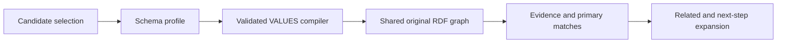

# ADR-0007: Schema candidate VALUES on the existing RDF graph

Status: Accepted. Date: 2026-10-11.

MCPGateway's bounded schema retrieval was reconstructing an RDF graph per query because schema profiles could not bind candidate subjects. Add an init-only `CandidateNodeIds` profile property and compile absolute subject IRIs to `VALUES` inside each local/federated direct/relationship UNION branch. This keeps released method and record-constructor signatures unchanged. Validate every IRI before SPARQL construction. Empty and null have distinct documented semantics. Expansion remains unrestricted, so this is not an authorization mechanism.

No consumer workaround, candidate graph cache, or replacement ranking implementation is required. Real local/federated TUnit flows and >=95% changed-runtime line coverage are acceptance gates. The scoped patch is released through the canonical GitHub workflow and verified on NuGet before consumer integration.

Maintainability exception: the existing schema compiler partial file has 356 code lines and belongs to a larger graph runtime partial type. This repair changes its existing branch-generation methods while keeping each new helper small. Removal path: extract evidence-branch and metadata compilation into dedicated internal compiler types, preserving generated-query and real local/federated integration coverage.
