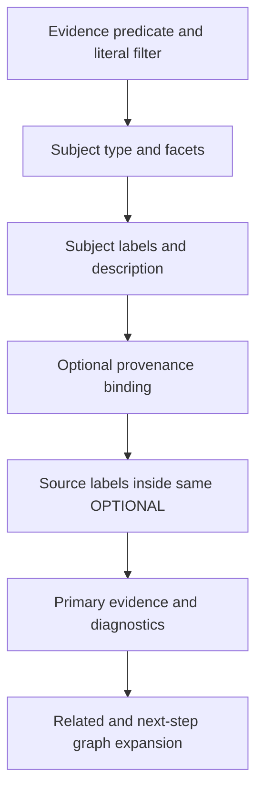

# ADR-0008: Ontology discovery and bounded schema provenance joins

Status: Accepted. Date: 2026-10-12.

Use the official dotNetRDF engine and ontology/full-text libraries. Add an ontology schema profile and independent caller-owned `OntologyGraph` snapshots rather than a second graph engine. The Markdown semantic builder explicitly asserts OWL class and RDF property declarations: dotNetRDF CreateOntologyClass/CreateOntologyProperty return resource wrappers and do not assert those types. Missing declarations previously made the official AllClasses/AllProperties inspection and typed ontology search miss the generated ontology. Existing full-text subject results may explicitly narrow local or allowlisted federated schema searches through candidate VALUES. HTML and DataTables APIs are out of scope.

Missing `prov:wasDerivedFrom` previously left the source variable unbound while following OPTIONAL label patterns ran outside its OPTIONAL. Those patterns could bind arbitrary graph subjects as sources, multiplying intermediate rows and producing incorrect citations. Keep source and source-label lookup inside one provenance OPTIONAL. Generate mandatory evidence patterns before optional metadata decoration. Preserve multiple sources, labels, types, facets, directions and relationship paths through real regression tests.

The upstream PLINQ propagation defect is tracked in [issue #910](https://github.com/dotnetrdf/dotnetrdf/issues/910); no engine fork or dependency implementation is introduced. BenchmarkDotNet MemoryDiagnoser measurements choose runtime changes. Existing candidate semantics are specified in [ADR-0007](ADR-0007-schema-search-candidate-values.md). Correctness flows, full-suite verification, >=95% touched-production coverage, full benchmark coverage and published-feed verification gate delivery.

Maintainability exception: the existing semantic-layer builder combines ontology and SKOS construction and exceeds the 200-code-line type limit. This repair adds only explicit declarations and disposal to its existing ontology methods, preserving the unrelated SKOS pipeline. Removal path: extract ontology construction and SKOS normalization into separate builders under Graph/Build, retaining existing integration/coverage gates. No new oversized type is introduced by this task.

URI identity regression: System.Uri equality/hash semantics ignore fragments, unlike RDF IRI identity. The semantic layer and legacy entity/article result grouping now use official dotNetRDF EqualityHelper/UriComparer throughout their URI comparisons, dictionaries, sets and SameAs deduplication. This prevents rdf:Property from being mistaken for rdf:Statement, preserves distinct fragment concepts and labels, and keeps correct SHACL statement targeting. Real fragment-IRI Markdown, entity and article flows reproduce and guard the repairs.
