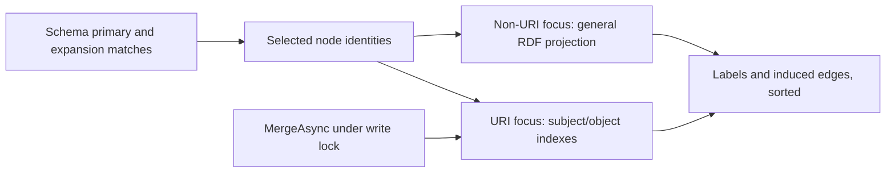

# ADR-0009: Preserve schema expansion roles and RDF types

Status: Accepted

Gateway integration exposed that grouping schema expansion rows only by node discards a related or next-step role when both point at the same neighbor. Selecting one row also loses additional rdf:type values.

Group expansion matches by node and role. Within each group retain the highest score, use ordinal predicate/source/label tie-breaking, and merge distinct sorted type IRIs. Related and next-step arrays may therefore contain the same node with different scores and bindings. The focused graph still contains that node once. Primary candidate VALUES constrain primary subjects and do not restrict neighbor expansion.

Keep row-to-match mapping beside expansion in a separate feature-local partial file. This preserves public signatures and the official SPARQL engine while reducing the previous expansion file size. Generated Markdown and real JSON-LD regressions cover overlapping roles, competing edge scores, multiple types, reverse predicate order, no-match, and parallel searches. Full tests, coverage, benchmarks and publication are qualification gates; consumer repairs use the published package.

The live MCPGateway 120-tool profile additionally detected a large candidate-VALUES memory regression on the full graph. The measured solution is constant-predicate evidence/expansion branches and one priority-preserving label OPTIONAL. Every highest-priority label value and source-less provenance semantics stay unchanged. Complete the entire benchmark and consumer qualification before releasing the candidate integration; role correctness alone does not qualify performance.

Maintainability: split evidence and label compilation into feature-local partial files; the remaining schema serialization/filter compiler has fewer than 250 code lines. The existing KnowledgeGraph partial-type size exception in ADR-0007 remains until dedicated internal compiler types replace these partials. Each new method stays below the 50-line limit; this is a reduction of the existing exception, not a new monolithic compiler.

Expansion result mapping reads mandatory compiler-owned node/source/predicate bindings directly and resolves the predicate with First. Missing mandatory bindings or unknown predicates are invariant failures rather than silently dropped rows; optional label/type bindings retain documented fallback behavior. This removes the inherited unreachable catch-and-skip mapping branches instead of adding artificial mock rows for coverage.

Compile compact predicate VALUES for local graphs below 8,192 triples and indexed singleton predicate branches for larger graphs; unknown remote graphs use indexed branches. Measured None corpora contain 684 and 1,794 triples, the generated Tiktoken catalog 14,160 and actual gateway export 56,168. Subject metadata decorates all bound evidence once, related metadata stays in the relationship-only group, and expansion metadata decorates its mandatory union once. An empty target list always emits empty predicate VALUES, preventing identity-only groups from fabricating unbound evidence rows. Real rich-catalog and empty-target local/federated flows cover both compiler shapes.

Replace the broad dotNetRdf meta dependency with the same-version official Core/Client/Spin split references plus existing graph capability packages. HTML/DataTables cease to be transitive runtime dependencies, honoring the narrowed graph/ontology/full-text/federation scope.

## Indexed focused projection follow-up

The published compiler repair leaves focused projection as a measured hotspot on the actual 56,168-triple gateway graph: 59.25% inclusive allocation samples enter BuildSchemaSearchFocusedGraph, dominated by enumerating every asserted triple. URI-only focus now selects subject triples with official dotNetRDF indexes before rendering identities. Object-index lookup retains selected nodes that exist only as objects without importing unselected incoming subjects. All selected-subject triples still contribute preferred labels and every edge with two selected endpoints; output retains ordinal sorting and node deduplication. No per-query reduced graph, custom index or hidden snapshot cache is introduced.

When focus includes blank or rendered literal identities, use the existing general RDF projection because a rendered literal identity does not carry language/datatype. Literal expansion strings remain search metadata under the existing schema result contract; an URI-shaped literal must not fabricate an absent URI node. Graph read locking covers index access, and MergeAsync updates the official indexes; concurrent post-merge searches verify fresh labels. Move projection into its own feature-local partial file; the existing KnowledgeGraph partial-type exception still applies. This extracts the expansion runtime into a smaller file rather than adding another combined responsibility.

Validation uses generated Markdown plus real JSON-LD for induced-edge equivalence, selected labels, object-only targets, mixed RDF nodes, URI-shaped literals and concurrent searches after merge. Allocation budgets stay in BenchmarkDotNet rather than machine-sensitive TUnit assertions. Compare full 131-case suites and final gateway 12-case qualification after published 0.2.15 adoption.
