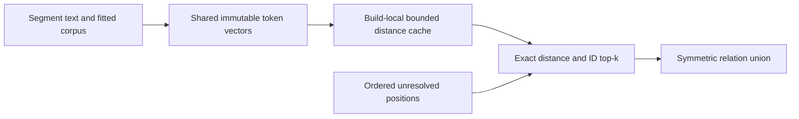

# ADR-0011: Exact-neighbor pruning for repeated segments

Status: Accepted. Related: ADR-0003 and [benchmark qualification](../Features/PerformanceBenchmarks.md).

## Context

Real gateway cold graph setup scales poorly because related-segment construction evaluates every vector pair, including repeated segments with already final zero-distance top-k neighbors. The 1,000/5,000 tool measurements on public 0.2.16 took 33.456/552.317 seconds on a shared Apple M2 Pro; these are capacity observations, not portable SLOs.

## Decision

Visit segments in ordinal ID order and track unresolved destinations. Once both endpoints have complete zero-distance neighbor sets, later IDs cannot improve their distance/ID ordered top-k sets, so their pair needs no distance calculation. An unresolved endpoint still receives every necessary candidate, including a distinct final segment. Preserve the original input-index operand order for floating-point distance accumulation. Distinct vectors without enough exact neighbors retain exhaustive processing. No approximate nearest-neighbor algorithm, extraction substitution, graph limit or public API change is introduced.

Adopt the reviewed existing source/test patch in this primary checkout. The patch is relevant to the measured defect; unrelated serialization and large-document work remains unstaged. Unit tests compare complete relation arrays to the exhaustive reference over shuffled repeated and sparse weighted vectors. A 35,000-vector case verifies every source and a distinct tail. Full pipeline and graph regressions remain mandatory. The repeated-catalog benchmark now measures 48 and 384 documents with independent source paths.

## Bounded reuse for generated catalogs

A generated 1,000-tool catalog produced 20,500 segments with 3,046 distinct texts. The fitted corpus assigns the same immutable vector to repeated text. Reuse that vector across its segments. Cache distances for the most frequent repeated vectors during one build. The cache has at most 32 hot rows and one million vector-pair slots, with two operand orientations per slot. Cached values keep the original floating-point accumulation order.

Traverse unresolved positions through one integer array. When a source reaches a final zero-distance top-k, visit only unresolved destinations with later IDs. The traversal removes each destination once when its choices become final. The sorted top-k lists reject candidates that cannot beat their current tail.

Shuffled sparse and shared-vector regressions compare the entire ordered relation union and exact distances against exhaustive input-order evaluation. The large repeated-tail case and generated Markdown flow verify that distinct segments and token retrieval remain represented.

## Consequences

Repeated corpora avoid redundant pairs after their exact choices become final. Worst-case distinct corpora remain quadratic; this change does not claim a general subquadratic nearest-neighbor index. The distance cache and unresolved-position array belong to one build and are released on return. Benchmarks report allocations and preserve complete graph semantics.
