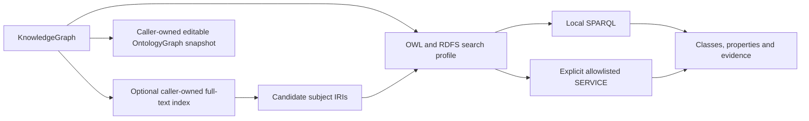

# Ontology graph search

`KnowledgeGraphSchemaSearchProfile.Ontology` searches OWL/RDFS class and property declarations. Direct evidence includes RDFS labels/comments, SKOS labels and schema names/descriptions. Related evidence follows subclass, subproperty, domain, range, equivalent-class and equivalent-property edges. Related-node expansion uses those same ontology edges. The generated Markdown ontology explicitly declares its OWL classes and RDF properties. RDF identity keeps URI fragments distinct in semantic layers and legacy entity/article search. This discovers the ontology; it does not claim complete OWL reasoning. Materialized RDFS/SKOS/N3 inference remains an explicit existing API.



```csharp
var ontologyProfile = KnowledgeGraphSchemaSearchProfile.Ontology;
var matches = await graph.SearchBySchemaAsync("forecast", ontologyProfile);
using var ontology = graph.ToOntologySnapshot();
var classes = ontology.AllClasses.ToArray();
```

The snapshot is independent of the live graph; the caller disposes it. Edits to it never silently mutate the graph. The official dotNetRDF ontology API remains available on the snapshot.

For full-text preselection, build a subjects index explicitly and pass its URI results as candidates. Narrowing can lower recall if the index/query omits useful subjects, so the caller chooses when to use it. Empty candidates mean no primary matches; null means unrestricted primary matching. Expansion and relationship evidence still use the complete graph.

```csharp
using var index = await graph.BuildFullTextIndexAsync();
var lexical = await index.SearchAsync("forecast OR rainfall", limit: 25);
var profile = KnowledgeGraphSchemaSearchProfile.Ontology with
{
    CandidateNodeIds = lexical.Select(match => match.NodeId).Distinct().ToArray()
};
var refined = await graph.SearchBySchemaAsync("rainfall", profile);
```

Federated search is opt-in through `SearchBySchemaFederatedAsync` and the existing endpoint allowlist/local bindings. There is no hidden external query in default local search. Federated schema results retain endpoint/evidence diagnostics; related expansion and focused snapshots are currently local-search features. See [Federated SPARQL Execution](FederatedSparqlExecution.md) for policy and failure handling.

The official dotNetRdf 3.5.2 split packages retain Core, Client, Dynamic, Inferencing, Ldf, Ontology, FullText, Spin, Shacl and Skos. The broad meta-package is replaced by explicit graph packages so HTML/DataTables assemblies are not pulled into consumers. Legacy `dotNetRdf.AspNet` is only a net472 prerelease and cannot be referenced by the .NET 10 core. SPIN remains available through its explicit official package, but no new SPIN adapter is claimed: the 3.5.2 serializer/constraint processor are internal, rule application is commented out, and its public dataset constructor loads vocabulary URIs through a global importer that catches failures. Our graph search continues through the supported Core/FullText/Ontology APIs, without patching or copying engine code.

Verification uses real Markdown pipeline and JSON-LD graphs, isolated ontology edits, class comments, hierarchy/domain evidence, no-match queries, real Lucene subject preselection, and allowlisted local federation. TUnit and >=95% changed-production line coverage are required. Candidate and provenance regression tests additionally cover absent sources, concurrency, malformed IRIs and original graph retention.
