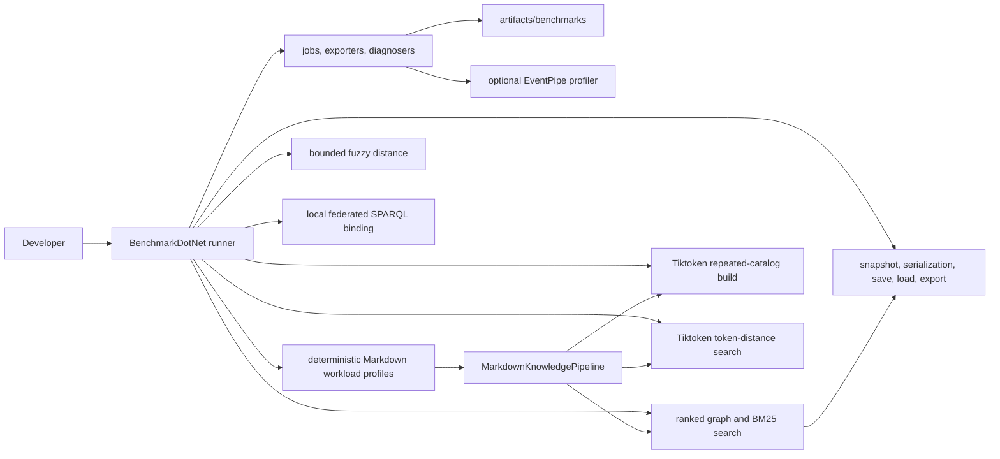

# Performance Benchmarks

Markdown-LD Knowledge Bank keeps correctness tests and performance measurements separate. TUnit flow tests prove behaviour; BenchmarkDotNet measures runtime, allocation, scaling, and profiler traces for the hot paths.

## Benchmark Boundaries



The benchmark project is `benchmarks/MarkdownLd.Kb.Benchmarks`. It references the production library, but production and test projects do not reference it.

## Suites

| Suite | Measures |
| --- | --- |
| `FuzzyEditDistanceBenchmarks` | Bounded bit-vector/banded edit distance against a naive Levenshtein baseline for short typo and long affix-heavy tokens. |
| `GraphBuildBenchmarks` | Markdown source to in-memory graph build time across named workload profiles. |
| `TiktokenGraphBuildBenchmarks` | Full Tiktoken extraction, related-segment selection, normalization, and RDF materialization for a repeated catalog corpus. |
| `SchemaCatalogGraphSearchBenchmarks` | Generated 120-document Tiktoken catalog, fixed-predicate evidence/metadata and expansion, unrestricted/candidate matching/no-match. |
| `SchemaGraphSearchBenchmarks` | Mandatory evidence/provenance query allocation with unrestricted or candidate VALUES, matching and no-match inputs. |
| `GraphSearchBenchmarks` | Graph-ranked search, BM25, BM25 fuzzy matching, schema search, focused search, and local federated schema search. |
| `TokenVectorDistanceBenchmarks` | Sparse normalized vector distance at 16/128 weights, including allocated bytes. |
| `TokenFocusedSearchBenchmarks` | Warm real Tiktoken focused search at 120/1000 documents, matching/no-match. |
| `TiktokenSearchBenchmarks` | Exact token-distance search and fuzzy query correction over long-document and multilingual token-heavy graphs. |
| `GraphPersistenceBenchmarks` | Snapshot creation, Turtle/JSON-LD serialization, Mermaid/DOT export, in-memory store save/load, and file save/load. |
| `GraphLifecycleBenchmarks` | One broad build/search/save/load/export lifecycle benchmark for the complete suite. |

## Workload Profiles

Benchmark parameters use named workload profiles instead of raw document-count ranges.

| Profile | Shape | Why it exists |
| --- | --- | --- |
| `ShortDocuments` | 250 compact runbook-like Markdown documents. | Normal knowledge-base retrieval and persistence pressure. |
| `LongDocuments` | 80 long recovery playbooks with repeated sections. | Long body and chunk-scan pressure without pretending the main variable is file count. |
| `LargeCorpus` | 1000 compact documents. | Scale pressure for graph build, snapshot, serialization, save, and load paths. |
| `TokenizedMultilingual` | 250 token-heavy multilingual/CJK documents. | Tiktoken and fuzzy query-correction behaviour on non-trivial tokenization input. |
| `RepeatedCatalog` | 48 catalog-like documents with deliberately repeated headings and authorization/revision phrases. | Detects redundant topic facts, symmetric neighbor pairs, unbounded confidence warnings, and graph-build allocation regressions. |
| `FederatedRunbooks` | 250 SPARQL/service/runbook documents. | Local federated schema-search and service-binding query plans. |

## Commands

```bash
dotnet run --project benchmarks/MarkdownLd.Kb.Benchmarks -c Release -- --list flat
dotnet run --project benchmarks/MarkdownLd.Kb.Benchmarks -c Release -- --filter "*FuzzyEditDistanceBenchmarks*"
dotnet run --project benchmarks/MarkdownLd.Kb.Benchmarks -c Release -- --filter "*GraphBuildBenchmarks*"
dotnet run --project benchmarks/MarkdownLd.Kb.Benchmarks -c Release -- --filter "*TiktokenGraphBuildBenchmarks*"
dotnet run --project benchmarks/MarkdownLd.Kb.Benchmarks -c Release -- --filter "*GraphSearchBenchmarks*"
dotnet run --project benchmarks/MarkdownLd.Kb.Benchmarks -c Release -- --filter "*TiktokenSearchBenchmarks*"
dotnet run --project benchmarks/MarkdownLd.Kb.Benchmarks -c Release -- --filter "*GraphPersistenceBenchmarks*"
dotnet run --project benchmarks/MarkdownLd.Kb.Benchmarks -c Release -- --filter "*GraphLifecycleBenchmarks*"
```

`MarkdownLdBenchmarkConfig` writes Markdown, CSV, and full JSON reports to `artifacts/benchmarks/results`. Those files are machine-specific and intentionally ignored by git. If the command does not pass a BenchmarkDotNet job option, the config adds one `Required` job: one launch, two warmup iterations, five measured iterations, and a 100 ms minimum iteration time. It still executes every benchmark case, but avoids multi-hour default auto-tuning runs.

## Measured Metrics

The benchmark configuration is intentionally diagnostic, not just a stopwatch. The default reports collect:

| Metric group | BenchmarkDotNet data | Why it matters |
| --- | --- | --- |
| Latency | `Mean`, `Error`, `StdDev`, `Ratio`, `RatioSD`; full JSON also keeps min, quartiles, max, percentiles, and raw measurements | Shows the cost and distribution of each public path under the same deterministic workload. |
| Allocation and GC | `Allocated`, `Alloc Ratio`, `Gen0`, `Gen1`, `Gen2` | Catches search paths that look acceptable once but become expensive under repeated calls. |
| Threading and contention | `Completed Work Items`, `Lock Contentions` | Highlights SPARQL and federation paths that schedule work or contend while executing query plans. |
| Benchmark shape | corpus profile, query scenario, runtime, platform, JIT, job, iteration counts | Keeps runs explainable and comparable without turning local numbers into a cross-machine contract. |
| Optional profiler traces | EventPipe CPU, GC, or JIT files | Gives the next level of evidence when a benchmark result points at a hot path. |

The build/test/pack validation job stays separate from performance measurement. The PR validation workflow, release workflow, and dedicated benchmark workflow run the complete benchmark suite: fuzzy edit distance, graph build, Tiktoken graph build, graph search, Tiktoken search, graph persistence, and graph lifecycle. They run suites as parallel matrix jobs and upload `artifacts/benchmarks/results` as suite-specific `benchmarkdotnet-results-*` artifacts so CI keeps the same performance evidence shape without serializing every suite into one long job.

Optional EventPipe profiling is opt-in:

```bash
MARKDOWN_LD_KB_BENCHMARK_PROFILE=cpu dotnet run --project benchmarks/MarkdownLd.Kb.Benchmarks -c Release -- --filter "*FuzzyEditDistanceBenchmarks*"
MARKDOWN_LD_KB_BENCHMARK_PROFILE=gc dotnet run --project benchmarks/MarkdownLd.Kb.Benchmarks -c Release -- --filter "*GraphSearchBenchmarks*"
MARKDOWN_LD_KB_BENCHMARK_PROFILE=jit dotnet run --project benchmarks/MarkdownLd.Kb.Benchmarks -c Release -- --filter "*TiktokenSearchBenchmarks*"
```

## Current Results

Full local `Required` suite: 138 unique successful cases, 448.99 seconds, October 12, 2026, Apple M2 Pro, .NET 10.0.12 / SDK 10.0.401, BenchmarkDotNet 0.15.8. Every exported case has non-empty statistics and allocation measurements. Primary-checkout codec/serialization edits remain outside this scoped release; canonical CI artifacts qualify the exact committed source. Warm operation statistics do not represent cold graph initialization or retained managed memory. Timings on a shared host are observations rather than causal speedup claims. Receipts: `artifacts/cold-related-verification.json`, `artifacts/cold-related-benchmarks.log`, `artifacts/benchmarks/cold-related-final/results/`.

Repeated-catalog builds cover 48 and 384 independently addressed sources. Exact-neighbor pruning preserves exhaustive top-k choices and floating-point distances; distinct corpora without enough exact neighbors remain quadratic. See [ADR-0011](../ADR/ADR-0011-exact-neighbor-pruning-for-repeated-segments.md).

### FuzzyEditDistanceBenchmarks

```

BenchmarkDotNet v0.15.8, macOS 27.0.1 (26A434) [Darwin 27.0.0]
Apple M2 Pro, 1 CPU, 12 logical and 12 physical cores
.NET SDK 10.0.401
  [Host]   : .NET 10.0.12 (10.0.12, 10.0.1226.42308), Arm64 RyuJIT armv8.0-a
  Required : .NET 10.0.12 (10.0.12, 10.0.1226.42308), Arm64 RyuJIT armv8.0-a

Job=Required  MinIterationTime=100ms  IterationCount=5
LaunchCount=1  WarmupCount=2

```
| Method                   | Scenario          | Mean         | Error        | StdDev        | Median       | Ratio  | RatioSD | Completed Work Items | Lock Contentions | Gen0   | Allocated | Alloc Ratio |
|------------------------- |------------------ |-------------:|-------------:|--------------:|-------------:|-------:|--------:|---------------------:|-----------------:|-------:|----------:|------------:|
| **BoundedBitVectorOrBanded** | **ShortDeletion**     |     **16.11 ns** |     **33.92 ns** |      **8.810 ns** |     **17.34 ns** |   **1.35** |    **1.07** |                    **-** |                **-** |      **-** |         **-** |          **NA** |
| NaiveLevenshtein         | ShortDeletion     |    197.31 ns |    292.13 ns |     75.864 ns |    189.92 ns |  16.52 |   11.34 |                    - |                - | 0.0134 |     112 B |          NA |
|                          |                   |              |              |               |              |        |         |                      |                  |        |           |             |
| **BoundedBitVectorOrBanded** | **ShortSubstitution** |     **47.76 ns** |     **35.98 ns** |      **9.344 ns** |     **48.44 ns** |   **1.03** |    **0.27** |                    **-** |                **-** |      **-** |         **-** |          **NA** |
| NaiveLevenshtein         | ShortSubstitution |    162.12 ns |    379.80 ns |     98.634 ns |     99.02 ns |   3.51 |    2.09 |                    - |                - | 0.0076 |     112 B |          NA |
|                          |                   |              |              |               |              |        |         |                      |                  |        |           |             |
| **BoundedBitVectorOrBanded** | **LongInsertion**     |     **71.81 ns** |    **188.05 ns** |     **29.101 ns** |     **60.65 ns** |   **1.10** |    **0.51** |                    **-** |                **-** |      **-** |         **-** |          **NA** |
| NaiveLevenshtein         | LongInsertion     | 32,017.40 ns | 57,105.32 ns | 14,830.070 ns | 24,717.29 ns | 490.81 |  253.68 |                    - |                - |      - |     640 B |          NA |
|                          |                   |              |              |               |              |        |         |                      |                  |        |           |             |
| **BoundedBitVectorOrBanded** | **LongNoMatch**       |    **803.46 ns** |  **2,584.59 ns** |    **671.209 ns** |  **1,013.82 ns** |   **3.01** |    **4.32** |                    **-** |                **-** |      **-** |         **-** |          **NA** |
| NaiveLevenshtein         | LongNoMatch       | 17,839.90 ns | 30,436.34 ns |  4,710.057 ns | 17,351.75 ns |  66.90 |   68.97 |                    - |                - |      - |     672 B |          NA |

### GraphBuildBenchmarks

```

BenchmarkDotNet v0.15.8, macOS 27.0.1 (26A434) [Darwin 27.0.0]
Apple M2 Pro, 1 CPU, 12 logical and 12 physical cores
.NET SDK 10.0.401
  [Host]   : .NET 10.0.12 (10.0.12, 10.0.1226.42308), Arm64 RyuJIT armv8.0-a
  Required : .NET 10.0.12 (10.0.12, 10.0.1226.42308), Arm64 RyuJIT armv8.0-a

Job=Required  MinIterationTime=100ms  IterationCount=5
LaunchCount=1  WarmupCount=2

```
| Method     | CorpusProfile        | Mean      | Error    | StdDev    | Completed Work Items | Lock Contentions | Gen0      | Gen1      | Gen2     | Allocated |
|----------- |--------------------- |----------:|---------:|----------:|---------------------:|-----------------:|----------:|----------:|---------:|----------:|
| **BuildGraph** | **ShortDocuments**       |  **84.64 ms** | **51.62 ms** | **13.406 ms** |                    **-** |                **-** | **1500.0000** |  **500.0000** |        **-** |  **15.16 MB** |
| **BuildGraph** | **LongDocuments**        |  **87.39 ms** | **90.88 ms** | **23.601 ms** |                    **-** |                **-** | **1500.0000** |  **500.0000** |        **-** |  **14.49 MB** |
| **BuildGraph** | **LargeCorpus**          | **138.31 ms** | **68.25 ms** | **17.725 ms** |                    **-** |                **-** | **7000.0000** | **2000.0000** |        **-** |  **59.01 MB** |
| **BuildGraph** | **Token(...)ngual [21]** |  **48.53 ms** | **37.63 ms** |  **9.772 ms** |                    **-** |                **-** | **2000.0000** | **1000.0000** | **333.3333** |  **18.25 MB** |

### GraphLifecycleBenchmarks

```

BenchmarkDotNet v0.15.8, macOS 27.0.1 (26A434) [Darwin 27.0.0]
Apple M2 Pro, 1 CPU, 12 logical and 12 physical cores
.NET SDK 10.0.401
  [Host]   : .NET 10.0.12 (10.0.12, 10.0.1226.42308), Arm64 RyuJIT armv8.0-a
  Required : .NET 10.0.12 (10.0.12, 10.0.1226.42308), Arm64 RyuJIT armv8.0-a

Job=Required  MinIterationTime=100ms  IterationCount=5
LaunchCount=1  WarmupCount=2

```
| Method                       | Mean     | Error    | StdDev   | Ratio | RatioSD | Completed Work Items | Lock Contentions | Gen0      | Gen1      | Gen2     | Allocated | Alloc Ratio |
|----------------------------- |---------:|---------:|---------:|------:|--------:|---------------------:|-----------------:|----------:|----------:|---------:|----------:|------------:|
| BuildSearchSaveLoadAndExport | 94.51 ms | 80.52 ms | 12.46 ms |  1.01 |    0.17 |              52.0000 |                - | 6000.0000 | 2000.0000 | 500.0000 |  51.85 MB |        1.00 |

### GraphPersistenceBenchmarks

```

BenchmarkDotNet v0.15.8, macOS 27.0.1 (26A434) [Darwin 27.0.0]
Apple M2 Pro, 1 CPU, 12 logical and 12 physical cores
.NET SDK 10.0.401
  [Host]   : .NET 10.0.12 (10.0.12, 10.0.1226.42308), Arm64 RyuJIT armv8.0-a
  Required : .NET 10.0.12 (10.0.12, 10.0.1226.42308), Arm64 RyuJIT armv8.0-a

Job=Required  MinIterationTime=100ms  IterationCount=5
LaunchCount=1  WarmupCount=2

```
| Method                      | CorpusProfile  | Mean              | Error              | StdDev            | Median            | Ratio         | RatioSD      | Completed Work Items | Lock Contentions | Gen0       | Gen1      | Gen2      | Allocated  | Alloc Ratio |
|---------------------------- |--------------- |------------------:|-------------------:|------------------:|------------------:|--------------:|-------------:|---------------------:|-----------------:|-----------:|----------:|----------:|-----------:|------------:|
| **ExportMermaidFlowchart**      | **ShortDocuments** |     **405,352.83 ns** |     **286,010.318 ns** |     **74,275.972 ns** |     **374,538.73 ns** |     **35,011.42** |     **5,866.90** |                    **-** |                **-** |    **62.5000** |   **39.0625** |   **27.3438** |   **503791 B** |          **NA** |
| ExportDotGraph              | ShortDocuments |     502,069.92 ns |     738,330.882 ns |    191,742.186 ns |     535,382.81 ns |     43,365.13 |    15,125.08 |                    - |                - |    70.3125 |   39.0625 |   31.2500 |   623172 B |          NA |
| LoadTurtleFromInMemoryStore | ShortDocuments |  32,333,533.30 ns |  19,081,412.522 ns |  4,955,382.247 ns |  32,831,895.75 ns |  2,792,734.41 |   391,706.25 |                    - |                - |   750.0000 |  250.0000 |         - |  6719244 B |          NA |
| LoadJsonLdFromInMemoryStore | ShortDocuments |  53,591,616.67 ns |  59,699,533.837 ns | 15,503,779.387 ns |  61,275,180.67 ns |  4,628,852.36 | 1,223,338.31 |                    - |                - |  2333.3333 |  666.6667 |         - | 20753253 B |          NA |
| LoadTurtleFromFile          | ShortDocuments |  30,024,960.40 ns |  12,401,461.031 ns |  3,220,620.054 ns |  31,749,552.00 ns |  2,593,336.75 |   255,234.28 |              50.0000 |                - |   750.0000 |  250.0000 |         - |  7508876 B |          NA |
| LoadJsonLdFromFile          | ShortDocuments |  58,566,683.20 ns |  23,963,684.161 ns |  6,223,292.690 ns |  61,680,729.00 ns |  5,058,562.26 |   493,243.31 |              44.0000 |                - |  2500.0000 | 1000.0000 |         - | 21447224 B |          NA |
| SaveTurtleToInMemoryStore   | ShortDocuments |   5,568,167.33 ns |   9,182,779.758 ns |  1,421,045.330 ns |   5,066,528.66 ns |    480,937.62 |   109,166.28 |                    - |                - |   875.0000 |  375.0000 |         - |  8028002 B |          NA |
| SaveJsonLdToInMemoryStore   | ShortDocuments |   7,570,165.10 ns |     787,429.278 ns |    204,492.883 ns |   7,650,760.44 ns |    653,855.56 |    17,367.10 |                    - |                - |  1437.5000 |  625.0000 |   62.5000 | 12177575 B |          NA |
| SaveTurtleToFile            | ShortDocuments |   6,588,389.97 ns |   7,956,324.372 ns |  1,231,250.002 ns |   6,031,727.84 ns |    569,057.00 |    94,664.06 |               2.0000 |                - |  1000.0000 |  500.0000 |  125.0000 | 12422052 B |          NA |
| SaveJsonLdToFile            | ShortDocuments |   8,975,189.59 ns |     733,109.528 ns |    190,386.217 ns |   8,981,901.03 ns |    775,211.31 |    16,848.29 |               2.0000 |                - |  1500.0000 |  687.5000 |  125.0000 | 16547765 B |          NA |
| CreateSnapshot              | ShortDocuments |          11.58 ns |           0.482 ns |          0.125 ns |          11.56 ns |          1.00 |         0.01 |                    - |                - |          - |         - |         - |          - |          NA |
| SerializeTurtle             | ShortDocuments |   6,167,413.04 ns |   9,674,336.557 ns |  2,512,394.487 ns |   6,128,718.78 ns |    532,696.09 |   198,174.04 |                    - |                - |   500.0000 |  187.5000 |         - |  4903888 B |          NA |
| SerializeJsonLd             | ShortDocuments |   3,909,785.14 ns |  11,137,155.855 ns |  1,723,487.194 ns |   3,083,701.81 ns |    337,698.68 |   132,316.15 |                    - |                - |   500.0000 |  250.0000 |         - |  5478800 B |          NA |
|                             |                |                   |                    |                   |                   |               |              |                      |                  |            |           |           |            |             |
| **ExportMermaidFlowchart**      | **LongDocuments**  |      **67,583.50 ns** |       **5,310.830 ns** |        **821.857 ns** |      **67,646.99 ns** |      **5,021.06** |       **702.35** |                    **-** |                **-** |    **21.4844** |    **2.9297** |         **-** |   **187920 B** |          **NA** |
| ExportDotGraph              | LongDocuments  |     194,112.40 ns |     340,497.905 ns |     88,426.225 ns |     159,534.75 ns |     14,421.41 |     6,374.39 |                    - |                - |    19.5313 |    7.8125 |    5.8594 |   224709 B |          NA |
| LoadTurtleFromInMemoryStore | LongDocuments  |  10,548,820.82 ns |   9,924,500.219 ns |  2,577,361.196 ns |  11,224,966.12 ns |    783,715.62 |   207,219.01 |                    - |                - |   250.0000 |   62.5000 |         - |  2466743 B |          NA |
| LoadJsonLdFromInMemoryStore | LongDocuments  |  10,941,377.62 ns |  13,090,956.831 ns |  3,399,679.924 ns |   9,431,638.00 ns |    812,880.29 |   258,575.18 |                    - |                - |  1062.5000 |  500.0000 |  125.0000 |  7853916 B |          NA |
| LoadTurtleFromFile          | LongDocuments  |  11,024,611.99 ns |  10,391,780.650 ns |  2,698,712.440 ns |  11,366,648.44 ns |    819,064.12 |   216,862.76 |              20.0000 |                - |   312.5000 |  125.0000 |         - |  2763581 B |          NA |
| LoadJsonLdFromFile          | LongDocuments  |  19,015,272.27 ns |   9,010,043.989 ns |  2,339,879.816 ns |  18,786,625.00 ns |  1,412,723.39 |   253,096.14 |              17.0000 |                - |   833.3333 |  333.3333 |         - |  8112691 B |          NA |
| SaveTurtleToInMemoryStore   | LongDocuments  |   4,418,766.16 ns |   9,200,100.001 ns |  2,389,236.759 ns |   3,866,296.88 ns |    328,288.45 |   169,753.57 |                    - |                - |   312.5000 |  156.2500 |         - |  2927560 B |          NA |
| SaveJsonLdToInMemoryStore   | LongDocuments  |   5,718,319.81 ns |  10,727,443.521 ns |  2,785,883.022 ns |   5,577,320.31 ns |    424,837.68 |   199,579.12 |                    - |                - |   500.0000 |  250.0000 |         - |  4520923 B |          NA |
| SaveTurtleToFile            | LongDocuments  |   5,771,321.34 ns |   7,267,951.072 ns |  1,887,463.817 ns |   6,233,108.06 ns |    428,775.38 |   142,222.95 |               2.0000 |                - |   468.7500 |  312.5000 |  156.2500 |  7197836 B |          NA |
| SaveJsonLdToFile            | LongDocuments  |   8,969,492.98 ns |   8,740,527.750 ns |  2,269,887.305 ns |   8,895,962.28 ns |    666,380.81 |   180,784.98 |               2.0000 |                - |   625.0000 |  375.0000 |  125.0000 |  8813166 B |          NA |
| CreateSnapshot              | LongDocuments  |          13.70 ns |           7.611 ns |          1.977 ns |          14.84 ns |          1.02 |         0.20 |                    - |                - |          - |         - |         - |          - |          NA |
| SerializeTurtle             | LongDocuments  |   3,012,246.61 ns |   2,927,536.050 ns |    760,271.817 ns |   2,512,669.25 ns |    223,792.29 |    60,594.10 |                    - |                - |   187.5000 |   31.2500 |         - |  1719920 B |          NA |
| SerializeJsonLd             | LongDocuments  |   1,086,121.75 ns |     248,968.495 ns |     64,656.328 ns |   1,116,365.23 ns |     80,692.49 |    12,037.17 |                    - |                - |   234.3750 |  125.0000 |   46.8750 |  2025995 B |          NA |
|                             |                |                   |                    |                   |                   |               |              |                      |                  |            |           |           |            |             |
| **ExportMermaidFlowchart**      | **LargeCorpus**    |   **1,354,249.68 ns** |     **521,728.467 ns** |     **80,738.058 ns** |   **1,362,156.27 ns** |    **111,430.14** |     **6,009.82** |                    **-** |                **-** |   **156.2500** |   **62.5000** |   **31.2500** |  **2058288 B** |          **NA** |
| ExportDotGraph              | LargeCorpus    |   1,403,207.75 ns |     369,849.520 ns |     96,048.746 ns |   1,345,538.74 ns |    115,458.49 |     7,311.45 |                    - |                - |   203.1250 |  109.3750 |   46.8750 |  2483368 B |          NA |
| LoadTurtleFromInMemoryStore | LargeCorpus    |  43,072,546.88 ns |  55,969,420.742 ns |  8,661,329.800 ns |  39,068,583.25 ns |  3,544,087.76 |   638,092.79 |                    - |                - |  3000.0000 | 1000.0000 |         - | 26511328 B |          NA |
| LoadJsonLdFromInMemoryStore | LargeCorpus    | 134,902,297.00 ns |  11,104,290.924 ns |  1,718,401.309 ns | 134,814,656.50 ns | 11,100,007.19 |   155,002.52 |                    - |                - | 10500.0000 | 4500.0000 | 1000.0000 | 81664840 B |          NA |
| LoadTurtleFromFile          | LargeCorpus    |  37,591,067.75 ns |  12,310,257.395 ns |  1,905,025.955 ns |  37,661,979.25 ns |  3,093,061.66 |   142,411.41 |             181.0000 |                - |  3000.0000 | 1000.0000 |         - | 29491852 B |          NA |
| LoadJsonLdFromFile          | LargeCorpus    | 123,992,970.80 ns |  48,452,313.912 ns | 12,582,912.084 ns | 125,421,229.00 ns | 10,202,367.92 |   953,643.69 |             161.0000 |                - | 10500.0000 | 3500.0000 | 1000.0000 | 84296332 B |          NA |
| SaveTurtleToInMemoryStore   | LargeCorpus    |  55,382,129.20 ns |  59,884,835.386 ns | 15,551,901.611 ns |  58,103,229.50 ns |  4,556,942.66 | 1,174,881.62 |                    - |                - |  3000.0000 | 1000.0000 |         - | 31518944 B |          NA |
| SaveJsonLdToInMemoryStore   | LargeCorpus    |  49,678,304.20 ns |  68,490,814.520 ns | 17,786,847.068 ns |  40,216,437.50 ns |  4,087,621.53 | 1,343,472.22 |                    - |                - |  5000.0000 | 1500.0000 |         - | 47825152 B |          NA |
| SaveTurtleToFile            | LargeCorpus    |  73,157,870.80 ns | 148,104,762.414 ns | 38,462,336.557 ns |  56,793,750.00 ns |  6,019,563.12 | 2,904,664.90 |               2.0000 |                - |  3000.0000 | 1000.0000 |         - | 36451584 B |          NA |
| SaveJsonLdToFile            | LargeCorpus    |  58,554,870.90 ns |  65,384,726.857 ns | 16,980,205.964 ns |  50,993,291.50 ns |  4,818,001.64 | 1,282,745.42 |               2.0000 |                - |  5000.0000 | 1500.0000 |         - | 52677064 B |          NA |
| CreateSnapshot              | LargeCorpus    |          12.15 ns |           0.709 ns |          0.110 ns |          12.16 ns |          1.00 |         0.01 |                    - |                - |          - |         - |         - |          - |          NA |
| SerializeTurtle             | LargeCorpus    |  10,503,969.41 ns |   7,802,650.922 ns |  1,207,468.865 ns |  10,008,774.75 ns |    864,285.77 |    89,140.04 |                    - |                - |  2187.5000 |  937.5000 |  125.0000 | 18956974 B |          NA |
| SerializeJsonLd             | LargeCorpus    |  26,996,619.47 ns |  67,596,880.335 ns | 17,554,695.198 ns |  31,477,166.67 ns |  2,221,331.12 | 1,325,662.26 |                    - |                - |  1666.6667 |  666.6667 |         - | 21311568 B |          NA |

### GraphSearchBenchmarks

```

BenchmarkDotNet v0.15.8, macOS 27.0.1 (26A434) [Darwin 27.0.0]
Apple M2 Pro, 1 CPU, 12 logical and 12 physical cores
.NET SDK 10.0.401
  [Host]   : .NET 10.0.12 (10.0.12, 10.0.1226.42308), Arm64 RyuJIT armv8.0-a
  Required : .NET 10.0.12 (10.0.12, 10.0.1226.42308), Arm64 RyuJIT armv8.0-a

Job=Required  MinIterationTime=100ms  IterationCount=5
LaunchCount=1  WarmupCount=2

```
| Method                     | CorpusProfile     | QueryScenario | Mean        | Error        | StdDev       | Median      | Ratio  | RatioSD | Completed Work Items | Lock Contentions | Gen0      | Gen1     | Allocated  | Alloc Ratio |
|--------------------------- |------------------ |-------------- |------------:|-------------:|-------------:|------------:|-------:|--------:|---------------------:|-----------------:|----------:|---------:|-----------:|------------:|
| **LocalFederatedSchemaSearch** | **ShortDocuments**    | **Exact**         | **26,078.3 μs** |  **2,066.79 μs** |    **536.74 μs** | **25,758.5 μs** |  **51.79** |    **1.03** |               **2.0000** |                **-** | **1000.0000** | **400.0000** |  **8430.4 KB** |        **9.48** |
| RankedGraphSearch          | ShortDocuments    | Exact         |    503.6 μs |     14.19 μs |      3.69 μs |    501.7 μs |   1.00 |    0.01 |                    - |                - |  101.5625 |  23.4375 |  889.16 KB |        1.00 |
| Bm25Search                 | ShortDocuments    | Exact         |    754.9 μs |    304.09 μs |     47.06 μs |    775.9 μs |   1.50 |    0.08 |                    - |                - |   93.7500 |  15.6250 |  892.65 KB |        1.00 |
| Bm25FuzzySearch            | ShortDocuments    | Exact         |  1,701.8 μs |  1,076.73 μs |    166.62 μs |  1,714.1 μs |   3.38 |    0.29 |                    - |                - |  187.5000 |  31.2500 |  1620.5 KB |        1.82 |
| SchemaSearch               | ShortDocuments    | Exact         | 11,488.1 μs |  4,865.07 μs |    752.88 μs | 11,390.7 μs |  22.81 |    1.34 |              23.0000 |          48.6667 |  500.0000 | 166.6667 |  4558.2 KB |        5.13 |
| FocusedSearch              | ShortDocuments    | Exact         |    510.3 μs |    510.08 μs |    132.47 μs |    457.4 μs |   1.01 |    0.24 |                    - |                - |   54.6875 |   7.8125 |  481.53 KB |        0.54 |
|                            |                   |               |             |              |              |             |        |         |                      |                  |           |          |            |             |
| **LocalFederatedSchemaSearch** | **ShortDocuments**    | **Typo**          | **33,124.1 μs** | **21,363.55 μs** |  **5,548.05 μs** | **32,150.1 μs** |  **65.75** |   **10.67** |               **2.0000** |                **-** | **1000.0000** | **500.0000** | **8375.95 KB** |        **9.42** |
| RankedGraphSearch          | ShortDocuments    | Typo          |    505.2 μs |    115.10 μs |     29.89 μs |    504.1 μs |   1.00 |    0.08 |                    - |                - |  101.5625 |  23.4375 |  889.16 KB |        1.00 |
| Bm25Search                 | ShortDocuments    | Typo          |  1,154.8 μs |    613.93 μs |    159.44 μs |  1,202.9 μs |   2.29 |    0.31 |                    - |                - |   93.7500 |  31.2500 |  870.91 KB |        0.98 |
| Bm25FuzzySearch            | ShortDocuments    | Typo          |  1,863.1 μs |  3,271.25 μs |    506.23 μs |  1,996.1 μs |   3.70 |    0.92 |                    - |                - |  187.5000 |  31.2500 | 1620.44 KB |        1.82 |
| SchemaSearch               | ShortDocuments    | Typo          | 15,456.9 μs |  1,333.53 μs |    206.37 μs | 15,528.2 μs |  30.68 |    1.70 |              23.0000 |          65.0000 |  500.0000 | 166.6667 | 4556.94 KB |        5.13 |
| FocusedSearch              | ShortDocuments    | Typo          |    538.5 μs |    549.33 μs |    142.66 μs |    559.8 μs |   1.07 |    0.27 |                    - |                - |   54.6875 |   7.8125 |  481.53 KB |        0.54 |
|                            |                   |               |             |              |              |             |        |         |                      |                  |           |          |            |             |
| **LocalFederatedSchemaSearch** | **ShortDocuments**    | **NoMatch**       | **23,006.4 μs** | **30,395.21 μs** |  **7,893.54 μs** | **28,366.3 μs** |  **48.90** |   **15.33** |               **2.0000** |                **-** | **1000.0000** | **400.0000** | **8259.75 KB** |        **9.29** |
| RankedGraphSearch          | ShortDocuments    | NoMatch       |    470.6 μs |     22.69 μs |      5.89 μs |    471.2 μs |   1.00 |    0.02 |                    - |                - |  101.5625 |  23.4375 |  889.16 KB |        1.00 |
| Bm25Search                 | ShortDocuments    | NoMatch       |    628.9 μs |     19.93 μs |      5.18 μs |    630.2 μs |   1.34 |    0.02 |                    - |                - |   93.7500 |  31.2500 |  870.46 KB |        0.98 |
| Bm25FuzzySearch            | ShortDocuments    | NoMatch       |  1,161.4 μs |    144.71 μs |     22.39 μs |  1,156.3 μs |   2.47 |    0.05 |                    - |                - |  187.5000 |  31.2500 | 1598.42 KB |        1.80 |
| SchemaSearch               | ShortDocuments    | NoMatch       | 16,646.6 μs |  4,106.25 μs |    635.45 μs | 16,428.1 μs |  35.38 |    1.27 |              23.0000 |          51.4000 |  400.0000 | 200.0000 |  4556.4 KB |        5.12 |
| FocusedSearch              | ShortDocuments    | NoMatch       |    542.1 μs |    571.95 μs |    148.53 μs |    554.8 μs |   1.15 |    0.29 |                    - |                - |   54.6875 |   7.8125 |  481.53 KB |        0.54 |
|                            |                   |               |             |              |              |             |        |         |                      |                  |           |          |            |             |
| **LocalFederatedSchemaSearch** | **LongDocuments**     | **Exact**         | **15,918.7 μs** | **24,450.68 μs** |  **6,349.76 μs** | **14,909.1 μs** |  **58.53** |   **21.45** |               **2.0000** |                **-** |  **857.1429** | **285.7143** | **7354.75 KB** |        **5.26** |
| RankedGraphSearch          | LongDocuments     | Exact         |    272.3 μs |     43.42 μs |     11.28 μs |    273.1 μs |   1.00 |    0.05 |                    - |                - |  167.9688 |  54.6875 |  1398.3 KB |        1.00 |
| Bm25Search                 | LongDocuments     | Exact         |  1,173.4 μs |     25.48 μs |      6.62 μs |  1,173.0 μs |   4.31 |    0.17 |                    - |                - |  156.2500 |  62.5000 | 1400.67 KB |        1.00 |
| Bm25FuzzySearch            | LongDocuments     | Exact         |  1,828.1 μs |  3,875.34 μs |    599.71 μs |  1,600.2 μs |   6.72 |    1.98 |                    - |                - |  343.7500 | 156.2500 | 2987.39 KB |        2.14 |
| SchemaSearch               | LongDocuments     | Exact         |  8,904.0 μs |  6,985.01 μs |  1,813.98 μs |  8,989.1 μs |  32.74 |    6.22 |              23.0000 |           9.0000 |  250.0000 |        - | 2563.28 KB |        1.83 |
| FocusedSearch              | LongDocuments     | Exact         |    335.0 μs |    312.91 μs |     81.26 μs |    295.3 μs |   1.23 |    0.28 |                    - |                - |   19.5313 |        - |  172.41 KB |        0.12 |
|                            |                   |               |             |              |              |             |        |         |                      |                  |           |          |            |             |
| **LocalFederatedSchemaSearch** | **LongDocuments**     | **Typo**          | **14,579.0 μs** | **28,967.47 μs** |  **7,522.76 μs** | **11,208.7 μs** |  **46.56** |   **23.35** |               **2.0000** |                **-** |  **833.3333** | **166.6667** | **7293.28 KB** |        **5.22** |
| RankedGraphSearch          | LongDocuments     | Typo          |    319.3 μs |    175.44 μs |     45.56 μs |    327.9 μs |   1.02 |    0.21 |                    - |                - |  167.9688 |  54.6875 |  1398.3 KB |        1.00 |
| Bm25Search                 | LongDocuments     | Typo          |  1,249.4 μs |    293.27 μs |     76.16 μs |  1,279.0 μs |   3.99 |    0.66 |                    - |                - |  156.2500 |  62.5000 | 1393.47 KB |        1.00 |
| Bm25FuzzySearch            | LongDocuments     | Typo          |  3,759.7 μs |  8,340.73 μs |  2,166.06 μs |  2,414.1 μs |  12.01 |    6.66 |                    - |                - |  312.5000 | 125.0000 | 2987.32 KB |        2.14 |
| SchemaSearch               | LongDocuments     | Typo          |  6,782.3 μs |  5,817.45 μs |  1,510.77 μs |  7,717.2 μs |  21.66 |    5.59 |              23.0000 |           9.8462 |  307.6923 |  76.9231 | 2553.09 KB |        1.83 |
| FocusedSearch              | LongDocuments     | Typo          |    222.3 μs |    313.82 μs |     81.50 μs |    272.5 μs |   0.71 |    0.26 |                    - |                - |   19.5313 |        - |  172.41 KB |        0.12 |
|                            |                   |               |             |              |              |             |        |         |                      |                  |           |          |            |             |
| **LocalFederatedSchemaSearch** | **LongDocuments**     | **NoMatch**       | **24,069.3 μs** | **32,221.13 μs** |  **8,367.73 μs** | **18,566.7 μs** |  **71.57** |   **23.02** |               **2.0000** |                **-** |  **833.3333** | **166.6667** | **7295.07 KB** |        **5.22** |
| RankedGraphSearch          | LongDocuments     | NoMatch       |    337.1 μs |     71.81 μs |     18.65 μs |    336.5 μs |   1.00 |    0.07 |                    - |                - |  167.9688 |  54.6875 |  1398.3 KB |        1.00 |
| Bm25Search                 | LongDocuments     | NoMatch       |  2,076.9 μs |    786.31 μs |    204.20 μs |  2,206.0 μs |   6.18 |    0.64 |                    - |                - |  156.2500 |  62.5000 | 1392.88 KB |        1.00 |
| Bm25FuzzySearch            | LongDocuments     | NoMatch       |  5,153.8 μs |  3,145.12 μs |    816.78 μs |  5,286.3 μs |  15.32 |    2.35 |                    - |                - |  312.5000 | 125.0000 | 2979.71 KB |        2.13 |
| SchemaSearch               | LongDocuments     | NoMatch       | 14,032.2 μs |  8,028.84 μs |  2,085.07 μs | 14,055.4 μs |  41.72 |    6.04 |              23.0000 |           3.5000 |  250.0000 |        - |  2560.6 KB |        1.83 |
| FocusedSearch              | LongDocuments     | NoMatch       |    279.9 μs |     85.21 μs |     22.13 μs |    292.2 μs |   0.83 |    0.07 |                    - |                - |   15.6250 |        - |  172.47 KB |        0.12 |
|                            |                   |               |             |              |              |             |        |         |                      |                  |           |          |            |             |
| **LocalFederatedSchemaSearch** | **FederatedRunbooks** | **Exact**         | **22,511.9 μs** | **10,933.23 μs** |  **2,839.32 μs** | **21,243.5 μs** |  **61.25** |   **13.31** |               **2.0000** |                **-** | **1000.0000** | **400.0000** |    **8372 KB** |        **8.86** |
| RankedGraphSearch          | FederatedRunbooks | Exact         |    379.0 μs |    276.21 μs |     71.73 μs |    412.7 μs |   1.03 |    0.26 |                    - |                - |  113.2813 |  35.1563 |  945.27 KB |        1.00 |
| Bm25Search                 | FederatedRunbooks | Exact         |  1,526.8 μs |  1,052.26 μs |    273.27 μs |  1,582.8 μs |   4.15 |    1.03 |                    - |                - |   93.7500 |  31.2500 |  948.83 KB |        1.00 |
| Bm25FuzzySearch            | FederatedRunbooks | Exact         |  2,837.7 μs |  8,158.74 μs |  2,118.80 μs |  1,943.4 μs |   7.72 |    5.53 |                    - |                - |  218.7500 |  93.7500 | 1973.78 KB |        2.09 |
| SchemaSearch               | FederatedRunbooks | Exact         | 15,525.9 μs |  5,675.24 μs |  1,473.84 μs | 16,090.1 μs |  42.24 |    8.58 |              23.0000 |          59.6667 |  500.0000 | 166.6667 | 4639.76 KB |        4.91 |
| FocusedSearch              | FederatedRunbooks | Exact         |    519.6 μs |    592.67 μs |    153.91 μs |    580.0 μs |   1.41 |    0.47 |                    - |                - |   54.6875 |   7.8125 |  467.17 KB |        0.49 |
|                            |                   |               |             |              |              |             |        |         |                      |                  |           |          |            |             |
| **LocalFederatedSchemaSearch** | **FederatedRunbooks** | **Typo**          | **20,265.7 μs** | **12,686.55 μs** |  **1,963.26 μs** | **21,030.3 μs** |  **38.40** |    **9.89** |               **2.0000** |                **-** | **1000.0000** | **500.0000** | **8446.98 KB** |        **8.94** |
| RankedGraphSearch          | FederatedRunbooks | Typo          |    562.9 μs |    646.24 μs |    167.83 μs |    469.6 μs |   1.07 |    0.39 |                    - |                - |  109.3750 |  31.2500 |  945.33 KB |        1.00 |
| Bm25Search                 | FederatedRunbooks | Typo          |    816.9 μs |     19.03 μs |      4.94 μs |    814.4 μs |   1.55 |    0.37 |                    - |                - |   93.7500 |  31.2500 |  927.21 KB |        0.98 |
| Bm25FuzzySearch            | FederatedRunbooks | Typo          |  3,356.3 μs |  7,261.52 μs |  1,885.79 μs |  2,222.1 μs |   6.36 |    3.68 |                    - |                - |  187.5000 |  62.5000 | 1973.79 KB |        2.09 |
| SchemaSearch               | FederatedRunbooks | Typo          | 14,825.6 μs |  3,804.38 μs |    987.99 μs | 15,280.1 μs |  28.09 |    6.99 |              23.0000 |          66.5000 |  500.0000 | 166.6667 | 4639.21 KB |        4.91 |
| FocusedSearch              | FederatedRunbooks | Typo          |    478.4 μs |    511.62 μs |    132.87 μs |    570.2 μs |   0.91 |    0.32 |                    - |                - |   54.6875 |   7.8125 |  467.17 KB |        0.49 |
|                            |                   |               |             |              |              |             |        |         |                      |                  |           |          |            |             |
| **LocalFederatedSchemaSearch** | **FederatedRunbooks** | **NoMatch**       | **58,615.0 μs** | **69,161.03 μs** | **17,960.90 μs** | **64,857.9 μs** | **104.07** |   **45.81** |               **2.0000** |                **-** | **1000.0000** | **500.0000** | **8459.74 KB** |        **8.95** |
| RankedGraphSearch          | FederatedRunbooks | NoMatch       |    629.6 μs |    901.32 μs |    234.07 μs |    566.5 μs |   1.12 |    0.54 |                    - |                - |  109.3750 |  31.2500 |  945.33 KB |        1.00 |
| Bm25Search                 | FederatedRunbooks | NoMatch       |  1,239.6 μs |    916.42 μs |    237.99 μs |  1,357.5 μs |   2.20 |    0.83 |                    - |                - |   93.7500 |  31.2500 |  926.63 KB |        0.98 |
| Bm25FuzzySearch            | FederatedRunbooks | NoMatch       |  4,476.4 μs | 14,381.00 μs |  3,734.70 μs |  2,233.9 μs |   7.95 |    6.87 |                    - |                - |  187.5000 |  62.5000 | 1951.76 KB |        2.06 |
| SchemaSearch               | FederatedRunbooks | NoMatch       | 15,506.1 μs | 20,620.50 μs |  3,191.04 μs | 15,916.8 μs |  27.53 |   10.50 |              23.0000 |          31.5000 |  500.0000 | 166.6667 | 4574.09 KB |        4.84 |
| FocusedSearch              | FederatedRunbooks | NoMatch       |    361.2 μs |     62.42 μs |     16.21 μs |    364.5 μs |   0.64 |    0.21 |                    - |                - |   54.6875 |   7.8125 |  467.17 KB |        0.49 |

### SchemaCatalogGraphSearchBenchmarks

```

BenchmarkDotNet v0.15.8, macOS 27.0.1 (26A434) [Darwin 27.0.0]
Apple M2 Pro, 1 CPU, 12 logical and 12 physical cores
.NET SDK 10.0.401
  [Host]   : .NET 10.0.12 (10.0.12, 10.0.1226.42308), Arm64 RyuJIT armv8.0-a
  Required : .NET 10.0.12 (10.0.12, 10.0.1226.42308), Arm64 RyuJIT armv8.0-a

Job=Required  MinIterationTime=100ms  IterationCount=5
LaunchCount=1  WarmupCount=2

```
| Method          | QueryScenario | Mean     | Error     | StdDev    | Ratio | RatioSD | Completed Work Items | Lock Contentions | Gen0      | Gen1      | Allocated | Alloc Ratio |
|---------------- |-------------- |---------:|----------:|----------:|------:|--------:|---------------------:|-----------------:|----------:|----------:|----------:|------------:|
| **Unrestricted**    | **Exact**         | **62.13 ms** | **80.511 ms** | **20.908 ms** |  **1.10** |    **0.49** |             **310.0000** |           **0.5000** | **1500.0000** |  **500.0000** |  **13.42 MB** |        **1.00** |
| CandidateValues | Exact         | 14.16 ms | 11.638 ms |  3.022 ms |  0.25 |    0.09 |             365.0000 |           0.1875 |  687.5000 |  187.5000 |   5.93 MB |        0.44 |
|                 |               |          |           |           |       |         |                      |                  |           |           |           |             |
| **Unrestricted**    | **NoMatch**       | **46.60 ms** |  **3.670 ms** |  **0.568 ms** |  **1.00** |    **0.02** |               **1.0000** |                **-** | **2500.0000** | **1000.0000** |  **22.12 MB** |        **1.00** |
| CandidateValues | NoMatch       | 10.78 ms |  5.984 ms |  0.926 ms |  0.23 |    0.02 |             188.0000 |           1.5000 |  500.0000 |  125.0000 |   3.99 MB |        0.18 |

### SchemaGraphSearchBenchmarks

```

BenchmarkDotNet v0.15.8, macOS 27.0.1 (26A434) [Darwin 27.0.0]
Apple M2 Pro, 1 CPU, 12 logical and 12 physical cores
.NET SDK 10.0.401
  [Host]   : .NET 10.0.12 (10.0.12, 10.0.1226.42308), Arm64 RyuJIT armv8.0-a
  Required : .NET 10.0.12 (10.0.12, 10.0.1226.42308), Arm64 RyuJIT armv8.0-a

Job=Required  MinIterationTime=100ms  IterationCount=5
LaunchCount=1  WarmupCount=2

```
| Method          | CorpusProfile  | QueryScenario | Mean      | Error      | StdDev    | Ratio | RatioSD | Completed Work Items | Lock Contentions | Gen0      | Gen1     | Allocated | Alloc Ratio |
|---------------- |--------------- |-------------- |----------:|-----------:|----------:|------:|--------:|---------------------:|-----------------:|----------:|---------:|----------:|------------:|
| **Unrestricted**    | **ShortDocuments** | **Exact**         | **48.699 ms** | **20.5169 ms** | **5.3282 ms** |  **1.01** |    **0.14** |              **79.0000** |          **54.3333** | **1666.6667** | **666.6667** |  **14.84 MB** |        **1.00** |
| CandidateValues | ShortDocuments | Exact         | 12.212 ms |  7.2656 ms | 1.8869 ms |  0.25 |    0.04 |              90.0000 |          17.9375 |  562.5000 | 187.5000 |   4.82 MB |        0.32 |
|                 |                |               |           |            |           |       |         |                      |                  |           |          |           |             |
| **Unrestricted**    | **ShortDocuments** | **NoMatch**       | **10.233 ms** |  **9.1896 ms** | **2.3865 ms** |  **1.04** |    **0.31** |              **23.0000** |          **15.2500** |  **687.5000** | **250.0000** |   **5.79 MB** |        **1.00** |
| CandidateValues | ShortDocuments | NoMatch       |  8.146 ms |  5.2517 ms | 1.3639 ms |  0.83 |    0.21 |              34.0000 |           4.9375 |  375.0000 | 125.0000 |   3.26 MB |        0.56 |
|                 |                |               |           |            |           |       |         |                      |                  |           |          |           |             |
| **Unrestricted**    | **LongDocuments**  | **Exact**         | **10.492 ms** |  **8.6099 ms** | **1.3324 ms** |  **1.01** |    **0.17** |              **79.0000** |           **4.8750** |  **812.5000** | **250.0000** |   **6.52 MB** |        **1.00** |
| CandidateValues | LongDocuments  | Exact         | 10.385 ms |  0.9202 ms | 0.1424 ms |  1.00 |    0.13 |              90.0000 |           7.1250 |  500.0000 | 125.0000 |   4.01 MB |        0.61 |
|                 |                |               |           |            |           |       |         |                      |                  |           |          |           |             |
| **Unrestricted**    | **LongDocuments**  | **NoMatch**       |  **8.039 ms** |  **3.4303 ms** | **0.5308 ms** |  **1.00** |    **0.08** |              **23.0000** |          **17.8750** |  **375.0000** | **125.0000** |   **3.08 MB** |        **1.00** |
| CandidateValues | LongDocuments  | NoMatch       |  9.587 ms |  1.6316 ms | 0.4237 ms |  1.20 |    0.08 |              34.0000 |           2.4286 |  285.7143 |        - |   2.58 MB |        0.84 |

### TiktokenGraphBuildBenchmarks

```

BenchmarkDotNet v0.15.8, macOS 27.0.1 (26A434) [Darwin 27.0.0]
Apple M2 Pro, 1 CPU, 12 logical and 12 physical cores
.NET SDK 10.0.401
  [Host]   : .NET 10.0.12 (10.0.12, 10.0.1226.42308), Arm64 RyuJIT armv8.0-a
  Required : .NET 10.0.12 (10.0.12, 10.0.1226.42308), Arm64 RyuJIT armv8.0-a

Job=Required  MinIterationTime=100ms  IterationCount=5
LaunchCount=1  WarmupCount=2

```
| Method                    | CorpusCopies | Mean     | Error    | StdDev   | Completed Work Items | Lock Contentions | Gen0       | Gen1       | Gen2      | Allocated |
|-------------------------- |------------- |---------:|---------:|---------:|---------------------:|-----------------:|-----------:|-----------:|----------:|----------:|
| **BuildRepeatedCatalogGraph** | **1**            | **135.0 ms** | **123.0 ms** | **31.94 ms** |                    **-** |                **-** |  **8500.0000** |  **3500.0000** |  **500.0000** |  **66.57 MB** |
| **BuildRepeatedCatalogGraph** | **8**            | **606.6 ms** | **250.8 ms** | **65.14 ms** |                    **-** |                **-** | **56000.0000** | **18000.0000** | **2000.0000** | **461.04 MB** |

### TiktokenSearchBenchmarks

```

BenchmarkDotNet v0.15.8, macOS 27.0.1 (26A434) [Darwin 27.0.0]
Apple M2 Pro, 1 CPU, 12 logical and 12 physical cores
.NET SDK 10.0.401
  [Host]   : .NET 10.0.12 (10.0.12, 10.0.1226.42308), Arm64 RyuJIT armv8.0-a
  Required : .NET 10.0.12 (10.0.12, 10.0.1226.42308), Arm64 RyuJIT armv8.0-a

Job=Required  MinIterationTime=100ms  IterationCount=5
LaunchCount=1  WarmupCount=2

```
| Method                            | CorpusProfile        | QueryScenario | Mean      | Error        | StdDev     | Median    | Ratio | RatioSD | Completed Work Items | Lock Contentions | Allocated | Alloc Ratio |
|---------------------------------- |--------------------- |-------------- |----------:|-------------:|-----------:|----------:|------:|--------:|---------------------:|-----------------:|----------:|------------:|
| **ExactTokenDistanceSearch**          | **LongDocuments**        | **Exact**         | **106.74 μs** |     **6.842 μs** |   **1.059 μs** | **107.21 μs** |  **1.00** |    **0.01** |                    **-** |                **-** |   **2.23 KB** |        **1.00** |
| FuzzyCorrectedTokenDistanceSearch | LongDocuments        | Exact         | 108.20 μs |    21.291 μs |   3.295 μs | 106.65 μs |  1.01 |    0.03 |                    - |                - |   3.34 KB |        1.50 |
|                                   |                      |               |           |              |            |           |       |         |                      |                  |           |             |
| **ExactTokenDistanceSearch**          | **LongDocuments**        | **Typo**          | **159.43 μs** |    **12.387 μs** |   **3.217 μs** | **159.47 μs** |  **1.00** |    **0.03** |                    **-** |                **-** |   **2.95 KB** |        **1.00** |
| FuzzyCorrectedTokenDistanceSearch | LongDocuments        | Typo          | 204.51 μs |     8.711 μs |   1.348 μs | 205.09 μs |  1.28 |    0.03 |                    - |                - |   5.25 KB |        1.78 |
|                                   |                      |               |           |              |            |           |       |         |                      |                  |           |             |
| **ExactTokenDistanceSearch**          | **LongDocuments**        | **NoMatch**       |  **86.91 μs** |     **3.024 μs** |   **0.468 μs** |  **86.87 μs** |  **1.00** |    **0.01** |                    **-** |                **-** |   **2.18 KB** |        **1.00** |
| FuzzyCorrectedTokenDistanceSearch | LongDocuments        | NoMatch       | 353.78 μs | 1,305.588 μs | 339.057 μs | 128.14 μs |  4.07 |    3.58 |                    - |                - |   3.09 KB |        1.42 |
|                                   |                      |               |           |              |            |           |       |         |                      |                  |           |             |
| **ExactTokenDistanceSearch**          | **Token(...)ngual [21]** | **Exact**         |  **80.75 μs** |     **1.569 μs** |   **0.407 μs** |  **80.85 μs** |  **1.00** |    **0.01** |                    **-** |                **-** |   **2.45 KB** |        **1.00** |
| FuzzyCorrectedTokenDistanceSearch | Token(...)ngual [21] | Exact         |  82.77 μs |    24.230 μs |   3.750 μs |  81.57 μs |  1.02 |    0.04 |                    - |                - |   3.59 KB |        1.46 |
|                                   |                      |               |           |              |            |           |       |         |                      |                  |           |             |
| **ExactTokenDistanceSearch**          | **Token(...)ngual [21]** | **Typo**          |  **93.92 μs** |     **2.746 μs** |   **0.713 μs** |  **93.72 μs** |  **1.00** |    **0.01** |                    **-** |                **-** |   **2.87 KB** |        **1.00** |
| FuzzyCorrectedTokenDistanceSearch | Token(...)ngual [21] | Typo          | 122.55 μs |    79.655 μs |  12.327 μs | 120.32 μs |  1.30 |    0.12 |                    - |                - |   4.58 KB |        1.60 |
|                                   |                      |               |           |              |            |           |       |         |                      |                  |           |             |
| **ExactTokenDistanceSearch**          | **Token(...)ngual [21]** | **NoMatch**       |  **89.14 μs** |     **6.512 μs** |   **1.691 μs** |  **88.95 μs** |  **1.00** |    **0.02** |                    **-** |                **-** |   **2.18 KB** |        **1.00** |
| FuzzyCorrectedTokenDistanceSearch | Token(...)ngual [21] | NoMatch       |  85.87 μs |     1.145 μs |   0.177 μs |  85.94 μs |  0.96 |    0.02 |                    - |                - |   3.01 KB |        1.38 |

### TokenFocusedSearchBenchmarks

```

BenchmarkDotNet v0.15.8, macOS 27.0.1 (26A434) [Darwin 27.0.0]
Apple M2 Pro, 1 CPU, 12 logical and 12 physical cores
.NET SDK 10.0.401
  [Host]   : .NET 10.0.12 (10.0.12, 10.0.1226.42308), Arm64 RyuJIT armv8.0-a
  Required : .NET 10.0.12 (10.0.12, 10.0.1226.42308), Arm64 RyuJIT armv8.0-a

Job=Required  MinIterationTime=100ms  IterationCount=5
LaunchCount=1  WarmupCount=2

```
| Method             | DocumentCount | QueryScenario | Mean      | Error       | StdDev    | Median    | Completed Work Items | Lock Contentions | Gen0    | Allocated |
|------------------- |-------------- |-------------- |----------:|------------:|----------:|----------:|---------------------:|-----------------:|--------:|----------:|
| **FocusedTokenSearch** | **120**           | **Exact**         |  **81.08 μs** |    **75.45 μs** |  **19.59 μs** |  **77.77 μs** |                    **-** |                **-** |  **4.3945** |  **38.03 KB** |
| **FocusedTokenSearch** | **120**           | **NoMatch**       |  **74.95 μs** |    **68.78 μs** |  **17.86 μs** |  **73.22 μs** |                    **-** |                **-** |  **4.3945** |  **38.25 KB** |
| **FocusedTokenSearch** | **1000**          | **Exact**         | **749.36 μs** | **1,560.33 μs** | **405.21 μs** | **536.66 μs** |                    **-** |                **-** | **31.2500** | **269.61 KB** |
| **FocusedTokenSearch** | **1000**          | **NoMatch**       | **474.86 μs** |   **147.53 μs** |  **22.83 μs** | **468.15 μs** |                    **-** |                **-** | **31.2500** | **269.83 KB** |

### TokenVectorDistanceBenchmarks

```

BenchmarkDotNet v0.15.8, macOS 27.0.1 (26A434) [Darwin 27.0.0]
Apple M2 Pro, 1 CPU, 12 logical and 12 physical cores
.NET SDK 10.0.401
  [Host]   : .NET 10.0.12 (10.0.12, 10.0.1226.42308), Arm64 RyuJIT armv8.0-a
  Required : .NET 10.0.12 (10.0.12, 10.0.1226.42308), Arm64 RyuJIT armv8.0-a

Job=Required  MinIterationTime=100ms  IterationCount=5
LaunchCount=1  WarmupCount=2

```
| Method               | WeightCount | Mean      | Error      | StdDev    | Completed Work Items | Lock Contentions | Allocated |
|--------------------- |------------ |----------:|-----------:|----------:|---------------------:|-----------------:|----------:|
| **SparseVectorDistance** | **16**          |  **46.73 ns** |   **2.128 ns** |  **0.553 ns** |                    **-** |                **-** |         **-** |
| **SparseVectorDistance** | **128**         | **414.73 ns** | **351.621 ns** | **91.315 ns** |                    **-** |                **-** |         **-** |

## Semantic snapshot and vector allocation qualification (2026-10-12)

| Workload | Before allocated | After allocated | After mean |
| --- | ---: | ---: | ---: |
| Sparse vector distance, 16 weights | 56 B | 0 B | 62.29 ns |
| Sparse vector distance, 128 weights | 56 B | 0 B | 729.45 ns |
| Focused no-match, 120 documents | 4.71 MB | 38.27 KB | 58.23 us |
| Focused no-match, 1000 documents | 44.48 MB | 269.85 KB | 458.22 us |

Distance timing is noisy; allocation elimination and reference-equivalent distances are the supported conclusion. Focused search uses one immutable graph-owned snapshot invalidated by merge. Measurements are uninstrumented; allocation profiler sample estimates are separate evidence. Reports are under `artifacts/benchmarks/governed-vector-before`, `governed-vector-after`, `governed-focused-before`, and `governed-focused-after`.
