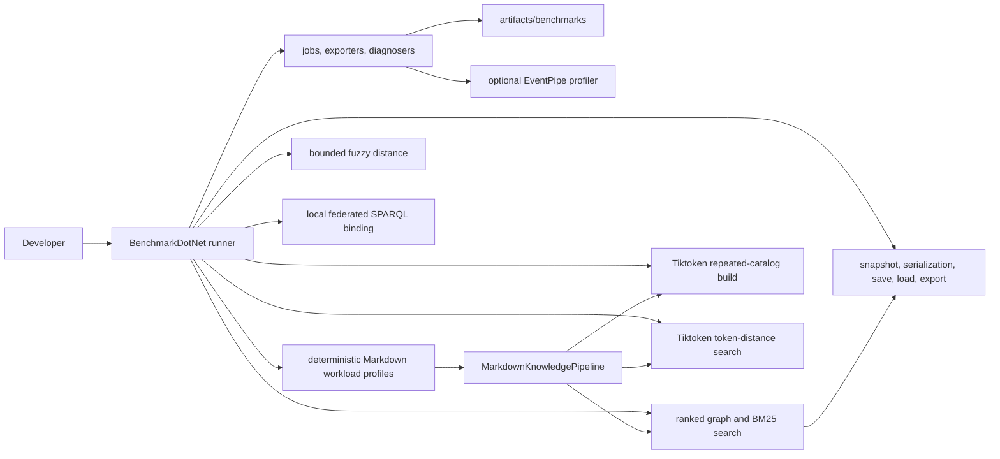

# Performance Benchmarks

Markdown-LD Knowledge Bank keeps correctness tests and performance measurements separate. TUnit flow tests prove behaviour; BenchmarkDotNet measures runtime, allocation, scaling, and profiler traces for the hot paths.

## Benchmark Boundaries



The benchmark project is `benchmarks/MarkdownLd.Kb.Benchmarks`. It references the production library, but production and test projects do not reference it.

## Suites

| Suite | Measures |
| --- | --- |
| `FuzzyEditDistanceBenchmarks` | Bounded bit-vector/banded edit distance against a naive Levenshtein baseline for short typo and long affix-heavy tokens. |
| `GraphBuildBenchmarks` | Markdown source to in-memory graph build time across named workload profiles. |
| `TiktokenGraphBuildBenchmarks` | Full Tiktoken extraction, related-segment selection, normalization, and RDF materialization for a repeated catalog corpus. |
| `SchemaGraphSearchBenchmarks` | Mandatory evidence/provenance query allocation with unrestricted or candidate VALUES, matching and no-match inputs. |
| `GraphSearchBenchmarks` | Graph-ranked search, BM25, BM25 fuzzy matching, schema search, focused search, and local federated schema search. |
| `TiktokenSearchBenchmarks` | Exact token-distance search and fuzzy query correction over long-document and multilingual token-heavy graphs. |
| `GraphPersistenceBenchmarks` | Snapshot creation, Turtle/JSON-LD serialization, Mermaid/DOT export, in-memory store save/load, and file save/load. |
| `GraphLifecycleBenchmarks` | One broad build/search/save/load/export lifecycle benchmark for the complete suite. |

## Workload Profiles

Benchmark parameters use named workload profiles instead of raw document-count ranges.

| Profile | Shape | Why it exists |
| --- | --- | --- |
| `ShortDocuments` | 250 compact runbook-like Markdown documents. | Normal knowledge-base retrieval and persistence pressure. |
| `LongDocuments` | 80 long recovery playbooks with repeated sections. | Long body and chunk-scan pressure without pretending the main variable is file count. |
| `LargeCorpus` | 1000 compact documents. | Scale pressure for graph build, snapshot, serialization, save, and load paths. |
| `TokenizedMultilingual` | 250 token-heavy multilingual/CJK documents. | Tiktoken and fuzzy query-correction behaviour on non-trivial tokenization input. |
| `RepeatedCatalog` | 48 catalog-like documents with deliberately repeated headings and authorization/revision phrases. | Detects redundant topic facts, symmetric neighbor pairs, unbounded confidence warnings, and graph-build allocation regressions. |
| `FederatedRunbooks` | 250 SPARQL/service/runbook documents. | Local federated schema-search and service-binding query plans. |

## Commands

```bash
dotnet run --project benchmarks/MarkdownLd.Kb.Benchmarks -c Release -- --list flat
dotnet run --project benchmarks/MarkdownLd.Kb.Benchmarks -c Release -- --filter "*FuzzyEditDistanceBenchmarks*"
dotnet run --project benchmarks/MarkdownLd.Kb.Benchmarks -c Release -- --filter "*GraphBuildBenchmarks*"
dotnet run --project benchmarks/MarkdownLd.Kb.Benchmarks -c Release -- --filter "*TiktokenGraphBuildBenchmarks*"
dotnet run --project benchmarks/MarkdownLd.Kb.Benchmarks -c Release -- --filter "*GraphSearchBenchmarks*"
dotnet run --project benchmarks/MarkdownLd.Kb.Benchmarks -c Release -- --filter "*TiktokenSearchBenchmarks*"
dotnet run --project benchmarks/MarkdownLd.Kb.Benchmarks -c Release -- --filter "*GraphPersistenceBenchmarks*"
dotnet run --project benchmarks/MarkdownLd.Kb.Benchmarks -c Release -- --filter "*GraphLifecycleBenchmarks*"
```

`MarkdownLdBenchmarkConfig` writes Markdown, CSV, and full JSON reports to `artifacts/benchmarks/results`. Those files are machine-specific and intentionally ignored by git. If the command does not pass a BenchmarkDotNet job option, the config adds one `Required` job: one launch, two warmup iterations, five measured iterations, and a 100 ms minimum iteration time. It still executes every benchmark case, but avoids multi-hour default auto-tuning runs.

## Measured Metrics

The benchmark configuration is intentionally diagnostic, not just a stopwatch. The default reports collect:

| Metric group | BenchmarkDotNet data | Why it matters |
| --- | --- | --- |
| Latency | `Mean`, `Error`, `StdDev`, `Ratio`, `RatioSD`; full JSON also keeps min, quartiles, max, percentiles, and raw measurements | Shows the cost and distribution of each public path under the same deterministic workload. |
| Allocation and GC | `Allocated`, `Alloc Ratio`, `Gen0`, `Gen1`, `Gen2` | Catches search paths that look acceptable once but become expensive under repeated calls. |
| Threading and contention | `Completed Work Items`, `Lock Contentions` | Highlights SPARQL and federation paths that schedule work or contend while executing query plans. |
| Benchmark shape | corpus profile, query scenario, runtime, platform, JIT, job, iteration counts | Keeps runs explainable and comparable without turning local numbers into a cross-machine contract. |
| Optional profiler traces | EventPipe CPU, GC, or JIT files | Gives the next level of evidence when a benchmark result points at a hot path. |

The build/test/pack validation job stays separate from performance measurement. The PR validation workflow, release workflow, and dedicated benchmark workflow run the complete benchmark suite: fuzzy edit distance, graph build, Tiktoken graph build, graph search, Tiktoken search, graph persistence, and graph lifecycle. They run suites as parallel matrix jobs and upload `artifacts/benchmarks/results` as suite-specific `benchmarkdotnet-results-*` artifacts so CI keeps the same performance evidence shape without serializing every suite into one long job.

Optional EventPipe profiling is opt-in:

```bash
MARKDOWN_LD_KB_BENCHMARK_PROFILE=cpu dotnet run --project benchmarks/MarkdownLd.Kb.Benchmarks -c Release -- --filter "*FuzzyEditDistanceBenchmarks*"
MARKDOWN_LD_KB_BENCHMARK_PROFILE=gc dotnet run --project benchmarks/MarkdownLd.Kb.Benchmarks -c Release -- --filter "*GraphSearchBenchmarks*"
MARKDOWN_LD_KB_BENCHMARK_PROFILE=jit dotnet run --project benchmarks/MarkdownLd.Kb.Benchmarks -c Release -- --filter "*TiktokenSearchBenchmarks*"
```

## Current Results

On October 12, 2026 the full local `Required` suite completed 127 cases in 7 minutes 10 seconds (`430.01s`) on Apple M2 Pro, .NET 10.0.12, SDK 10.0.401, BenchmarkDotNet 0.15.8. Receipts: `artifacts/rdf-full-benchmarks.log` and Markdown/CSV/full JSON reports under `artifacts/benchmarks/results`.

Background Roslynk CPU load produced broad timing confidence intervals. Means below describe this run; allocation measurements support the query-shape decision, while timing does not establish a reliable latency speedup. Candidate pools contain ten known-good primary IDs from an unrestricted warmup and do not prove a separate preselector's recall. The primary checkout included pre-existing serialization/tokenization edits outside this scoped release, so persistence/Tiktoken measurements describe that checkout; release CI measures the committed source independently. MB/KB follow BenchmarkDotNet binary units.

| Suite | Job | Cases | Result files |
| --- | --- | ---: | --- |
| `FuzzyEditDistanceBenchmarks` | Required | 8 | Markdown, CSV, JSON |
| `GraphBuildBenchmarks` | Required | 4 | Markdown, CSV, JSON |
| `TiktokenGraphBuildBenchmarks` | Required | 1 | Markdown, CSV, JSON |
| `GraphSearchBenchmarks` | Required | 54 | Markdown, CSV, JSON |
| `SchemaGraphSearchBenchmarks` | Required | 8 | Markdown, CSV, JSON |
| `TiktokenSearchBenchmarks` | Required | 12 | Markdown, CSV, JSON |
| `GraphPersistenceBenchmarks` | Required | 39 | Markdown, CSV, JSON |
| `GraphLifecycleBenchmarks` | Required | 1 | Markdown, CSV, JSON |

### FuzzyEditDistanceBenchmarks

| Method                   | Scenario          | Mean          | Error         | StdDev        | Ratio  | RatioSD | Gen0   | Completed Work Items | Lock Contentions | Allocated | Alloc Ratio |
|------------------------- |------------------ |--------------:|--------------:|--------------:|-------:|--------:|-------:|---------------------:|-----------------:|----------:|------------:|
| **BoundedBitVectorOrBanded** | **ShortDeletion**     |      **5.620 ns** |     **0.4462 ns** |     **0.1159 ns** |   **1.00** |    **0.03** |      **-** |                    **-** |                **-** |         **-** |          **NA** |
| NaiveLevenshtein         | ShortDeletion     |     99.834 ns |     3.9518 ns |     1.0263 ns |  17.77 |    0.37 | 0.0134 |                    - |                - |     112 B |          NA |
|                          |                   |               |               |               |        |         |        |                      |                  |           |             |
| **BoundedBitVectorOrBanded** | **ShortSubstitution** |     **34.319 ns** |     **9.3547 ns** |     **1.4477 ns** |   **1.00** |    **0.05** |      **-** |                    **-** |                **-** |         **-** |          **NA** |
| NaiveLevenshtein         | ShortSubstitution |     84.915 ns |     5.2951 ns |     1.3751 ns |   2.48 |    0.10 | 0.0134 |                    - |                - |     112 B |          NA |
|                          |                   |               |               |               |        |         |        |                      |                  |           |             |
| **BoundedBitVectorOrBanded** | **LongInsertion**     |     **26.986 ns** |     **0.9034 ns** |     **0.2346 ns** |   **1.00** |    **0.01** |      **-** |                    **-** |                **-** |         **-** |          **NA** |
| NaiveLevenshtein         | LongInsertion     | 10,531.153 ns | 7,680.8722 ns | 1,994.6981 ns | 390.27 |   67.55 | 0.0610 |                    - |                - |     640 B |          NA |
|                          |                   |               |               |               |        |         |        |                      |                  |           |             |
| **BoundedBitVectorOrBanded** | **LongNoMatch**       |     **60.374 ns** |     **9.0748 ns** |     **1.4043 ns** |   **1.00** |    **0.03** |      **-** |                    **-** |                **-** |         **-** |          **NA** |
| NaiveLevenshtein         | LongNoMatch       | 10,110.620 ns | 1,657.1166 ns |   430.3479 ns | 167.54 |    7.42 | 0.0610 |                    - |                - |     672 B |          NA |


### GraphBuildBenchmarks

| Method     | CorpusProfile        | Mean     | Error    | StdDev    | Gen0      | Completed Work Items | Lock Contentions | Gen1      | Gen2      | Allocated |
|----------- |--------------------- |---------:|---------:|----------:|----------:|---------------------:|-----------------:|----------:|----------:|----------:|
| **BuildGraph** | **ShortDocuments**       | **43.64 ms** | **14.63 ms** |  **2.264 ms** | **1666.6667** |                    **-** |                **-** |  **666.6667** |         **-** |  **15.16 MB** |
| **BuildGraph** | **LongDocuments**        | **33.74 ms** | **38.92 ms** | **10.107 ms** | **1750.0000** |                    **-** |                **-** |  **750.0000** |         **-** |  **14.46 MB** |
| **BuildGraph** | **LargeCorpus**          | **71.56 ms** | **49.45 ms** | **12.843 ms** | **7500.0000** |                    **-** |                **-** | **2500.0000** | **1000.0000** |  **58.06 MB** |
| **BuildGraph** | **Token(...)ngual [21]** | **57.58 ms** | **38.55 ms** | **10.010 ms** | **2000.0000** |                    **-** |                **-** | **1000.0000** |  **333.3333** |  **18.01 MB** |


### TiktokenGraphBuildBenchmarks

| Method                    | Mean     | Error    | StdDev   | Gen0      | Completed Work Items | Lock Contentions | Gen1      | Gen2     | Allocated |
|-------------------------- |---------:|---------:|---------:|----------:|---------------------:|-----------------:|----------:|---------:|----------:|
| BuildRepeatedCatalogGraph | 104.4 ms | 85.77 ms | 13.27 ms | 8500.0000 |                    - |                - | 3500.0000 | 500.0000 |  67.05 MB |


### GraphSearchBenchmarks

| Method                     | CorpusProfile     | QueryScenario | Mean      | Error      | StdDev    | Median    | Ratio | RatioSD | Gen0      | Completed Work Items | Lock Contentions | Gen1     | Gen2    | Allocated | Alloc Ratio |
|--------------------------- |------------------ |-------------- |----------:|-----------:|----------:|----------:|------:|--------:|----------:|---------------------:|-----------------:|---------:|--------:|----------:|------------:|
| **LocalFederatedSchemaSearch** | **ShortDocuments**    | **Exact**         | **22.144 ms** |  **7.6906 ms** | **1.9972 ms** | **22.756 ms** |  **6.68** |    **1.46** | **1000.0000** |              **24.0000** |          **60.0000** | **333.3333** |       **-** |      **8 MB** |        **2.91** |
| RankedGraphSearch          | ShortDocuments    | Exact         |  3.438 ms |  4.6877 ms | 0.7254 ms |  3.474 ms |  1.04 |    0.29 |  343.7500 |                    - |                - | 125.0000 |       - |   2.75 MB |        1.00 |
| Bm25Search                 | ShortDocuments    | Exact         |  6.893 ms | 11.5900 ms | 3.0099 ms |  6.158 ms |  2.08 |    0.95 |  312.5000 |                    - |                - | 125.0000 |       - |   2.76 MB |        1.00 |
| Bm25FuzzySearch            | ShortDocuments    | Exact         |  6.706 ms | 12.7753 ms | 3.3177 ms |  4.612 ms |  2.02 |    1.02 |  375.0000 |                    - |                - | 187.5000 |       - |   3.47 MB |        1.26 |
| SchemaSearch               | ShortDocuments    | Exact         | 24.928 ms |  9.5743 ms | 2.4864 ms | 25.035 ms |  7.52 |    1.68 |  666.6667 |              23.0000 |          24.8333 | 166.6667 |       - |   5.92 MB |        2.15 |
| FocusedSearch              | ShortDocuments    | Exact         |  7.860 ms |  8.5457 ms | 2.2193 ms |  8.149 ms |  2.37 |    0.79 |  500.0000 |                    - |                - | 187.5000 |       - |   4.24 MB |        1.54 |
|                            |                   |               |           |            |           |           |       |         |           |                      |                  |          |         |           |             |
| **LocalFederatedSchemaSearch** | **ShortDocuments**    | **Typo**          | **28.294 ms** |  **1.6870 ms** | **0.2611 ms** | **28.286 ms** |  **6.99** |    **3.14** | **1000.0000** |              **24.0000** |          **62.0000** | **200.0000** |       **-** |   **8.03 MB** |        **2.92** |
| RankedGraphSearch          | ShortDocuments    | Typo          |  4.883 ms |  8.5211 ms | 2.2129 ms |  4.744 ms |  1.21 |    0.77 |  343.7500 |                    - |                - | 125.0000 |       - |   2.75 MB |        1.00 |
| Bm25Search                 | ShortDocuments    | Typo          |  3.630 ms |  4.5008 ms | 0.6965 ms |  3.581 ms |  0.90 |    0.44 |  312.5000 |                    - |                - | 125.0000 |       - |   2.73 MB |        0.99 |
| Bm25FuzzySearch            | ShortDocuments    | Typo          |  9.890 ms |  8.1993 ms | 2.1293 ms |  9.366 ms |  2.44 |    1.21 |  375.0000 |                    - |                - | 187.5000 |       - |   3.47 MB |        1.26 |
| SchemaSearch               | ShortDocuments    | Typo          | 37.334 ms | 13.8846 ms | 3.6058 ms | 38.276 ms |  9.23 |    4.22 |  666.6667 |              23.0000 |           7.0000 | 333.3333 |       - |   5.92 MB |        2.15 |
| FocusedSearch              | ShortDocuments    | Typo          | 11.218 ms | 21.8155 ms | 3.3760 ms | 10.172 ms |  2.77 |    1.49 |  500.0000 |                    - |                - | 166.6667 |       - |   4.24 MB |        1.54 |
|                            |                   |               |           |            |           |           |       |         |           |                      |                  |          |         |           |             |
| **LocalFederatedSchemaSearch** | **ShortDocuments**    | **NoMatch**       | **20.855 ms** | **28.8084 ms** | **7.4814 ms** | **17.622 ms** |  **6.66** |    **2.44** | **1000.0000** |              **24.0000** |          **46.0000** | **333.3333** |       **-** |      **8 MB** |        **2.91** |
| RankedGraphSearch          | ShortDocuments    | NoMatch       |  3.198 ms |  3.4589 ms | 0.5353 ms |  3.234 ms |  1.02 |    0.22 |  343.7500 |                    - |                - | 125.0000 |       - |   2.75 MB |        1.00 |
| Bm25Search                 | ShortDocuments    | NoMatch       | 14.503 ms | 22.9797 ms | 5.9678 ms | 12.080 ms |  4.63 |    1.90 |  200.0000 |                    - |                - |        - |       - |   2.73 MB |        0.99 |
| Bm25FuzzySearch            | ShortDocuments    | NoMatch       |  6.547 ms |  9.5280 ms | 2.4744 ms |  7.897 ms |  2.09 |    0.80 |  375.0000 |                    - |                - | 187.5000 |       - |   3.44 MB |        1.25 |
| SchemaSearch               | ShortDocuments    | NoMatch       | 15.504 ms |  1.2122 ms | 0.1876 ms | 15.574 ms |  4.95 |    0.76 |  600.0000 |              23.0000 |          58.6000 | 200.0000 |       - |   5.92 MB |        2.15 |
| FocusedSearch              | ShortDocuments    | NoMatch       |  5.652 ms |  1.5503 ms | 0.4026 ms |  5.767 ms |  1.81 |    0.30 |  500.0000 |                    - |                - | 187.5000 |       - |   4.24 MB |        1.54 |
|                            |                   |               |           |            |           |           |       |         |           |                      |                  |          |         |           |             |
| **LocalFederatedSchemaSearch** | **LongDocuments**     | **Exact**         | **11.761 ms** |  **0.7565 ms** | **0.1965 ms** | **11.711 ms** |  **7.28** |    **1.54** |  **750.0000** |              **24.0000** |          **15.2500** | **250.0000** |       **-** |    **6.1 MB** |        **2.97** |
| RankedGraphSearch          | LongDocuments     | Exact         |  1.686 ms |  2.5615 ms | 0.3964 ms |  1.703 ms |  1.04 |    0.32 |  250.0000 |                    - |                - |  78.1250 |       - |   2.06 MB |        1.00 |
| Bm25Search                 | LongDocuments     | Exact         |  3.435 ms |  3.2849 ms | 0.8531 ms |  3.009 ms |  2.13 |    0.67 |  250.0000 |                    - |                - |  62.5000 |       - |   2.06 MB |        1.00 |
| Bm25FuzzySearch            | LongDocuments     | Exact         |  4.642 ms |  4.6584 ms | 1.2098 ms |  3.827 ms |  2.87 |    0.93 |  437.5000 |                    - |                - | 156.2500 |       - |   3.61 MB |        1.75 |
| SchemaSearch               | LongDocuments     | Exact         | 19.646 ms | 12.0389 ms | 3.1265 ms | 19.663 ms | 12.16 |    3.14 |  333.3333 |              23.0000 |          36.3333 |        - |       - |   3.98 MB |        1.94 |
| FocusedSearch              | LongDocuments     | Exact         |  1.516 ms |  0.7112 ms | 0.1101 ms |  1.505 ms |  0.94 |    0.21 |  203.1250 |                    - |                - |  62.5000 |       - |   1.66 MB |        0.80 |
|                            |                   |               |           |            |           |           |       |         |           |                      |                  |          |         |           |             |
| **LocalFederatedSchemaSearch** | **LongDocuments**     | **Typo**          | **16.004 ms** |  **1.1272 ms** | **0.1744 ms** | **15.992 ms** |  **8.01** |    **1.47** |  **714.2857** |              **24.0000** |          **13.1429** | **142.8571** |       **-** |    **6.1 MB** |        **2.96** |
| RankedGraphSearch          | LongDocuments     | Typo          |  2.061 ms |  1.4890 ms | 0.3867 ms |  2.223 ms |  1.03 |    0.26 |  250.0000 |                    - |                - |  78.1250 |       - |   2.06 MB |        1.00 |
| Bm25Search                 | LongDocuments     | Typo          |  4.041 ms |  4.5695 ms | 0.7071 ms |  4.069 ms |  2.02 |    0.49 |  250.0000 |                    - |                - | 125.0000 |       - |   2.05 MB |        1.00 |
| Bm25FuzzySearch            | LongDocuments     | Typo          | 24.957 ms | 31.3924 ms | 8.1525 ms | 27.569 ms | 12.48 |    4.41 |  333.3333 |                    - |                - |        - |       - |   3.61 MB |        1.75 |
| SchemaSearch               | LongDocuments     | Typo          | 12.977 ms |  6.2325 ms | 1.6186 ms | 12.546 ms |  6.49 |    1.40 |  500.0000 |              23.0000 |           1.2000 | 100.0000 |       - |   3.97 MB |        1.93 |
| FocusedSearch              | LongDocuments     | Typo          |  5.852 ms |  4.4499 ms | 1.1556 ms |  5.383 ms |  2.93 |    0.76 |  187.5000 |                    - |                - |  31.2500 |       - |   1.66 MB |        0.81 |
|                            |                   |               |           |            |           |           |       |         |           |                      |                  |          |         |           |             |
| **LocalFederatedSchemaSearch** | **LongDocuments**     | **NoMatch**       | **15.911 ms** | **14.4620 ms** | **3.7557 ms** | **16.865 ms** | **10.39** |    **2.37** |  **750.0000** |              **24.0000** |          **11.7500** | **250.0000** |       **-** |   **6.06 MB** |        **2.94** |
| RankedGraphSearch          | LongDocuments     | NoMatch       |  1.538 ms |  0.7691 ms | 0.1190 ms |  1.533 ms |  1.00 |    0.10 |  250.0000 |                    - |                - |  78.1250 |       - |   2.06 MB |        1.00 |
| Bm25Search                 | LongDocuments     | NoMatch       |  7.212 ms | 17.1232 ms | 4.4468 ms |  5.822 ms |  4.71 |    2.69 |  250.0000 |                    - |                - | 125.0000 |       - |   2.05 MB |        1.00 |
| Bm25FuzzySearch            | LongDocuments     | NoMatch       |  7.107 ms |  6.7735 ms | 1.7591 ms |  7.927 ms |  4.64 |    1.10 |  416.6667 |                    - |                - | 166.6667 |       - |    3.6 MB |        1.75 |
| SchemaSearch               | LongDocuments     | NoMatch       |  9.296 ms |  0.5195 ms | 0.1349 ms |  9.267 ms |  6.07 |    0.42 |  333.3333 |              23.0000 |           8.0000 |        - |       - |   3.98 MB |        1.93 |
| FocusedSearch              | LongDocuments     | NoMatch       |  2.005 ms |  1.1743 ms | 0.1817 ms |  1.918 ms |  1.31 |    0.14 |  187.5000 |                    - |                - |  62.5000 |       - |   1.55 MB |        0.75 |
|                            |                   |               |           |            |           |           |       |         |           |                      |                  |          |         |           |             |
| **LocalFederatedSchemaSearch** | **FederatedRunbooks** | **Exact**         | **15.600 ms** |  **4.7717 ms** | **0.7384 ms** | **15.642 ms** |  **3.13** |    **0.40** | **1000.0000** |              **24.0000** |          **28.0000** | **200.0000** |       **-** |   **8.08 MB** |        **2.63** |
| RankedGraphSearch          | FederatedRunbooks | Exact         |  5.063 ms |  2.6201 ms | 0.6804 ms |  5.108 ms |  1.01 |    0.18 |  375.0000 |                    - |                - | 125.0000 | 31.2500 |   3.08 MB |        1.00 |
| Bm25Search                 | FederatedRunbooks | Exact         | 10.020 ms |  8.3829 ms | 1.2973 ms |  9.911 ms |  2.01 |    0.34 |  285.7143 |                    - |                - | 142.8571 |       - |   3.08 MB |        1.00 |
| Bm25FuzzySearch            | FederatedRunbooks | Exact         |  8.022 ms |  6.9257 ms | 1.0718 ms |  8.506 ms |  1.61 |    0.27 |  437.5000 |                    - |                - | 125.0000 |       - |   4.08 MB |        1.33 |
| SchemaSearch               | FederatedRunbooks | Exact         | 23.386 ms |  8.7527 ms | 2.2730 ms | 24.970 ms |  4.69 |    0.70 |  666.6667 |              23.0000 |          51.5000 | 166.6667 |       - |      6 MB |        1.95 |
| FocusedSearch              | FederatedRunbooks | Exact         |  6.987 ms | 10.3653 ms | 2.6918 ms |  6.071 ms |  1.40 |    0.52 |  625.0000 |                    - |                - | 250.0000 | 62.5000 |   4.76 MB |        1.55 |
|                            |                   |               |           |            |           |           |       |         |           |                      |                  |          |         |           |             |
| **LocalFederatedSchemaSearch** | **FederatedRunbooks** | **Typo**          | **47.045 ms** | **34.4799 ms** | **8.9543 ms** | **46.015 ms** | **16.36** |    **3.25** | **1000.0000** |              **24.0000** |           **2.7500** | **250.0000** |       **-** |   **8.08 MB** |        **2.56** |
| RankedGraphSearch          | FederatedRunbooks | Typo          |  2.900 ms |  2.0406 ms | 0.3158 ms |  2.826 ms |  1.01 |    0.14 |  406.2500 |                    - |                - | 125.0000 | 31.2500 |   3.15 MB |        1.00 |
| Bm25Search                 | FederatedRunbooks | Typo          |  7.434 ms | 13.0588 ms | 3.3913 ms |  8.433 ms |  2.59 |    1.11 |  375.0000 |                    - |                - | 125.0000 |       - |   3.14 MB |        0.99 |
| Bm25FuzzySearch            | FederatedRunbooks | Typo          |  4.818 ms |  3.3180 ms | 0.5135 ms |  4.577 ms |  1.68 |    0.22 |  437.5000 |                    - |                - | 125.0000 |       - |   4.08 MB |        1.29 |
| SchemaSearch               | FederatedRunbooks | Typo          | 16.827 ms |  7.3977 ms | 1.9212 ms | 17.843 ms |  5.85 |    0.82 |  666.6667 |              23.0000 |          60.8333 | 166.6667 |       - |   5.97 MB |        1.89 |
| FocusedSearch              | FederatedRunbooks | Typo          |  6.657 ms |  8.1311 ms | 2.1116 ms |  5.180 ms |  2.32 |    0.71 |  625.0000 |                    - |                - | 250.0000 | 62.5000 |   4.76 MB |        1.51 |
|                            |                   |               |           |            |           |           |       |         |           |                      |                  |          |         |           |             |
| **LocalFederatedSchemaSearch** | **FederatedRunbooks** | **NoMatch**       | **33.306 ms** |  **9.4576 ms** | **2.4561 ms** | **33.891 ms** |  **7.87** |    **2.28** | **1000.0000** |              **24.0000** |          **29.0000** | **250.0000** |       **-** |   **8.11 MB** |        **2.63** |
| RankedGraphSearch          | FederatedRunbooks | NoMatch       |  4.488 ms |  4.0109 ms | 1.0416 ms |  4.666 ms |  1.06 |    0.38 |  375.0000 |                    - |                - | 125.0000 | 31.2500 |   3.08 MB |        1.00 |
| Bm25Search                 | FederatedRunbooks | NoMatch       |  4.798 ms |  6.7255 ms | 1.7466 ms |  4.011 ms |  1.13 |    0.50 |  312.5000 |                    - |                - |  62.5000 |       - |   3.06 MB |        0.99 |
| Bm25FuzzySearch            | FederatedRunbooks | NoMatch       | 18.272 ms | 16.4390 ms | 4.2692 ms | 18.884 ms |  4.32 |    1.55 |  500.0000 |                    - |                - | 250.0000 |       - |   4.14 MB |        1.34 |
| SchemaSearch               | FederatedRunbooks | NoMatch       | 15.318 ms | 14.4726 ms | 3.7585 ms | 13.356 ms |  3.62 |    1.32 |  666.6667 |              23.0000 |          56.1667 | 166.6667 |       - |   5.98 MB |        1.94 |
| FocusedSearch              | FederatedRunbooks | NoMatch       |  8.345 ms | 17.1129 ms | 4.4442 ms |  6.621 ms |  1.97 |    1.14 |  625.0000 |                    - |                - | 250.0000 | 62.5000 |   4.76 MB |        1.55 |


### SchemaGraphSearchBenchmarks

| Method          | CorpusProfile  | QueryScenario | Mean      | Error     | StdDev    | Ratio | RatioSD | Gen0      | Completed Work Items | Lock Contentions | Gen1      | Allocated | Alloc Ratio |
|---------------- |--------------- |-------------- |----------:|----------:|----------:|------:|--------:|----------:|---------------------:|-----------------:|----------:|----------:|------------:|
| **Unrestricted**    | **ShortDocuments** | **Exact**         | **36.469 ms** | **30.831 ms** | **4.7711 ms** |  **1.01** |    **0.16** | **2000.0000** |              **57.0000** |          **36.5000** | **1000.0000** |  **17.86 MB** |        **1.00** |
| CandidateValues | ShortDocuments | Exact         | 16.003 ms | 19.081 ms | 4.9553 ms |  0.44 |    0.13 |  937.5000 |             101.0000 |          12.3750 |  312.5000 |   7.68 MB |        0.43 |
|                 |                |               |           |           |           |       |         |           |                      |                  |           |           |             |
| **Unrestricted**    | **ShortDocuments** | **NoMatch**       | **13.137 ms** | **19.320 ms** | **5.0174 ms** |  **1.10** |    **0.51** |  **875.0000** |              **23.0000** |          **17.8125** |  **312.5000** |   **7.24 MB** |        **1.00** |
| CandidateValues | ShortDocuments | NoMatch       | 12.179 ms | 14.337 ms | 3.7233 ms |  1.02 |    0.42 |  562.5000 |              67.0000 |          13.9375 |  187.5000 |   4.93 MB |        0.68 |
|                 |                |               |           |           |           |       |         |           |                      |                  |           |           |             |
| **Unrestricted**    | **LongDocuments**  | **Exact**         | **13.560 ms** |  **6.378 ms** | **1.6564 ms** |  **1.01** |    **0.16** | **1000.0000** |              **57.0000** |           **5.5000** |  **312.5000** |   **8.27 MB** |        **1.00** |
| CandidateValues | LongDocuments  | Exact         | 12.053 ms | 13.037 ms | 3.3856 ms |  0.90 |    0.25 |  687.5000 |             101.0000 |           2.7500 |  187.5000 |   5.82 MB |        0.70 |
|                 |                |               |           |           |           |       |         |           |                      |                  |           |           |             |
| **Unrestricted**    | **LongDocuments**  | **NoMatch**       |  **8.520 ms** |  **5.361 ms** | **0.8296 ms** |  **1.01** |    **0.12** |  **562.5000** |              **23.0000** |          **20.7500** |  **187.5000** |   **4.54 MB** |        **1.00** |
| CandidateValues | LongDocuments  | NoMatch       | 11.651 ms |  6.395 ms | 1.6608 ms |  1.38 |    0.22 |  500.0000 |              67.0000 |           2.5000 |  125.0000 |   4.26 MB |        0.94 |


### TiktokenSearchBenchmarks

| Method                            | CorpusProfile        | QueryScenario | Mean       | Error       | StdDev    | Median     | Ratio | RatioSD | Gen0    | Completed Work Items | Lock Contentions | Allocated | Alloc Ratio |
|---------------------------------- |--------------------- |-------------- |-----------:|------------:|----------:|-----------:|------:|--------:|--------:|---------------------:|-----------------:|----------:|------------:|
| **ExactTokenDistanceSearch**          | **LongDocuments**        | **Exact**         | **1,373.4 μs** | **3,008.40 μs** | **781.27 μs** | **1,658.4 μs** |  **2.12** |    **3.05** |       **-** |                    **-** |                **-** | **107.31 KB** |        **1.00** |
| FuzzyCorrectedTokenDistanceSearch | LongDocuments        | Exact         |   139.0 μs |     2.39 μs |   0.62 μs |   139.2 μs |  0.22 |    0.26 | 12.6953 |                    - |                - | 108.34 KB |        1.01 |
|                                   |                      |               |            |             |           |            |       |         |         |                      |                  |           |             |
| **ExactTokenDistanceSearch**          | **LongDocuments**        | **Typo**          |   **176.8 μs** |    **19.61 μs** |   **3.03 μs** |   **176.6 μs** |  **1.00** |    **0.02** | **12.6953** |                    **-** |                **-** | **107.87 KB** |        **1.00** |
| FuzzyCorrectedTokenDistanceSearch | LongDocuments        | Typo          |   271.8 μs |    29.79 μs |   7.74 μs |   269.4 μs |  1.54 |    0.05 |       - |                    - |                - | 110.17 KB |        1.02 |
|                                   |                      |               |            |             |           |            |       |         |         |                      |                  |           |             |
| **ExactTokenDistanceSearch**          | **LongDocuments**        | **NoMatch**       |   **156.0 μs** |   **179.42 μs** |  **46.59 μs** |   **133.4 μs** |  **1.07** |    **0.40** | **12.6953** |                    **-** |                **-** | **107.18 KB** |        **1.00** |
| FuzzyCorrectedTokenDistanceSearch | LongDocuments        | NoMatch       |   115.9 μs |    10.71 μs |   1.66 μs |   115.6 μs |  0.79 |    0.19 | 12.6953 |                    - |                - | 108.01 KB |        1.01 |
|                                   |                      |               |            |             |           |            |       |         |         |                      |                  |           |             |
| **ExactTokenDistanceSearch**          | **Token(...)ngual [21]** | **Exact**         |   **111.6 μs** |     **6.25 μs** |   **1.62 μs** |   **110.6 μs** |  **1.00** |    **0.02** |  **7.8125** |                    **-** |                **-** |  **70.81 KB** |        **1.00** |
| FuzzyCorrectedTokenDistanceSearch | Token(...)ngual [21] | Exact         |   106.9 μs |     4.06 μs |   1.06 μs |   106.8 μs |  0.96 |    0.02 |  8.7891 |                    - |                - |  71.95 KB |        1.02 |
|                                   |                      |               |            |             |           |            |       |         |         |                      |                  |           |             |
| **ExactTokenDistanceSearch**          | **Token(...)ngual [21]** | **Typo**          |   **134.5 μs** |    **11.65 μs** |   **3.02 μs** |   **133.0 μs** |  **1.00** |    **0.03** |  **7.8125** |                    **-** |                **-** |  **71.23 KB** |        **1.00** |
| FuzzyCorrectedTokenDistanceSearch | Token(...)ngual [21] | Typo          |   158.9 μs |     3.36 μs |   0.52 μs |   159.0 μs |  1.18 |    0.02 |  7.8125 |                    - |                - |  72.94 KB |        1.02 |
|                                   |                      |               |            |             |           |            |       |         |         |                      |                  |           |             |
| **ExactTokenDistanceSearch**          | **Token(...)ngual [21]** | **NoMatch**       |   **102.1 μs** |     **6.79 μs** |   **1.76 μs** |   **101.9 μs** |  **1.00** |    **0.02** |  **7.8125** |                    **-** |                **-** |  **70.54 KB** |        **1.00** |
| FuzzyCorrectedTokenDistanceSearch | Token(...)ngual [21] | NoMatch       |   101.6 μs |     3.11 μs |   0.81 μs |   101.4 μs |  1.00 |    0.02 |  7.8125 |                    - |                - |  71.37 KB |        1.01 |


### GraphPersistenceBenchmarks

| Method                      | CorpusProfile  | Mean         | Error        | StdDev       | Median       | Ratio | RatioSD | Gen0       | Completed Work Items | Lock Contentions | Gen1      | Gen2      | Allocated   | Alloc Ratio |
|---------------------------- |--------------- |-------------:|-------------:|-------------:|-------------:|------:|--------:|-----------:|---------------------:|-----------------:|----------:|----------:|------------:|------------:|
| **ExportMermaidFlowchart**      | **ShortDocuments** |   **4,722.5 μs** |   **7,862.1 μs** |  **2,041.75 μs** |   **4,513.1 μs** |  **1.97** |    **0.82** |   **250.0000** |                    **-** |                **-** |  **125.0000** |         **-** |  **2498.88 KB** |        **1.30** |
| ExportDotGraph              | ShortDocuments |   4,389.0 μs |   8,072.8 μs |  2,096.47 μs |   3,645.8 μs |  1.83 |    0.83 |   281.2500 |                    - |                - |  125.0000 |         - |   2615.7 KB |        1.37 |
| LoadTurtleFromInMemoryStore | ShortDocuments |  32,830.0 μs |   8,454.7 μs |  2,195.65 μs |  33,012.5 μs | 13.68 |    1.80 |   750.0000 |                    - |                - |  250.0000 |         - |  6561.75 KB |        3.43 |
| LoadJsonLdFromInMemoryStore | ShortDocuments |  50,541.7 μs |  19,224.8 μs |  4,992.63 μs |  51,657.5 μs | 21.06 |    3.11 |  2000.0000 |                    - |                - |  500.0000 |         - | 20267.02 KB |       10.58 |
| LoadTurtleFromFile          | ShortDocuments |  35,602.0 μs |   4,727.9 μs |    731.65 μs |  35,584.5 μs | 14.83 |    1.76 |   750.0000 |              50.0000 |                - |  250.0000 |         - |  7332.88 KB |        3.83 |
| LoadJsonLdFromFile          | ShortDocuments |  71,790.0 μs |  87,023.8 μs | 13,467.02 μs |  70,405.0 μs | 29.91 |    6.15 |  2500.0000 |              44.0000 |                - | 1000.0000 |         - | 20944.55 KB |       10.93 |
| SaveTurtleToInMemoryStore   | ShortDocuments |   5,794.1 μs |   4,830.6 μs |  1,254.48 μs |   5,304.9 μs |  2.41 |    0.56 |   875.0000 |                    - |                - |  375.0000 |         - |  7839.78 KB |        4.09 |
| SaveJsonLdToInMemoryStore   | ShortDocuments |   7,864.7 μs |   1,695.0 μs |    440.18 μs |   8,078.4 μs |  3.28 |    0.42 |  1437.5000 |                    - |                - |  625.0000 |   62.5000 | 11891.92 KB |        6.21 |
| SaveTurtleToFile            | ShortDocuments |  10,301.4 μs |  10,666.6 μs |  2,770.09 μs |  12,022.0 μs |  4.29 |    1.18 |  1000.0000 |               2.0000 |                - |  500.0000 |  125.0000 | 12130.81 KB |        6.33 |
| SaveJsonLdToFile            | ShortDocuments |   8,660.3 μs |   1,610.1 μs |    418.15 μs |   8,860.9 μs |  3.61 |    0.45 |  1562.5000 |               2.0000 |                - |  687.5000 |  187.5000 | 16159.98 KB |        8.44 |
| CreateSnapshot              | ShortDocuments |   2,435.4 μs |   2,328.9 μs |    360.41 μs |   2,300.4 μs |  1.01 |    0.18 |   218.7500 |                    - |                - |   62.5000 |         - |  1915.58 KB |        1.00 |
| SerializeTurtle             | ShortDocuments |   6,483.8 μs |     809.1 μs |    125.21 μs |   6,486.0 μs |  2.70 |    0.32 |   500.0000 |                    - |                - |  187.5000 |         - |  4788.95 KB |        2.50 |
| SerializeJsonLd             | ShortDocuments |   3,744.0 μs |     159.4 μs |     41.40 μs |   3,740.0 μs |  1.56 |    0.18 |   562.5000 |                    - |                - |  312.5000 |   62.5000 |  5350.59 KB |        2.79 |
|                             |                |              |              |              |              |       |         |            |                      |                  |           |           |             |             |
| **ExportMermaidFlowchart**      | **LongDocuments**  |   **1,735.8 μs** |   **3,525.4 μs** |    **915.55 μs** |   **1,214.4 μs** |  **2.33** |    **1.30** |   **109.3750** |                    **-** |                **-** |   **15.6250** |         **-** |   **945.32 KB** |        **1.24** |
| ExportDotGraph              | LongDocuments  |   2,226.1 μs |   2,418.0 μs |    627.94 μs |   2,569.9 μs |  2.98 |    1.10 |    93.7500 |                    - |                - |   15.6250 |         - |   981.22 KB |        1.29 |
| LoadTurtleFromInMemoryStore | LongDocuments  |  10,326.5 μs |  12,033.9 μs |  3,125.16 μs |  10,752.7 μs | 13.85 |    5.31 |   250.0000 |                    - |                - |   62.5000 |         - |  2408.92 KB |        3.16 |
| LoadJsonLdFromInMemoryStore | LongDocuments  |  18,962.4 μs |   6,600.1 μs |  1,714.02 μs |  19,673.9 μs | 25.42 |    6.88 |   833.3333 |                    - |                - |  333.3333 |         - |  7686.58 KB |       10.09 |
| LoadTurtleFromFile          | LongDocuments  |  10,962.8 μs |  11,695.9 μs |  1,809.95 μs |  11,641.2 μs | 14.70 |    4.40 |   312.5000 |              20.0000 |                - |  125.0000 |         - |  2698.79 KB |        3.54 |
| LoadJsonLdFromFile          | LongDocuments  |  21,976.4 μs |   9,564.6 μs |  2,483.90 μs |  22,808.3 μs | 29.47 |    8.19 |   857.1429 |              17.0000 |                - |  285.7143 |         - |  7922.85 KB |       10.40 |
| SaveTurtleToInMemoryStore   | LongDocuments  |   4,606.0 μs |   8,819.2 μs |  2,290.31 μs |   4,601.3 μs |  6.18 |    3.30 |   312.5000 |                    - |                - |  156.2500 |         - |  2858.95 KB |        3.75 |
| SaveJsonLdToInMemoryStore   | LongDocuments  |   7,702.0 μs |  12,216.0 μs |  3,172.46 μs |   7,145.2 μs | 10.33 |    4.80 |   500.0000 |                    - |                - |  250.0000 |         - |  4414.96 KB |        5.80 |
| SaveTurtleToFile            | LongDocuments  |   5,413.7 μs |   9,271.0 μs |  2,407.64 μs |   5,891.7 μs |  7.26 |    3.57 |   468.7500 |               2.0000 |                - |  312.5000 |  156.2500 |  7029.13 KB |        9.23 |
| SaveJsonLdToFile            | LongDocuments  |  12,076.3 μs |  11,159.4 μs |  2,898.07 μs |  11,276.7 μs | 16.19 |    5.54 |   562.5000 |               2.0000 |                - |  250.0000 |   62.5000 |  8573.98 KB |       11.26 |
| CreateSnapshot              | LongDocuments  |     791.3 μs |     783.1 μs |    203.37 μs |     880.1 μs |  1.06 |    0.37 |    85.9375 |                    - |                - |   15.6250 |         - |   761.76 KB |        1.00 |
| SerializeTurtle             | LongDocuments  |   2,949.2 μs |   1,942.1 μs |    300.54 μs |   2,819.3 μs |  3.95 |    1.09 |   187.5000 |                    - |                - |   31.2500 |         - |  1679.61 KB |        2.20 |
| SerializeJsonLd             | LongDocuments  |   1,768.2 μs |   2,475.2 μs |    642.80 μs |   2,163.7 μs |  2.37 |    1.01 |   187.5000 |                    - |                - |   62.5000 |         - |  1978.36 KB |        2.60 |
|                             |                |              |              |              |              |       |         |            |                      |                  |           |           |             |             |
| **ExportMermaidFlowchart**      | **LargeCorpus**    |  **28,905.9 μs** |  **26,283.7 μs** |  **6,825.80 μs** |  **29,839.0 μs** |  **3.53** |    **0.79** |  **1000.0000** |                    **-** |                **-** |  **333.3333** |         **-** |  **9980.48 KB** |        **1.25** |
| ExportDotGraph              | LargeCorpus    |  10,629.3 μs |   2,645.2 μs |    686.94 μs |  10,568.8 μs |  1.30 |    0.11 |  1062.5000 |                    - |                - |  312.5000 |         - | 10395.25 KB |        1.30 |
| LoadTurtleFromInMemoryStore | LargeCorpus    |  38,093.5 μs |  18,216.5 μs |  2,819.03 μs |  38,675.0 μs |  4.65 |    0.41 |  3000.0000 |                    - |                - | 1000.0000 |         - | 25889.96 KB |        3.25 |
| LoadJsonLdFromInMemoryStore | LargeCorpus    | 124,799.3 μs |  23,384.1 μs |  6,072.77 μs | 124,450.9 μs | 15.23 |    1.11 | 10500.0000 |                    - |                - | 4500.0000 | 1000.0000 | 79749.68 KB |       10.01 |
| LoadTurtleFromFile          | LargeCorpus    |  93,947.9 μs | 150,364.0 μs | 39,049.04 μs |  93,169.4 μs | 11.46 |    4.41 |  3000.0000 |             181.0000 |                - | 1000.0000 |         - | 28800.07 KB |        3.61 |
| LoadJsonLdFromFile          | LargeCorpus    | 140,071.6 μs | 147,849.2 μs | 22,879.83 μs | 133,225.6 μs | 17.09 |    2.68 | 10500.0000 |             161.0000 |                - | 4000.0000 | 1000.0000 | 82320.67 KB |       10.33 |
| SaveTurtleToInMemoryStore   | LargeCorpus    |  67,360.5 μs |  74,797.0 μs | 19,424.53 μs |  68,194.7 μs |  8.22 |    2.22 |  3000.0000 |                    - |                - | 1000.0000 |         - | 30780.22 KB |        3.86 |
| SaveJsonLdToInMemoryStore   | LargeCorpus    |  43,315.2 μs |  53,454.1 μs |  8,272.08 μs |  40,690.9 μs |  5.29 |    0.95 |  5000.0000 |                    - |                - | 1500.0000 |         - | 46705.66 KB |        5.86 |
| SaveTurtleToFile            | LargeCorpus    |  65,528.1 μs |  65,685.1 μs | 17,058.21 μs |  67,672.0 μs |  8.00 |    1.96 |  3000.0000 |               2.0000 |                - | 1000.0000 |         - | 35597.25 KB |        4.47 |
| SaveJsonLdToFile            | LargeCorpus    |  45,138.1 μs |  62,833.2 μs |  9,723.51 μs |  43,205.6 μs |  5.51 |    1.10 |  5000.0000 |               2.0000 |                - | 1500.0000 |         - | 51440.95 KB |        6.45 |
| CreateSnapshot              | LargeCorpus    |   8,222.3 μs |   2,061.7 μs |    535.42 μs |   8,028.8 μs |  1.00 |    0.08 |   875.0000 |                    - |                - |  312.5000 |         - |   7970.5 KB |        1.00 |
| SerializeTurtle             | LargeCorpus    |  10,331.0 μs |   3,452.1 μs |    896.49 μs |   9,980.9 μs |  1.26 |    0.12 |  2187.5000 |                    - |                - |  937.5000 |  125.0000 | 18512.67 KB |        2.32 |
| SerializeJsonLd             | LargeCorpus    |  34,019.4 μs |  52,889.3 μs | 13,735.18 μs |  37,678.1 μs |  4.15 |    1.55 |  1666.6667 |                    - |                - |  666.6667 |         - | 20812.08 KB |        2.61 |


### GraphLifecycleBenchmarks

| Method                       | Mean     | Error    | StdDev   | Ratio | RatioSD | Gen0      | Completed Work Items | Lock Contentions | Gen1      | Gen2     | Allocated | Alloc Ratio |
|----------------------------- |---------:|---------:|---------:|------:|--------:|----------:|---------------------:|-----------------:|----------:|---------:|----------:|------------:|
| BuildSearchSaveLoadAndExport | 110.0 ms | 140.3 ms | 36.43 ms |  1.10 |    0.50 | 6500.0000 |              52.0000 |                - | 2000.0000 | 500.0000 |  55.72 MB |        1.00 |
