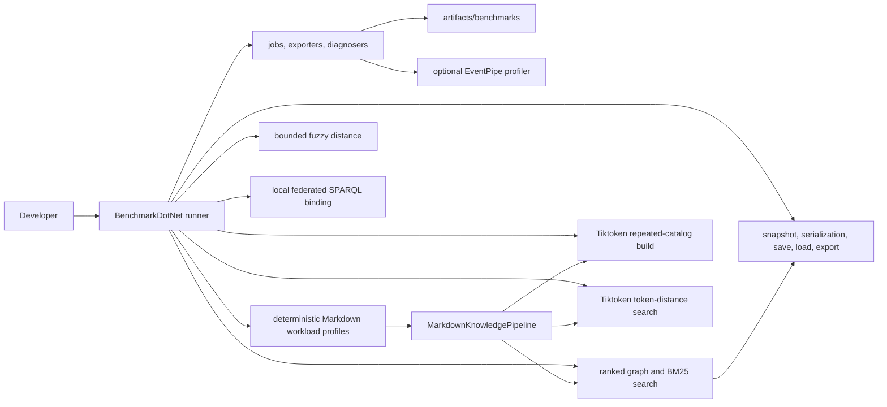

# Performance Benchmarks

Markdown-LD Knowledge Bank keeps correctness tests and performance measurements separate. TUnit flow tests prove behaviour; BenchmarkDotNet measures runtime, allocation, scaling, and profiler traces for the hot paths.

## Benchmark Boundaries



The benchmark project is `benchmarks/MarkdownLd.Kb.Benchmarks`. It references the production library, but production and test projects do not reference it.

## Suites

| Suite | Measures |
| --- | --- |
| `FuzzyEditDistanceBenchmarks` | Bounded bit-vector/banded edit distance against a naive Levenshtein baseline for short typo and long affix-heavy tokens. |
| `GraphBuildBenchmarks` | Markdown source to in-memory graph build time across named workload profiles. |
| `TiktokenGraphBuildBenchmarks` | Full Tiktoken extraction, related-segment selection, normalization, and RDF materialization for a repeated catalog corpus. |
| `SchemaCatalogGraphSearchBenchmarks` | Generated 120-document Tiktoken catalog, fixed-predicate evidence/metadata and expansion, unrestricted/candidate matching/no-match. |
| `SchemaGraphSearchBenchmarks` | Mandatory evidence/provenance query allocation with unrestricted or candidate VALUES, matching and no-match inputs. |
| `GraphSearchBenchmarks` | Graph-ranked search, BM25, BM25 fuzzy matching, schema search, focused search, and local federated schema search. |
| `TiktokenSearchBenchmarks` | Exact token-distance search and fuzzy query correction over long-document and multilingual token-heavy graphs. |
| `GraphPersistenceBenchmarks` | Snapshot creation, Turtle/JSON-LD serialization, Mermaid/DOT export, in-memory store save/load, and file save/load. |
| `GraphLifecycleBenchmarks` | One broad build/search/save/load/export lifecycle benchmark for the complete suite. |

## Workload Profiles

Benchmark parameters use named workload profiles instead of raw document-count ranges.

| Profile | Shape | Why it exists |
| --- | --- | --- |
| `ShortDocuments` | 250 compact runbook-like Markdown documents. | Normal knowledge-base retrieval and persistence pressure. |
| `LongDocuments` | 80 long recovery playbooks with repeated sections. | Long body and chunk-scan pressure without pretending the main variable is file count. |
| `LargeCorpus` | 1000 compact documents. | Scale pressure for graph build, snapshot, serialization, save, and load paths. |
| `TokenizedMultilingual` | 250 token-heavy multilingual/CJK documents. | Tiktoken and fuzzy query-correction behaviour on non-trivial tokenization input. |
| `RepeatedCatalog` | 48 catalog-like documents with deliberately repeated headings and authorization/revision phrases. | Detects redundant topic facts, symmetric neighbor pairs, unbounded confidence warnings, and graph-build allocation regressions. |
| `FederatedRunbooks` | 250 SPARQL/service/runbook documents. | Local federated schema-search and service-binding query plans. |

## Commands

```bash
dotnet run --project benchmarks/MarkdownLd.Kb.Benchmarks -c Release -- --list flat
dotnet run --project benchmarks/MarkdownLd.Kb.Benchmarks -c Release -- --filter "*FuzzyEditDistanceBenchmarks*"
dotnet run --project benchmarks/MarkdownLd.Kb.Benchmarks -c Release -- --filter "*GraphBuildBenchmarks*"
dotnet run --project benchmarks/MarkdownLd.Kb.Benchmarks -c Release -- --filter "*TiktokenGraphBuildBenchmarks*"
dotnet run --project benchmarks/MarkdownLd.Kb.Benchmarks -c Release -- --filter "*GraphSearchBenchmarks*"
dotnet run --project benchmarks/MarkdownLd.Kb.Benchmarks -c Release -- --filter "*TiktokenSearchBenchmarks*"
dotnet run --project benchmarks/MarkdownLd.Kb.Benchmarks -c Release -- --filter "*GraphPersistenceBenchmarks*"
dotnet run --project benchmarks/MarkdownLd.Kb.Benchmarks -c Release -- --filter "*GraphLifecycleBenchmarks*"
```

`MarkdownLdBenchmarkConfig` writes Markdown, CSV, and full JSON reports to `artifacts/benchmarks/results`. Those files are machine-specific and intentionally ignored by git. If the command does not pass a BenchmarkDotNet job option, the config adds one `Required` job: one launch, two warmup iterations, five measured iterations, and a 100 ms minimum iteration time. It still executes every benchmark case, but avoids multi-hour default auto-tuning runs.

## Measured Metrics

The benchmark configuration is intentionally diagnostic, not just a stopwatch. The default reports collect:

| Metric group | BenchmarkDotNet data | Why it matters |
| --- | --- | --- |
| Latency | `Mean`, `Error`, `StdDev`, `Ratio`, `RatioSD`; full JSON also keeps min, quartiles, max, percentiles, and raw measurements | Shows the cost and distribution of each public path under the same deterministic workload. |
| Allocation and GC | `Allocated`, `Alloc Ratio`, `Gen0`, `Gen1`, `Gen2` | Catches search paths that look acceptable once but become expensive under repeated calls. |
| Threading and contention | `Completed Work Items`, `Lock Contentions` | Highlights SPARQL and federation paths that schedule work or contend while executing query plans. |
| Benchmark shape | corpus profile, query scenario, runtime, platform, JIT, job, iteration counts | Keeps runs explainable and comparable without turning local numbers into a cross-machine contract. |
| Optional profiler traces | EventPipe CPU, GC, or JIT files | Gives the next level of evidence when a benchmark result points at a hot path. |

The build/test/pack validation job stays separate from performance measurement. The PR validation workflow, release workflow, and dedicated benchmark workflow run the complete benchmark suite: fuzzy edit distance, graph build, Tiktoken graph build, graph search, Tiktoken search, graph persistence, and graph lifecycle. They run suites as parallel matrix jobs and upload `artifacts/benchmarks/results` as suite-specific `benchmarkdotnet-results-*` artifacts so CI keeps the same performance evidence shape without serializing every suite into one long job.

Optional EventPipe profiling is opt-in:

```bash
MARKDOWN_LD_KB_BENCHMARK_PROFILE=cpu dotnet run --project benchmarks/MarkdownLd.Kb.Benchmarks -c Release -- --filter "*FuzzyEditDistanceBenchmarks*"
MARKDOWN_LD_KB_BENCHMARK_PROFILE=gc dotnet run --project benchmarks/MarkdownLd.Kb.Benchmarks -c Release -- --filter "*GraphSearchBenchmarks*"
MARKDOWN_LD_KB_BENCHMARK_PROFILE=jit dotnet run --project benchmarks/MarkdownLd.Kb.Benchmarks -c Release -- --filter "*TiktokenSearchBenchmarks*"
```

## Current Results

On October 12, 2026 the complete local `Required` suite completed 131/131 cases in 6 minutes 45 seconds (405.91s), on Apple M2 Pro, .NET 10.0.12, SDK 10.0.401, BenchmarkDotNet 0.15.8. Every exported case has valid statistics. Receipts: artifacts/query-release-full-benchmarks.log and artifacts/benchmarks/schema-release-final/results.

Background processes produced broad timing confidence intervals; observed means do not establish a reliable cross-machine latency speedup. Allocation figures support the compact/indexed compiler choice. None corpora have 684/1,794 triples, generated 120-document Tiktoken catalog 14,160 and the actual gateway export 56,168. Known-good candidate pools measure retrieval allocation, not preselector recall. The primary checkout includes preserved unrelated serialization/tokenization edits outside this release; committed-source CI independently verifies release behavior. MB/KB below use BenchmarkDotNet binary units (MiB/KiB).

| Suite | Job | Cases | Result files |
| --- | --- | ---: | --- |
| `FuzzyEditDistanceBenchmarks` | Required | 8 | Markdown, CSV, JSON |
| `GraphBuildBenchmarks` | Required | 4 | Markdown, CSV, JSON |
| `TiktokenGraphBuildBenchmarks` | Required | 1 | Markdown, CSV, JSON |
| `GraphSearchBenchmarks` | Required | 54 | Markdown, CSV, JSON |
| `SchemaCatalogGraphSearchBenchmarks` | Required | 4 | Markdown, CSV, JSON |
| `SchemaGraphSearchBenchmarks` | Required | 8 | Markdown, CSV, JSON |
| `TiktokenSearchBenchmarks` | Required | 12 | Markdown, CSV, JSON |
| `GraphPersistenceBenchmarks` | Required | 39 | Markdown, CSV, JSON |
| `GraphLifecycleBenchmarks` | Required | 1 | Markdown, CSV, JSON |

### FuzzyEditDistanceBenchmarks

```

BenchmarkDotNet v0.15.8, macOS 27.0.1 (26A434) [Darwin 27.0.0]
Apple M2 Pro, 1 CPU, 12 logical and 12 physical cores
.NET SDK 10.0.401
  [Host]   : .NET 10.0.12 (10.0.12, 10.0.1226.42308), Arm64 RyuJIT armv8.0-a
  Required : .NET 10.0.12 (10.0.12, 10.0.1226.42308), Arm64 RyuJIT armv8.0-a

Job=Required  MinIterationTime=100ms  IterationCount=5
LaunchCount=1  WarmupCount=2

```
| Method                   | Scenario          | Mean         | Error       | StdDev     | Ratio  | RatioSD | Completed Work Items | Lock Contentions | Gen0   | Allocated | Alloc Ratio |
|------------------------- |------------------ |-------------:|------------:|-----------:|-------:|--------:|---------------------:|-----------------:|-------:|----------:|------------:|
| **BoundedBitVectorOrBanded** | **ShortDeletion**     |     **6.872 ns** |   **0.3638 ns** |  **0.0945 ns** |   **1.00** |    **0.02** |                    **-** |                **-** |      **-** |         **-** |          **NA** |
| NaiveLevenshtein         | ShortDeletion     |    99.970 ns |   3.1578 ns |  0.4887 ns |  14.55 |    0.19 |                    - |                - | 0.0134 |     112 B |          NA |
|                          |                   |              |             |            |        |         |                      |                  |        |           |             |
| **BoundedBitVectorOrBanded** | **ShortSubstitution** |    **34.024 ns** |   **1.2444 ns** |  **0.1926 ns** |   **1.00** |    **0.01** |                    **-** |                **-** |      **-** |         **-** |          **NA** |
| NaiveLevenshtein         | ShortSubstitution |    89.803 ns |   5.2667 ns |  0.8150 ns |   2.64 |    0.03 |                    - |                - | 0.0134 |     112 B |          NA |
|                          |                   |              |             |            |        |         |                      |                  |        |           |             |
| **BoundedBitVectorOrBanded** | **LongInsertion**     |    **27.950 ns** |   **2.0548 ns** |  **0.3180 ns** |   **1.00** |    **0.01** |                    **-** |                **-** |      **-** |         **-** |          **NA** |
| NaiveLevenshtein         | LongInsertion     | 8,360.497 ns | 419.0020 ns | 64.8410 ns | 299.16 |    3.68 |                    - |                - | 0.0610 |     640 B |          NA |
|                          |                   |              |             |            |        |         |                      |                  |        |           |             |
| **BoundedBitVectorOrBanded** | **LongNoMatch**       |    **56.608 ns** |   **1.6331 ns** |  **0.2527 ns** |   **1.00** |    **0.01** |                    **-** |                **-** |      **-** |         **-** |          **NA** |
| NaiveLevenshtein         | LongNoMatch       | 9,622.943 ns | 288.3598 ns | 74.8861 ns | 170.00 |    1.39 |                    - |                - | 0.0610 |     672 B |          NA |

### GraphBuildBenchmarks

```

BenchmarkDotNet v0.15.8, macOS 27.0.1 (26A434) [Darwin 27.0.0]
Apple M2 Pro, 1 CPU, 12 logical and 12 physical cores
.NET SDK 10.0.401
  [Host]   : .NET 10.0.12 (10.0.12, 10.0.1226.42308), Arm64 RyuJIT armv8.0-a
  Required : .NET 10.0.12 (10.0.12, 10.0.1226.42308), Arm64 RyuJIT armv8.0-a

Job=Required  MinIterationTime=100ms  IterationCount=5
LaunchCount=1  WarmupCount=2

```
| Method     | CorpusProfile        | Mean      | Error     | StdDev    | Completed Work Items | Lock Contentions | Gen0      | Gen1      | Gen2      | Allocated |
|----------- |--------------------- |----------:|----------:|----------:|---------------------:|-----------------:|----------:|----------:|----------:|----------:|
| **BuildGraph** | **ShortDocuments**       |  **49.08 ms** |  **14.95 ms** |  **3.881 ms** |                    **-** |                **-** | **1666.6667** |  **666.6667** |         **-** |   **15.1 MB** |
| **BuildGraph** | **LongDocuments**        |  **28.41 ms** |  **16.72 ms** |  **4.341 ms** |                    **-** |                **-** | **1750.0000** |  **750.0000** |         **-** |  **14.56 MB** |
| **BuildGraph** | **LargeCorpus**          | **145.34 ms** | **122.70 ms** | **31.864 ms** |                    **-** |                **-** | **7500.0000** | **2500.0000** | **1000.0000** |  **58.04 MB** |
| **BuildGraph** | **Token(...)ngual [21]** |  **45.88 ms** |  **13.66 ms** |  **3.548 ms** |                    **-** |                **-** | **2000.0000** | **1000.0000** |  **333.3333** |     **18 MB** |

### TiktokenGraphBuildBenchmarks

```

BenchmarkDotNet v0.15.8, macOS 27.0.1 (26A434) [Darwin 27.0.0]
Apple M2 Pro, 1 CPU, 12 logical and 12 physical cores
.NET SDK 10.0.401
  [Host]   : .NET 10.0.12 (10.0.12, 10.0.1226.42308), Arm64 RyuJIT armv8.0-a
  Required : .NET 10.0.12 (10.0.12, 10.0.1226.42308), Arm64 RyuJIT armv8.0-a

Job=Required  MinIterationTime=100ms  IterationCount=5
LaunchCount=1  WarmupCount=2

```
| Method                    | Mean     | Error    | StdDev   | Completed Work Items | Lock Contentions | Gen0      | Gen1      | Gen2     | Allocated |
|-------------------------- |---------:|---------:|---------:|---------------------:|-----------------:|----------:|----------:|---------:|----------:|
| BuildRepeatedCatalogGraph | 113.1 ms | 99.61 ms | 25.87 ms |                    - |                - | 8500.0000 | 3500.0000 | 500.0000 |  67.07 MB |

### GraphSearchBenchmarks

```

BenchmarkDotNet v0.15.8, macOS 27.0.1 (26A434) [Darwin 27.0.0]
Apple M2 Pro, 1 CPU, 12 logical and 12 physical cores
.NET SDK 10.0.401
  [Host]   : .NET 10.0.12 (10.0.12, 10.0.1226.42308), Arm64 RyuJIT armv8.0-a
  Required : .NET 10.0.12 (10.0.12, 10.0.1226.42308), Arm64 RyuJIT armv8.0-a

Job=Required  MinIterationTime=100ms  IterationCount=5
LaunchCount=1  WarmupCount=2

```
| Method                     | CorpusProfile     | QueryScenario | Mean      | Error      | StdDev     | Median    | Ratio | RatioSD | Completed Work Items | Lock Contentions | Gen0      | Gen1     | Gen2    | Allocated | Alloc Ratio |
|--------------------------- |------------------ |-------------- |----------:|-----------:|-----------:|----------:|------:|--------:|---------------------:|-----------------:|----------:|---------:|--------:|----------:|------------:|
| **LocalFederatedSchemaSearch** | **ShortDocuments**    | **Exact**         | **18.265 ms** | **28.9481 ms** |  **7.5177 ms** | **13.590 ms** |  **5.60** |    **2.57** |               **2.0000** |                **-** | **1000.0000** | **400.0000** |       **-** |    **8.2 MB** |        **2.98** |
| RankedGraphSearch          | ShortDocuments    | Exact         |  3.485 ms |  4.1160 ms |  1.0689 ms |  2.960 ms |  1.07 |    0.41 |                    - |                - |  343.7500 | 125.0000 |       - |   2.75 MB |        1.00 |
| Bm25Search                 | ShortDocuments    | Exact         |  6.401 ms | 11.3976 ms |  2.9599 ms |  5.764 ms |  1.96 |    0.98 |                    - |                - |  312.5000 | 125.0000 |       - |   2.76 MB |        1.00 |
| Bm25FuzzySearch            | ShortDocuments    | Exact         |  6.831 ms |  9.1725 ms |  2.3821 ms |  7.773 ms |  2.10 |    0.86 |                    - |                - |  375.0000 | 187.5000 |       - |   3.47 MB |        1.26 |
| SchemaSearch               | ShortDocuments    | Exact         | 21.635 ms |  0.8486 ms |  0.1313 ms | 21.665 ms |  6.64 |    1.65 |              23.0000 |          22.8333 |  500.0000 | 166.6667 |       - |   4.45 MB |        1.62 |
| FocusedSearch              | ShortDocuments    | Exact         |  7.200 ms |  7.4719 ms |  1.1563 ms |  7.328 ms |  2.21 |    0.64 |                    - |                - |  500.0000 | 250.0000 |       - |   4.21 MB |        1.53 |
|                            |                   |               |           |            |            |           |       |         |                      |                  |           |          |         |           |             |
| **LocalFederatedSchemaSearch** | **ShortDocuments**    | **Typo**          | **28.593 ms** | **18.5567 ms** |  **4.8191 ms** | **30.725 ms** |  **6.54** |    **1.19** |               **2.0000** |                **-** | **1000.0000** | **400.0000** |       **-** |   **8.22 MB** |        **2.99** |
| RankedGraphSearch          | ShortDocuments    | Typo          |  4.404 ms |  2.8062 ms |  0.4343 ms |  4.507 ms |  1.01 |    0.13 |                    - |                - |  343.7500 | 125.0000 |       - |   2.75 MB |        1.00 |
| Bm25Search                 | ShortDocuments    | Typo          |  3.781 ms |  5.5399 ms |  1.4387 ms |  3.068 ms |  0.87 |    0.31 |                    - |                - |  312.5000 | 125.0000 |       - |   2.73 MB |        0.99 |
| Bm25FuzzySearch            | ShortDocuments    | Typo          |  9.087 ms | 16.7800 ms |  4.3577 ms | 11.858 ms |  2.08 |    0.94 |                    - |                - |  375.0000 | 187.5000 |       - |   3.47 MB |        1.26 |
| SchemaSearch               | ShortDocuments    | Typo          | 16.439 ms |  3.6071 ms |  0.9367 ms | 16.431 ms |  3.76 |    0.40 |              23.0000 |          83.6667 |  500.0000 | 166.6667 |       - |   4.45 MB |        1.62 |
| FocusedSearch              | ShortDocuments    | Typo          |  7.443 ms | 10.3506 ms |  2.6880 ms |  7.965 ms |  1.70 |    0.59 |                    - |                - |  500.0000 | 187.5000 |       - |   4.24 MB |        1.54 |
|                            |                   |               |           |            |            |           |       |         |                      |                  |           |          |         |           |             |
| **LocalFederatedSchemaSearch** | **ShortDocuments**    | **NoMatch**       | **26.187 ms** | **12.9762 ms** |  **2.0081 ms** | **26.842 ms** |  **6.15** |    **1.02** |               **2.0000** |                **-** | **1000.0000** | **400.0000** |       **-** |   **8.14 MB** |        **2.96** |
| RankedGraphSearch          | ShortDocuments    | NoMatch       |  4.353 ms |  2.7876 ms |  0.7239 ms |  4.294 ms |  1.02 |    0.22 |                    - |                - |  343.7500 | 125.0000 |       - |   2.75 MB |        1.00 |
| Bm25Search                 | ShortDocuments    | NoMatch       |  4.027 ms |  3.9465 ms |  1.0249 ms |  3.643 ms |  0.95 |    0.26 |                    - |                - |  312.5000 | 125.0000 |       - |   2.73 MB |        0.99 |
| Bm25FuzzySearch            | ShortDocuments    | NoMatch       |  5.323 ms |  6.7307 ms |  1.7480 ms |  4.136 ms |  1.25 |    0.42 |                    - |                - |  375.0000 | 187.5000 |       - |   3.44 MB |        1.25 |
| SchemaSearch               | ShortDocuments    | NoMatch       | 14.882 ms |  4.8369 ms |  1.2561 ms | 15.430 ms |  3.49 |    0.59 |              23.0000 |          48.6667 |  500.0000 | 166.6667 |       - |   4.45 MB |        1.62 |
| FocusedSearch              | ShortDocuments    | NoMatch       |  5.933 ms |  3.0543 ms |  0.4726 ms |  5.829 ms |  1.39 |    0.23 |                    - |                - |  500.0000 | 187.5000 |       - |   4.24 MB |        1.54 |
|                            |                   |               |           |            |            |           |       |         |                      |                  |           |          |         |           |             |
| **LocalFederatedSchemaSearch** | **LongDocuments**     | **Exact**         | **17.660 ms** |  **8.1400 ms** |  **2.1139 ms** | **17.119 ms** |  **8.82** |    **3.21** |               **2.0000** |                **-** |  **833.3333** | **166.6667** |       **-** |   **7.18 MB** |        **3.49** |
| RankedGraphSearch          | LongDocuments     | Exact         |  2.183 ms |  2.3764 ms |  0.6171 ms |  2.182 ms |  1.09 |    0.48 |                    - |                - |  250.0000 |  78.1250 |       - |   2.06 MB |        1.00 |
| Bm25Search                 | LongDocuments     | Exact         |  3.194 ms |  2.0146 ms |  0.3118 ms |  3.120 ms |  1.60 |    0.57 |                    - |                - |  250.0000 |  62.5000 |       - |   2.06 MB |        1.00 |
| Bm25FuzzySearch            | LongDocuments     | Exact         |  4.108 ms |  4.0569 ms |  1.0536 ms |  3.557 ms |  2.05 |    0.87 |                    - |                - |  437.5000 | 156.2500 |       - |   3.61 MB |        1.75 |
| SchemaSearch               | LongDocuments     | Exact         |  8.175 ms |  0.8488 ms |  0.1313 ms |  8.201 ms |  4.08 |    1.42 |              23.0000 |          24.3636 |  272.7273 |        - |       - |   2.51 MB |        1.22 |
| FocusedSearch              | LongDocuments     | Exact         |  1.683 ms |  2.0433 ms |  0.5306 ms |  1.366 ms |  0.84 |    0.39 |                    - |                - |  203.1250 |  62.5000 |       - |   1.65 MB |        0.80 |
|                            |                   |               |           |            |            |           |       |         |                      |                  |           |          |         |           |             |
| **LocalFederatedSchemaSearch** | **LongDocuments**     | **Typo**          | **17.125 ms** | **10.0326 ms** |  **2.6054 ms** | **17.760 ms** |  **7.07** |    **1.41** |               **2.0000** |                **-** |  **833.3333** | **166.6667** |       **-** |   **7.15 MB** |        **3.39** |
| RankedGraphSearch          | LongDocuments     | Typo          |  2.469 ms |  1.4633 ms |  0.3800 ms |  2.358 ms |  1.02 |    0.20 |                    - |                - |  250.0000 |  78.1250 |       - |   2.11 MB |        1.00 |
| Bm25Search                 | LongDocuments     | Typo          |  3.217 ms |  1.6528 ms |  0.4292 ms |  3.311 ms |  1.33 |    0.25 |                    - |                - |  250.0000 |  93.7500 |       - |   2.05 MB |        0.97 |
| Bm25FuzzySearch            | LongDocuments     | Typo          |  6.770 ms |  5.4528 ms |  1.4161 ms |  7.072 ms |  2.79 |    0.67 |                    - |                - |  437.5000 | 125.0000 |       - |   3.61 MB |        1.71 |
| SchemaSearch               | LongDocuments     | Typo          |  7.961 ms |  5.3071 ms |  1.3782 ms |  7.932 ms |  3.29 |    0.70 |              23.0000 |          22.8182 |  272.7273 |        - |       - |   2.51 MB |        1.19 |
| FocusedSearch              | LongDocuments     | Typo          |  1.646 ms |  0.2665 ms |  0.0692 ms |  1.678 ms |  0.68 |    0.10 |                    - |                - |  203.1250 |  62.5000 |       - |   1.66 MB |        0.79 |
|                            |                   |               |           |            |            |           |       |         |                      |                  |           |          |         |           |             |
| **LocalFederatedSchemaSearch** | **LongDocuments**     | **NoMatch**       | **14.832 ms** | **25.2662 ms** |  **6.5615 ms** | **11.582 ms** |  **6.57** |    **3.02** |               **2.0000** |                **-** |  **833.3333** | **166.6667** |       **-** |   **7.12 MB** |        **3.46** |
| RankedGraphSearch          | LongDocuments     | NoMatch       |  2.359 ms |  2.2218 ms |  0.5770 ms |  2.094 ms |  1.05 |    0.32 |                    - |                - |  250.0000 |  78.1250 |       - |   2.06 MB |        1.00 |
| Bm25Search                 | LongDocuments     | NoMatch       |  7.279 ms |  2.6737 ms |  0.4138 ms |  7.344 ms |  3.22 |    0.68 |                    - |                - |  250.0000 | 125.0000 |       - |   2.05 MB |        1.00 |
| Bm25FuzzySearch            | LongDocuments     | NoMatch       |  5.595 ms |  4.3575 ms |  1.1316 ms |  5.583 ms |  2.48 |    0.69 |                    - |                - |  437.5000 | 125.0000 |       - |    3.6 MB |        1.75 |
| SchemaSearch               | LongDocuments     | NoMatch       | 13.224 ms |  6.2348 ms |  1.6192 ms | 13.378 ms |  5.86 |    1.37 |              23.0000 |           1.5556 |  222.2222 |        - |       - |   2.51 MB |        1.22 |
| FocusedSearch              | LongDocuments     | NoMatch       |  7.339 ms |  5.9343 ms |  1.5411 ms |  7.493 ms |  3.25 |    0.92 |                    - |                - |  187.5000 |  62.5000 |       - |   1.66 MB |        0.81 |
|                            |                   |               |           |            |            |           |       |         |                      |                  |           |          |         |           |             |
| **LocalFederatedSchemaSearch** | **FederatedRunbooks** | **Exact**         | **22.563 ms** | **12.2811 ms** |  **3.1894 ms** | **22.055 ms** |  **7.60** |    **1.40** |               **2.0000** |                **-** | **1000.0000** | **400.0000** |       **-** |   **8.18 MB** |        **2.66** |
| RankedGraphSearch          | FederatedRunbooks | Exact         |  3.023 ms |  1.7559 ms |  0.4560 ms |  2.849 ms |  1.02 |    0.19 |                    - |                - |  375.0000 | 125.0000 | 31.2500 |   3.08 MB |        1.00 |
| Bm25Search                 | FederatedRunbooks | Exact         |  6.680 ms |  6.9454 ms |  1.8037 ms |  5.658 ms |  2.25 |    0.63 |                    - |                - |  312.5000 | 125.0000 |       - |   3.08 MB |        1.00 |
| Bm25FuzzySearch            | FederatedRunbooks | Exact         | 12.762 ms | 45.0720 ms | 11.7050 ms |  6.904 ms |  4.30 |    3.67 |                    - |                - |  437.5000 | 125.0000 |       - |   4.08 MB |        1.33 |
| SchemaSearch               | FederatedRunbooks | Exact         | 14.671 ms |  5.1388 ms |  0.7952 ms | 14.730 ms |  4.94 |    0.69 |              23.0000 |          50.4000 |  400.0000 | 200.0000 |       - |   4.53 MB |        1.47 |
| FocusedSearch              | FederatedRunbooks | Exact         |  8.089 ms |  7.8014 ms |  2.0260 ms |  9.454 ms |  2.72 |    0.72 |                    - |                - |  625.0000 | 250.0000 | 62.5000 |   4.76 MB |        1.55 |
|                            |                   |               |           |            |            |           |       |         |                      |                  |           |          |         |           |             |
| **LocalFederatedSchemaSearch** | **FederatedRunbooks** | **Typo**          | **25.120 ms** |  **2.3747 ms** |  **0.6167 ms** | **24.997 ms** |  **6.76** |    **1.47** |               **2.0000** |                **-** | **1000.0000** | **400.0000** |       **-** |   **8.28 MB** |        **2.69** |
| RankedGraphSearch          | FederatedRunbooks | Typo          |  3.880 ms |  3.4187 ms |  0.8878 ms |  3.845 ms |  1.04 |    0.32 |                    - |                - |  375.0000 | 125.0000 | 31.2500 |   3.08 MB |        1.00 |
| Bm25Search                 | FederatedRunbooks | Typo          |  5.876 ms |  7.8375 ms |  2.0354 ms |  5.069 ms |  1.58 |    0.61 |                    - |                - |  312.5000 |  62.5000 |       - |   3.06 MB |        0.99 |
| Bm25FuzzySearch            | FederatedRunbooks | Typo          |  4.363 ms |  0.4545 ms |  0.0703 ms |  4.383 ms |  1.17 |    0.26 |                    - |                - |  437.5000 | 125.0000 |       - |   4.08 MB |        1.33 |
| SchemaSearch               | FederatedRunbooks | Typo          | 13.297 ms |  9.4724 ms |  2.4600 ms | 12.145 ms |  3.58 |    0.99 |              23.0000 |          62.3333 |  500.0000 | 166.6667 |       - |   4.53 MB |        1.47 |
| FocusedSearch              | FederatedRunbooks | Typo          |  9.125 ms | 18.3253 ms |  2.8359 ms |  8.416 ms |  2.46 |    0.87 |                    - |                - |  625.0000 | 250.0000 | 62.5000 |   4.76 MB |        1.55 |
|                            |                   |               |           |            |            |           |       |         |                      |                  |           |          |         |           |             |
| **LocalFederatedSchemaSearch** | **FederatedRunbooks** | **NoMatch**       | **19.483 ms** | **39.9922 ms** | **10.3859 ms** | **12.438 ms** |  **4.71** |    **2.35** |               **2.0000** |                **-** | **1000.0000** | **400.0000** |       **-** |   **8.23 MB** |        **2.67** |
| RankedGraphSearch          | FederatedRunbooks | NoMatch       |  4.183 ms |  1.7906 ms |  0.4650 ms |  4.160 ms |  1.01 |    0.15 |                    - |                - |  375.0000 | 125.0000 | 31.2500 |   3.08 MB |        1.00 |
| Bm25Search                 | FederatedRunbooks | NoMatch       |  6.198 ms | 12.5144 ms |  3.2499 ms |  5.030 ms |  1.50 |    0.74 |                    - |                - |  312.5000 |  62.5000 |       - |   3.06 MB |        0.99 |
| Bm25FuzzySearch            | FederatedRunbooks | NoMatch       | 10.245 ms | 34.5877 ms |  8.9823 ms |  4.600 ms |  2.47 |    2.01 |                    - |                - |  437.5000 | 125.0000 |       - |   4.06 MB |        1.32 |
| SchemaSearch               | FederatedRunbooks | NoMatch       | 19.694 ms |  5.9552 ms |  1.5465 ms | 19.506 ms |  4.76 |    0.61 |              23.0000 |          62.2000 |  400.0000 | 200.0000 |       - |   4.53 MB |        1.47 |
| FocusedSearch              | FederatedRunbooks | NoMatch       | 10.102 ms | 19.9390 ms |  5.1781 ms |  7.120 ms |  2.44 |    1.18 |                    - |                - |  625.0000 | 250.0000 | 62.5000 |   4.76 MB |        1.55 |

### SchemaCatalogGraphSearchBenchmarks

```

BenchmarkDotNet v0.15.8, macOS 27.0.1 (26A434) [Darwin 27.0.0]
Apple M2 Pro, 1 CPU, 12 logical and 12 physical cores
.NET SDK 10.0.401
  [Host]   : .NET 10.0.12 (10.0.12, 10.0.1226.42308), Arm64 RyuJIT armv8.0-a
  Required : .NET 10.0.12 (10.0.12, 10.0.1226.42308), Arm64 RyuJIT armv8.0-a

Job=Required  MinIterationTime=100ms  IterationCount=5
LaunchCount=1  WarmupCount=2

```
| Method          | QueryScenario | Mean      | Error      | StdDev     | Median    | Ratio | RatioSD | Completed Work Items | Lock Contentions | Gen0      | Gen1      | Allocated | Alloc Ratio |
|---------------- |-------------- |----------:|-----------:|-----------:|----------:|------:|--------:|---------------------:|-----------------:|----------:|----------:|----------:|------------:|
| **Unrestricted**    | **Exact**         | **69.734 ms** | **110.989 ms** | **28.8234 ms** | **51.895 ms** |  **1.12** |    **0.55** |             **310.0000** |           **0.5000** | **2000.0000** |  **500.0000** |  **16.88 MB** |        **1.00** |
| CandidateValues | Exact         | 10.577 ms |   1.848 ms |  0.4800 ms | 10.674 ms |  0.17 |    0.05 |             365.0000 |           0.3750 | 1125.0000 |  312.5000 |   9.41 MB |        0.56 |
|                 |               |           |            |            |           |       |         |                      |                  |           |           |           |             |
| **Unrestricted**    | **NoMatch**       | **46.694 ms** |   **9.280 ms** |  **2.4099 ms** | **46.705 ms** |  **1.00** |    **0.07** |               **1.0000** |                **-** | **2500.0000** | **1000.0000** |   **22.1 MB** |        **1.00** |
| CandidateValues | NoMatch       |  9.838 ms |  14.234 ms |  3.6966 ms |  9.158 ms |  0.21 |    0.07 |             188.0000 |           0.4375 |  500.0000 |  125.0000 |      4 MB |        0.18 |

### SchemaGraphSearchBenchmarks

```

BenchmarkDotNet v0.15.8, macOS 27.0.1 (26A434) [Darwin 27.0.0]
Apple M2 Pro, 1 CPU, 12 logical and 12 physical cores
.NET SDK 10.0.401
  [Host]   : .NET 10.0.12 (10.0.12, 10.0.1226.42308), Arm64 RyuJIT armv8.0-a
  Required : .NET 10.0.12 (10.0.12, 10.0.1226.42308), Arm64 RyuJIT armv8.0-a

Job=Required  MinIterationTime=100ms  IterationCount=5
LaunchCount=1  WarmupCount=2

```
| Method          | CorpusProfile  | QueryScenario | Mean      | Error     | StdDev    | Ratio | RatioSD | Completed Work Items | Lock Contentions | Gen0      | Gen1     | Allocated | Alloc Ratio |
|---------------- |--------------- |-------------- |----------:|----------:|----------:|------:|--------:|---------------------:|-----------------:|----------:|---------:|----------:|------------:|
| **Unrestricted**    | **ShortDocuments** | **Exact**         | **36.204 ms** | **14.679 ms** | **3.8122 ms** |  **1.01** |    **0.13** |              **79.0000** |          **74.6667** | **1666.6667** | **333.3333** |  **15.36 MB** |        **1.00** |
| CandidateValues | ShortDocuments | Exact         |  9.504 ms |  8.362 ms | 2.1717 ms |  0.26 |    0.06 |              90.0000 |           5.3750 |  625.0000 | 312.5000 |   5.32 MB |        0.35 |
|                 |                |               |           |           |           |       |         |                      |                  |           |          |           |             |
| **Unrestricted**    | **ShortDocuments** | **NoMatch**       | **10.381 ms** |  **5.599 ms** | **0.8665 ms** |  **1.01** |    **0.10** |              **23.0000** |          **28.1250** |  **687.5000** | **250.0000** |   **5.85 MB** |        **1.00** |
| CandidateValues | ShortDocuments | NoMatch       |  8.609 ms |  9.925 ms | 2.5775 ms |  0.83 |    0.24 |              34.0000 |          15.8750 |  375.0000 | 125.0000 |   3.26 MB |        0.56 |
|                 |                |               |           |           |           |       |         |                      |                  |           |          |           |             |
| **Unrestricted**    | **LongDocuments**  | **Exact**         |  **9.289 ms** |  **5.117 ms** | **1.3289 ms** |  **1.02** |    **0.19** |              **79.0000** |           **5.8750** |  **812.5000** | **250.0000** |   **6.72 MB** |        **1.00** |
| CandidateValues | LongDocuments  | Exact         |  9.947 ms | 12.875 ms | 3.3437 ms |  1.09 |    0.37 |              90.0000 |          11.7500 |  500.0000 | 125.0000 |   4.21 MB |        0.63 |
|                 |                |               |           |           |           |       |         |                      |                  |           |          |           |             |
| **Unrestricted**    | **LongDocuments**  | **NoMatch**       |  **7.385 ms** |  **3.185 ms** | **0.4928 ms** |  **1.00** |    **0.09** |              **23.0000** |          **17.6875** |  **375.0000** | **125.0000** |   **3.09 MB** |        **1.00** |
| CandidateValues | LongDocuments  | NoMatch       |  7.462 ms |  6.734 ms | 1.7488 ms |  1.01 |    0.23 |              34.0000 |           9.3125 |  312.5000 |  62.5000 |   2.58 MB |        0.83 |

### TiktokenSearchBenchmarks

```

BenchmarkDotNet v0.15.8, macOS 27.0.1 (26A434) [Darwin 27.0.0]
Apple M2 Pro, 1 CPU, 12 logical and 12 physical cores
.NET SDK 10.0.401
  [Host]   : .NET 10.0.12 (10.0.12, 10.0.1226.42308), Arm64 RyuJIT armv8.0-a
  Required : .NET 10.0.12 (10.0.12, 10.0.1226.42308), Arm64 RyuJIT armv8.0-a

Job=Required  MinIterationTime=100ms  IterationCount=5
LaunchCount=1  WarmupCount=2

```
| Method                            | CorpusProfile        | QueryScenario | Mean      | Error     | StdDev    | Ratio | RatioSD | Completed Work Items | Lock Contentions | Gen0    | Allocated | Alloc Ratio |
|---------------------------------- |--------------------- |-------------- |----------:|----------:|----------:|------:|--------:|---------------------:|-----------------:|--------:|----------:|------------:|
| **ExactTokenDistanceSearch**          | **LongDocuments**        | **Exact**         | **134.20 μs** |  **1.221 μs** |  **0.189 μs** |  **1.00** |    **0.00** |                    **-** |                **-** | **12.6953** | **107.23 KB** |        **1.00** |
| FuzzyCorrectedTokenDistanceSearch | LongDocuments        | Exact         | 135.54 μs |  2.544 μs |  0.661 μs |  1.01 |    0.00 |                    - |                - | 12.6953 | 108.34 KB |        1.01 |
|                                   |                      |               |           |           |           |       |         |                      |                  |         |           |             |
| **ExactTokenDistanceSearch**          | **LongDocuments**        | **Typo**          | **170.87 μs** |  **7.465 μs** |  **1.155 μs** |  **1.00** |    **0.01** |                    **-** |                **-** | **12.6953** | **107.87 KB** |        **1.00** |
| FuzzyCorrectedTokenDistanceSearch | LongDocuments        | Typo          | 211.76 μs |  4.433 μs |  0.686 μs |  1.24 |    0.01 |                    - |                - | 11.7188 | 110.17 KB |        1.02 |
|                                   |                      |               |           |           |           |       |         |                      |                  |         |           |             |
| **ExactTokenDistanceSearch**          | **LongDocuments**        | **NoMatch**       | **109.51 μs** |  **7.784 μs** |  **2.022 μs** |  **1.00** |    **0.02** |                    **-** |                **-** | **12.6953** | **107.18 KB** |        **1.00** |
| FuzzyCorrectedTokenDistanceSearch | LongDocuments        | NoMatch       | 114.73 μs | 23.957 μs |  3.707 μs |  1.05 |    0.03 |                    - |                - |  7.8125 | 108.01 KB |        1.01 |
|                                   |                      |               |           |           |           |       |         |                      |                  |         |           |             |
| **ExactTokenDistanceSearch**          | **Token(...)ngual [21]** | **Exact**         | **103.21 μs** | **18.236 μs** |  **2.822 μs** |  **1.00** |    **0.03** |                    **-** |                **-** |  **7.8125** |  **70.81 KB** |        **1.00** |
| FuzzyCorrectedTokenDistanceSearch | Token(...)ngual [21] | Exact         | 104.07 μs |  2.849 μs |  0.740 μs |  1.01 |    0.02 |                    - |                - |  8.7891 |  71.95 KB |        1.02 |
|                                   |                      |               |           |           |           |       |         |                      |                  |         |           |             |
| **ExactTokenDistanceSearch**          | **Token(...)ngual [21]** | **Typo**          | **125.97 μs** |  **4.128 μs** |  **0.639 μs** |  **1.00** |    **0.01** |                    **-** |                **-** |  **7.8125** |  **71.23 KB** |        **1.00** |
| FuzzyCorrectedTokenDistanceSearch | Token(...)ngual [21] | Typo          | 208.47 μs | 25.884 μs |  4.006 μs |  1.66 |    0.03 |                    - |                - |       - |  72.94 KB |        1.02 |
|                                   |                      |               |           |           |           |       |         |                      |                  |         |           |             |
| **ExactTokenDistanceSearch**          | **Token(...)ngual [21]** | **NoMatch**       |  **99.18 μs** |  **1.840 μs** |  **0.285 μs** |  **1.00** |    **0.00** |                    **-** |                **-** |  **7.8125** |  **70.54 KB** |        **1.00** |
| FuzzyCorrectedTokenDistanceSearch | Token(...)ngual [21] | NoMatch       | 121.96 μs | 43.209 μs | 11.221 μs |  1.23 |    0.10 |                    - |                - |  7.8125 |  71.37 KB |        1.01 |

### GraphPersistenceBenchmarks

```

BenchmarkDotNet v0.15.8, macOS 27.0.1 (26A434) [Darwin 27.0.0]
Apple M2 Pro, 1 CPU, 12 logical and 12 physical cores
.NET SDK 10.0.401
  [Host]   : .NET 10.0.12 (10.0.12, 10.0.1226.42308), Arm64 RyuJIT armv8.0-a
  Required : .NET 10.0.12 (10.0.12, 10.0.1226.42308), Arm64 RyuJIT armv8.0-a

Job=Required  MinIterationTime=100ms  IterationCount=5
LaunchCount=1  WarmupCount=2

```
| Method                      | CorpusProfile  | Mean         | Error         | StdDev       | Median       | Ratio | RatioSD | Completed Work Items | Lock Contentions | Gen0       | Gen1      | Gen2      | Allocated   | Alloc Ratio |
|---------------------------- |--------------- |-------------:|--------------:|-------------:|-------------:|------:|--------:|---------------------:|-----------------:|-----------:|----------:|----------:|------------:|------------:|
| **ExportMermaidFlowchart**      | **ShortDocuments** |   **3,096.2 μs** |   **4,581.39 μs** |    **708.98 μs** |   **2,754.9 μs** |  **0.68** |    **0.22** |                    **-** |                **-** |   **250.0000** |   **93.7500** |         **-** |  **2420.84 KB** |        **1.21** |
| ExportDotGraph              | ShortDocuments |   4,604.4 μs |   7,396.21 μs |  1,920.77 μs |   4,355.6 μs |  1.02 |    0.46 |                    - |                - |   281.2500 |  125.0000 |         - |   2615.7 KB |        1.30 |
| LoadTurtleFromInMemoryStore | ShortDocuments |  37,009.7 μs |  25,054.05 μs |  6,506.46 μs |  38,563.1 μs |  8.16 |    2.35 |                    - |                - |   750.0000 |  250.0000 |         - |  6561.75 KB |        3.27 |
| LoadJsonLdFromInMemoryStore | ShortDocuments |  53,671.7 μs |  80,339.74 μs | 20,863.98 μs |  50,924.1 μs | 11.84 |    5.14 |                    - |                - |  2333.3333 |  666.6667 |         - | 20266.84 KB |       10.10 |
| LoadTurtleFromFile          | ShortDocuments |  33,677.2 μs |   9,193.22 μs |  2,387.45 μs |  33,321.9 μs |  7.43 |    1.82 |              50.0000 |                - |   750.0000 |  250.0000 |         - |  7332.88 KB |        3.65 |
| LoadJsonLdFromFile          | ShortDocuments |  55,695.6 μs |  21,084.80 μs |  5,475.66 μs |  56,601.0 μs | 12.29 |    3.11 |              44.0000 |                - |  2500.0000 | 1000.0000 |         - | 20944.55 KB |       10.43 |
| SaveTurtleToInMemoryStore   | ShortDocuments |   7,140.8 μs |   8,455.58 μs |  2,195.89 μs |   6,889.5 μs |  1.58 |    0.59 |                    - |                - |   875.0000 |  375.0000 |         - |  7839.94 KB |        3.91 |
| SaveJsonLdToInMemoryStore   | ShortDocuments |   7,619.1 μs |     808.84 μs |    210.05 μs |   7,555.0 μs |  1.68 |    0.40 |                    - |                - |  1437.5000 |  625.0000 |   62.5000 | 11891.92 KB |        5.92 |
| SaveTurtleToFile            | ShortDocuments |   6,236.9 μs |   5,075.65 μs |    785.46 μs |   5,920.4 μs |  1.38 |    0.36 |               2.0000 |                - |  1000.0000 |  500.0000 |  125.0000 | 12130.75 KB |        6.04 |
| SaveJsonLdToFile            | ShortDocuments |   8,297.4 μs |     689.22 μs |    106.66 μs |   8,281.9 μs |  1.83 |    0.43 |               2.0000 |                - |  1437.5000 |  625.0000 |   62.5000 | 16160.15 KB |        8.05 |
| CreateSnapshot              | ShortDocuments |   4,814.5 μs |   5,295.22 μs |  1,375.15 μs |   4,306.4 μs |  1.06 |    0.38 |                    - |                - |   187.5000 |   62.5000 |         - |  2007.21 KB |        1.00 |
| SerializeTurtle             | ShortDocuments |   6,206.5 μs |   3,449.75 μs |    533.85 μs |   6,360.1 μs |  1.37 |    0.34 |                    - |                - |   500.0000 |  187.5000 |         - |  4788.95 KB |        2.39 |
| SerializeJsonLd             | ShortDocuments |   6,298.0 μs |  16,495.27 μs |  4,283.77 μs |   3,513.3 μs |  1.39 |    0.94 |                    - |                - |   500.0000 |  250.0000 |         - |  5350.39 KB |        2.67 |
|                             |                |              |               |              |              |       |         |                      |                  |            |           |           |             |             |
| **ExportMermaidFlowchart**      | **LongDocuments**  |   **1,786.7 μs** |   **1,668.48 μs** |    **433.30 μs** |   **1,542.9 μs** |  **2.31** |    **0.68** |                    **-** |                **-** |   **109.3750** |   **15.6250** |         **-** |   **945.32 KB** |        **1.24** |
| ExportDotGraph              | LongDocuments  |   2,123.8 μs |   3,443.27 μs |    894.21 μs |   2,453.8 μs |  2.74 |    1.19 |                    - |                - |    93.7500 |   15.6250 |         - |   981.22 KB |        1.29 |
| LoadTurtleFromInMemoryStore | LongDocuments  |  10,500.6 μs |  13,457.14 μs |  2,082.51 μs |  11,226.4 μs | 13.55 |    3.53 |                    - |                - |   250.0000 |   62.5000 |         - |  2408.92 KB |        3.16 |
| LoadJsonLdFromInMemoryStore | LongDocuments  |   9,813.9 μs |   5,882.35 μs |  1,527.63 μs |   9,712.3 μs | 12.67 |    3.00 |                    - |                - |  1062.5000 |  500.0000 |  125.0000 |  7669.83 KB |       10.07 |
| LoadTurtleFromFile          | LongDocuments  |  11,260.6 μs |   5,135.44 μs |  1,333.66 μs |  11,199.7 μs | 14.53 |    3.15 |              20.0000 |                - |   312.5000 |  125.0000 |         - |  2698.96 KB |        3.54 |
| LoadJsonLdFromFile          | LongDocuments  |  20,306.0 μs |   5,149.97 μs |  1,337.43 μs |  20,794.4 μs | 26.21 |    5.15 |              17.0000 |                - |   857.1429 |  285.7143 |         - |  7922.55 KB |       10.40 |
| SaveTurtleToInMemoryStore   | LongDocuments  |   4,108.5 μs |   7,672.57 μs |  1,992.54 μs |   4,580.3 μs |  5.30 |    2.60 |                    - |                - |   312.5000 |  156.2500 |         - |  2858.95 KB |        3.75 |
| SaveJsonLdToInMemoryStore   | LongDocuments  |   7,085.2 μs |  15,604.93 μs |  2,414.88 μs |   8,029.8 μs |  9.14 |    3.31 |                    - |                - |   500.0000 |  250.0000 |         - |  4414.96 KB |        5.80 |
| SaveTurtleToFile            | LongDocuments  |   7,119.7 μs |  14,030.36 μs |  3,643.64 μs |   7,183.1 μs |  9.19 |    4.71 |               2.0000 |                - |   437.5000 |  281.2500 |  125.0000 |  7029.14 KB |        9.23 |
| SaveJsonLdToFile            | LongDocuments  |   9,319.9 μs |  10,479.80 μs |  2,721.57 μs |   9,358.0 μs | 12.03 |    3.97 |               2.0000 |                - |   625.0000 |  375.0000 |  125.0000 |  8606.63 KB |       11.30 |
| CreateSnapshot              | LongDocuments  |     796.6 μs |     894.26 μs |    138.39 μs |     862.1 μs |  1.03 |    0.25 |                    - |                - |    85.9375 |   15.6250 |         - |   761.76 KB |        1.00 |
| SerializeTurtle             | LongDocuments  |   1,568.7 μs |   3,459.76 μs |    535.40 μs |   1,504.1 μs |  2.02 |    0.73 |                    - |                - |   187.5000 |   46.8750 |         - |  1679.61 KB |        2.20 |
| SerializeJsonLd             | LongDocuments  |     838.5 μs |      60.42 μs |     15.69 μs |     832.5 μs |  1.08 |    0.20 |                    - |                - |   187.5000 |   62.5000 |         - |  1978.36 KB |        2.60 |
|                             |                |              |               |              |              |       |         |                      |                  |            |           |           |             |             |
| **ExportMermaidFlowchart**      | **LargeCorpus**    |  **13,833.4 μs** |  **16,134.94 μs** |  **4,190.19 μs** |  **13,155.2 μs** |  **1.60** |    **0.49** |                    **-** |                **-** |  **1000.0000** |  **312.5000** |         **-** |  **9980.44 KB** |        **1.25** |
| ExportDotGraph              | LargeCorpus    |   9,399.3 μs |   1,006.98 μs |    261.51 μs |   9,395.6 μs |  1.09 |    0.14 |                    - |                - |  1062.5000 |  312.5000 |         - | 10395.25 KB |        1.30 |
| LoadTurtleFromInMemoryStore | LargeCorpus    |  65,086.6 μs | 151,407.48 μs | 39,320.04 μs |  44,093.8 μs |  7.55 |    4.31 |                    - |                - |  3000.0000 | 1000.0000 |         - | 25889.96 KB |        3.25 |
| LoadJsonLdFromInMemoryStore | LargeCorpus    | 124,960.9 μs |  10,996.46 μs |  1,701.71 μs | 124,664.0 μs | 14.50 |    1.89 |                    - |                - | 10500.0000 | 4500.0000 | 1000.0000 | 79750.73 KB |       10.01 |
| LoadTurtleFromFile          | LargeCorpus    |  94,773.9 μs | 159,287.90 μs | 41,366.56 μs | 111,860.8 μs | 11.00 |    4.64 |             181.0000 |                - |  3000.0000 | 1000.0000 |         - | 28800.07 KB |        3.61 |
| LoadJsonLdFromFile          | LargeCorpus    | 145,087.1 μs |  53,297.94 μs | 13,841.31 μs | 141,022.9 μs | 16.83 |    2.63 |             161.0000 |                - | 10500.0000 | 4000.0000 | 1000.0000 | 82320.99 KB |       10.33 |
| SaveTurtleToInMemoryStore   | LargeCorpus    |  54,334.7 μs |  73,060.87 μs | 18,973.68 μs |  44,913.5 μs |  6.30 |    2.18 |                    - |                - |  3000.0000 | 1000.0000 |         - | 30780.22 KB |        3.86 |
| SaveJsonLdToInMemoryStore   | LargeCorpus    |  72,895.0 μs | 133,264.59 μs | 34,608.39 μs |  68,073.7 μs |  8.46 |    3.85 |                    - |                - |  5000.0000 | 1500.0000 |         - | 46707.22 KB |        5.86 |
| SaveTurtleToFile            | LargeCorpus    | 122,923.9 μs | 114,849.57 μs | 29,826.07 μs | 119,847.3 μs | 14.26 |    3.68 |               2.0000 |                - |  3000.0000 | 1000.0000 |         - | 35597.25 KB |        4.47 |
| SaveJsonLdToFile            | LargeCorpus    |  75,615.4 μs |  61,403.14 μs | 15,946.20 μs |  77,035.9 μs |  8.77 |    2.04 |               2.0000 |                - |  5000.0000 | 1500.0000 |         - | 51442.45 KB |        6.45 |
| CreateSnapshot              | LargeCorpus    |   8,771.6 μs |   5,202.99 μs |  1,351.20 μs |   7,966.1 μs |  1.02 |    0.19 |                    - |                - |   875.0000 |  312.5000 |         - |   7970.5 KB |        1.00 |
| SerializeTurtle             | LargeCorpus    |   9,456.4 μs |   1,562.44 μs |    241.79 μs |   9,495.2 μs |  1.10 |    0.14 |                    - |                - |  2187.5000 |  937.5000 |  125.0000 | 18512.68 KB |        2.32 |
| SerializeJsonLd             | LargeCorpus    |  21,999.0 μs |  63,382.26 μs | 16,460.17 μs |  13,696.5 μs |  2.55 |    1.79 |                    - |                - |  1666.6667 |  666.6667 |         - | 20812.08 KB |        2.61 |

### GraphLifecycleBenchmarks

```

BenchmarkDotNet v0.15.8, macOS 27.0.1 (26A434) [Darwin 27.0.0]
Apple M2 Pro, 1 CPU, 12 logical and 12 physical cores
.NET SDK 10.0.401
  [Host]   : .NET 10.0.12 (10.0.12, 10.0.1226.42308), Arm64 RyuJIT armv8.0-a
  Required : .NET 10.0.12 (10.0.12, 10.0.1226.42308), Arm64 RyuJIT armv8.0-a

Job=Required  MinIterationTime=100ms  IterationCount=5
LaunchCount=1  WarmupCount=2

```
| Method                       | Mean     | Error    | StdDev   | Ratio | RatioSD | Completed Work Items | Lock Contentions | Gen0      | Gen1      | Gen2     | Allocated | Alloc Ratio |
|----------------------------- |---------:|---------:|---------:|------:|--------:|---------------------:|-----------------:|----------:|----------:|---------:|----------:|------------:|
| BuildSearchSaveLoadAndExport | 117.0 ms | 148.1 ms | 22.91 ms |  1.03 |    0.25 |              52.0000 |                - | 6500.0000 | 2000.0000 | 500.0000 |  56.09 MB |        1.00 |
