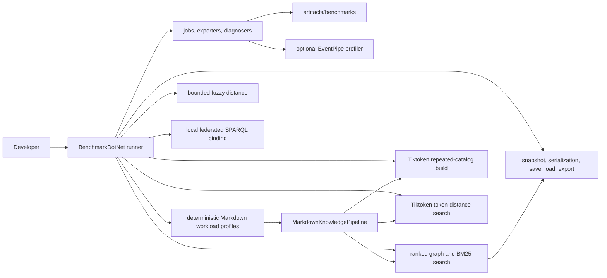

# Performance Benchmarks

Markdown-LD Knowledge Bank keeps correctness tests and performance measurements separate. TUnit flow tests prove behaviour; BenchmarkDotNet measures runtime, allocation, scaling, and profiler traces for the hot paths.

## Benchmark Boundaries



The benchmark project is `benchmarks/MarkdownLd.Kb.Benchmarks`. It references the production library, but production and test projects do not reference it.

## Suites

| Suite | Measures |
| --- | --- |
| `FuzzyEditDistanceBenchmarks` | Bounded bit-vector/banded edit distance against a naive Levenshtein baseline for short typo and long affix-heavy tokens. |
| `GraphBuildBenchmarks` | Markdown source to in-memory graph build time across named workload profiles. |
| `TiktokenGraphBuildBenchmarks` | Full Tiktoken extraction, related-segment selection, normalization, and RDF materialization for a repeated catalog corpus. |
| `SchemaCatalogGraphSearchBenchmarks` | Generated 120-document Tiktoken catalog, fixed-predicate evidence/metadata and expansion, unrestricted/candidate matching/no-match. |
| `SchemaGraphSearchBenchmarks` | Mandatory evidence/provenance query allocation with unrestricted or candidate VALUES, matching and no-match inputs. |
| `GraphSearchBenchmarks` | Graph-ranked search, BM25, BM25 fuzzy matching, schema search, focused search, and local federated schema search. |
| `TokenVectorDistanceBenchmarks` | Sparse normalized vector distance at 16/128 weights, including allocated bytes. |
| `TokenFocusedSearchBenchmarks` | Warm real Tiktoken focused search at 120/1000 documents, matching/no-match. |
| `TiktokenSearchBenchmarks` | Exact token-distance search and fuzzy query correction over long-document and multilingual token-heavy graphs. |
| `GraphPersistenceBenchmarks` | Snapshot creation, Turtle/JSON-LD serialization, Mermaid/DOT export, in-memory store save/load, and file save/load. |
| `GraphLifecycleBenchmarks` | One broad build/search/save/load/export lifecycle benchmark for the complete suite. |

## Workload Profiles

Benchmark parameters use named workload profiles instead of raw document-count ranges.

| Profile | Shape | Why it exists |
| --- | --- | --- |
| `ShortDocuments` | 250 compact runbook-like Markdown documents. | Normal knowledge-base retrieval and persistence pressure. |
| `LongDocuments` | 80 long recovery playbooks with repeated sections. | Long body and chunk-scan pressure without pretending the main variable is file count. |
| `LargeCorpus` | 1000 compact documents. | Scale pressure for graph build, snapshot, serialization, save, and load paths. |
| `TokenizedMultilingual` | 250 token-heavy multilingual/CJK documents. | Tiktoken and fuzzy query-correction behaviour on non-trivial tokenization input. |
| `RepeatedCatalog` | 48 catalog-like documents with deliberately repeated headings and authorization/revision phrases. | Detects redundant topic facts, symmetric neighbor pairs, unbounded confidence warnings, and graph-build allocation regressions. |
| `FederatedRunbooks` | 250 SPARQL/service/runbook documents. | Local federated schema-search and service-binding query plans. |

## Commands

```bash
dotnet run --project benchmarks/MarkdownLd.Kb.Benchmarks -c Release -- --list flat
dotnet run --project benchmarks/MarkdownLd.Kb.Benchmarks -c Release -- --filter "*FuzzyEditDistanceBenchmarks*"
dotnet run --project benchmarks/MarkdownLd.Kb.Benchmarks -c Release -- --filter "*GraphBuildBenchmarks*"
dotnet run --project benchmarks/MarkdownLd.Kb.Benchmarks -c Release -- --filter "*TiktokenGraphBuildBenchmarks*"
dotnet run --project benchmarks/MarkdownLd.Kb.Benchmarks -c Release -- --filter "*GraphSearchBenchmarks*"
dotnet run --project benchmarks/MarkdownLd.Kb.Benchmarks -c Release -- --filter "*TiktokenSearchBenchmarks*"
dotnet run --project benchmarks/MarkdownLd.Kb.Benchmarks -c Release -- --filter "*GraphPersistenceBenchmarks*"
dotnet run --project benchmarks/MarkdownLd.Kb.Benchmarks -c Release -- --filter "*GraphLifecycleBenchmarks*"
```

`MarkdownLdBenchmarkConfig` writes Markdown, CSV, and full JSON reports to `artifacts/benchmarks/results`. Those files are machine-specific and intentionally ignored by git. If the command does not pass a BenchmarkDotNet job option, the config adds one `Required` job: one launch, two warmup iterations, five measured iterations, and a 100 ms minimum iteration time. It still executes every benchmark case, but avoids multi-hour default auto-tuning runs.

## Measured Metrics

The benchmark configuration is intentionally diagnostic, not just a stopwatch. The default reports collect:

| Metric group | BenchmarkDotNet data | Why it matters |
| --- | --- | --- |
| Latency | `Mean`, `Error`, `StdDev`, `Ratio`, `RatioSD`; full JSON also keeps min, quartiles, max, percentiles, and raw measurements | Shows the cost and distribution of each public path under the same deterministic workload. |
| Allocation and GC | `Allocated`, `Alloc Ratio`, `Gen0`, `Gen1`, `Gen2` | Catches search paths that look acceptable once but become expensive under repeated calls. |
| Threading and contention | `Completed Work Items`, `Lock Contentions` | Highlights SPARQL and federation paths that schedule work or contend while executing query plans. |
| Benchmark shape | corpus profile, query scenario, runtime, platform, JIT, job, iteration counts | Keeps runs explainable and comparable without turning local numbers into a cross-machine contract. |
| Optional profiler traces | EventPipe CPU, GC, or JIT files | Gives the next level of evidence when a benchmark result points at a hot path. |

The build/test/pack validation job stays separate from performance measurement. The PR validation workflow, release workflow, and dedicated benchmark workflow run the complete benchmark suite: fuzzy edit distance, graph build, Tiktoken graph build, graph search, Tiktoken search, graph persistence, and graph lifecycle. They run suites as parallel matrix jobs and upload `artifacts/benchmarks/results` as suite-specific `benchmarkdotnet-results-*` artifacts so CI keeps the same performance evidence shape without serializing every suite into one long job.

Optional EventPipe profiling is opt-in:

```bash
MARKDOWN_LD_KB_BENCHMARK_PROFILE=cpu dotnet run --project benchmarks/MarkdownLd.Kb.Benchmarks -c Release -- --filter "*FuzzyEditDistanceBenchmarks*"
MARKDOWN_LD_KB_BENCHMARK_PROFILE=gc dotnet run --project benchmarks/MarkdownLd.Kb.Benchmarks -c Release -- --filter "*GraphSearchBenchmarks*"
MARKDOWN_LD_KB_BENCHMARK_PROFILE=jit dotnet run --project benchmarks/MarkdownLd.Kb.Benchmarks -c Release -- --filter "*TiktokenSearchBenchmarks*"
```

## Current Results

On October 12, 2026 the complete local `Required` suite completed 131/131 cases in 7 minutes 14 seconds (434.31s), on Apple M2 Pro, .NET 10.0.12, SDK 10.0.401, BenchmarkDotNet 0.15.8. Every exported case has valid statistics. Receipts: artifacts/projection-full-benchmarks.log and artifacts/benchmarks/projection-final/results.

Background processes produced broad timing confidence intervals; observed means do not establish a reliable cross-machine latency speedup. Matching allocation supports indexed focused projection: rich candidate 9.41 -> 5.95 MiB/op, unrestricted 16.88 -> 12.90; ShortDocuments candidate 5.32 -> 4.78. No-match remains broadly unchanged because it has no focused graph to project. None corpora have 684/1,794 triples, generated 120-document Tiktoken catalog 14,160 and the actual gateway export 56,168. Known-good candidate pools measure retrieval allocation, not preselector recall. The primary checkout includes preserved unrelated serialization/tokenization edits outside this release; committed-source CI independently verifies release behavior. MB/KB below use BenchmarkDotNet binary units (MiB/KiB).

| Suite | Job | Cases | Result files |
| --- | --- | ---: | --- |
| `FuzzyEditDistanceBenchmarks` | Required | 8 | Markdown, CSV, JSON |
| `GraphBuildBenchmarks` | Required | 4 | Markdown, CSV, JSON |
| `TiktokenGraphBuildBenchmarks` | Required | 1 | Markdown, CSV, JSON |
| `GraphSearchBenchmarks` | Required | 54 | Markdown, CSV, JSON |
| `SchemaCatalogGraphSearchBenchmarks` | Required | 4 | Markdown, CSV, JSON |
| `SchemaGraphSearchBenchmarks` | Required | 8 | Markdown, CSV, JSON |
| `TiktokenSearchBenchmarks` | Required | 12 | Markdown, CSV, JSON |
| `GraphPersistenceBenchmarks` | Required | 39 | Markdown, CSV, JSON |
| `GraphLifecycleBenchmarks` | Required | 1 | Markdown, CSV, JSON |

### FuzzyEditDistanceBenchmarks

```

BenchmarkDotNet v0.15.8, macOS 27.0.1 (26A434) [Darwin 27.0.0]
Apple M2 Pro, 1 CPU, 12 logical and 12 physical cores
.NET SDK 10.0.401
  [Host]   : .NET 10.0.12 (10.0.12, 10.0.1226.42308), Arm64 RyuJIT armv8.0-a
  Required : .NET 10.0.12 (10.0.12, 10.0.1226.42308), Arm64 RyuJIT armv8.0-a

Job=Required  MinIterationTime=100ms  IterationCount=5
LaunchCount=1  WarmupCount=2

```
| Method                   | Scenario          | Mean         | Error       | StdDev     | Ratio  | RatioSD | Completed Work Items | Lock Contentions | Gen0   | Allocated | Alloc Ratio |
|------------------------- |------------------ |-------------:|------------:|-----------:|-------:|--------:|---------------------:|-----------------:|-------:|----------:|------------:|
| **BoundedBitVectorOrBanded** | **ShortDeletion**     |     **6.429 ns** |   **0.5417 ns** |  **0.1407 ns** |   **1.00** |    **0.03** |                    **-** |                **-** |      **-** |         **-** |          **NA** |
| NaiveLevenshtein         | ShortDeletion     |    94.473 ns |   0.7479 ns |  0.1942 ns |  14.70 |    0.29 |                    - |                - | 0.0134 |     112 B |          NA |
|                          |                   |              |             |            |        |         |                      |                  |        |           |             |
| **BoundedBitVectorOrBanded** | **ShortSubstitution** |    **33.474 ns** |   **0.8167 ns** |  **0.1264 ns** |   **1.00** |    **0.00** |                    **-** |                **-** |      **-** |         **-** |          **NA** |
| NaiveLevenshtein         | ShortSubstitution |    86.042 ns |   7.4757 ns |  1.1569 ns |   2.57 |    0.03 |                    - |                - | 0.0134 |     112 B |          NA |
|                          |                   |              |             |            |        |         |                      |                  |        |           |             |
| **BoundedBitVectorOrBanded** | **LongInsertion**     |    **27.014 ns** |   **0.4803 ns** |  **0.1247 ns** |   **1.00** |    **0.01** |                    **-** |                **-** |      **-** |         **-** |          **NA** |
| NaiveLevenshtein         | LongInsertion     | 8,293.029 ns | 155.5642 ns | 24.0737 ns | 306.99 |    1.52 |                    - |                - | 0.0610 |     640 B |          NA |
|                          |                   |              |             |            |        |         |                      |                  |        |           |             |
| **BoundedBitVectorOrBanded** | **LongNoMatch**       |    **57.458 ns** |   **0.1591 ns** |  **0.0413 ns** |   **1.00** |    **0.00** |                    **-** |                **-** |      **-** |         **-** |          **NA** |
| NaiveLevenshtein         | LongNoMatch       | 9,404.724 ns |  72.7884 ns | 18.9029 ns | 163.68 |    0.32 |                    - |                - | 0.0610 |     672 B |          NA |

### GraphBuildBenchmarks

```

BenchmarkDotNet v0.15.8, macOS 27.0.1 (26A434) [Darwin 27.0.0]
Apple M2 Pro, 1 CPU, 12 logical and 12 physical cores
.NET SDK 10.0.401
  [Host]   : .NET 10.0.12 (10.0.12, 10.0.1226.42308), Arm64 RyuJIT armv8.0-a
  Required : .NET 10.0.12 (10.0.12, 10.0.1226.42308), Arm64 RyuJIT armv8.0-a

Job=Required  MinIterationTime=100ms  IterationCount=5
LaunchCount=1  WarmupCount=2

```
| Method     | CorpusProfile        | Mean      | Error    | StdDev    | Completed Work Items | Lock Contentions | Gen0      | Gen1      | Gen2      | Allocated |
|----------- |--------------------- |----------:|---------:|----------:|---------------------:|-----------------:|----------:|----------:|----------:|----------:|
| **BuildGraph** | **ShortDocuments**       |  **48.80 ms** | **20.72 ms** |  **5.380 ms** |                    **-** |                **-** | **1666.6667** |  **666.6667** |         **-** |   **15.1 MB** |
| **BuildGraph** | **LongDocuments**        |  **25.35 ms** | **17.44 ms** |  **4.530 ms** |                    **-** |                **-** | **1750.0000** |  **750.0000** |         **-** |  **14.43 MB** |
| **BuildGraph** | **LargeCorpus**          | **117.89 ms** | **43.87 ms** | **11.394 ms** |                    **-** |                **-** | **7500.0000** | **2500.0000** | **1000.0000** |  **58.65 MB** |
| **BuildGraph** | **Token(...)ngual [21]** |  **57.96 ms** | **58.86 ms** | **15.286 ms** |                    **-** |                **-** | **2000.0000** | **1000.0000** |  **333.3333** |  **18.19 MB** |

### TiktokenGraphBuildBenchmarks

```

BenchmarkDotNet v0.15.8, macOS 27.0.1 (26A434) [Darwin 27.0.0]
Apple M2 Pro, 1 CPU, 12 logical and 12 physical cores
.NET SDK 10.0.401
  [Host]   : .NET 10.0.12 (10.0.12, 10.0.1226.42308), Arm64 RyuJIT armv8.0-a
  Required : .NET 10.0.12 (10.0.12, 10.0.1226.42308), Arm64 RyuJIT armv8.0-a

Job=Required  MinIterationTime=100ms  IterationCount=5
LaunchCount=1  WarmupCount=2

```
| Method                    | Mean     | Error    | StdDev   | Completed Work Items | Lock Contentions | Gen0      | Gen1      | Allocated |
|-------------------------- |---------:|---------:|---------:|---------------------:|-----------------:|----------:|----------:|----------:|
| BuildRepeatedCatalogGraph | 159.8 ms | 93.61 ms | 24.31 ms |                    - |                - | 8000.0000 | 3000.0000 |  67.09 MB |

### GraphSearchBenchmarks

```

BenchmarkDotNet v0.15.8, macOS 27.0.1 (26A434) [Darwin 27.0.0]
Apple M2 Pro, 1 CPU, 12 logical and 12 physical cores
.NET SDK 10.0.401
  [Host]   : .NET 10.0.12 (10.0.12, 10.0.1226.42308), Arm64 RyuJIT armv8.0-a
  Required : .NET 10.0.12 (10.0.12, 10.0.1226.42308), Arm64 RyuJIT armv8.0-a

Job=Required  MinIterationTime=100ms  IterationCount=5
LaunchCount=1  WarmupCount=2

```
| Method                     | CorpusProfile     | QueryScenario | Mean      | Error      | StdDev    | Median    | Ratio | RatioSD | Completed Work Items | Lock Contentions | Gen0      | Gen1     | Gen2    | Allocated | Alloc Ratio |
|--------------------------- |------------------ |-------------- |----------:|-----------:|----------:|----------:|------:|--------:|---------------------:|-----------------:|----------:|---------:|--------:|----------:|------------:|
| **LocalFederatedSchemaSearch** | **ShortDocuments**    | **Exact**         | **25.238 ms** | **22.7424 ms** | **5.9061 ms** | **26.339 ms** |  **6.11** |    **1.49** |               **2.0000** |                **-** | **1000.0000** | **400.0000** |       **-** |   **8.11 MB** |        **2.95** |
| RankedGraphSearch          | ShortDocuments    | Exact         |  4.176 ms |  3.2412 ms | 0.5016 ms |  4.215 ms |  1.01 |    0.16 |                    - |                - |  343.7500 | 125.0000 |       - |   2.75 MB |        1.00 |
| Bm25Search                 | ShortDocuments    | Exact         |  8.149 ms | 11.0347 ms | 2.8657 ms |  9.198 ms |  1.97 |    0.68 |                    - |                - |  312.5000 | 125.0000 |       - |   2.76 MB |        1.00 |
| Bm25FuzzySearch            | ShortDocuments    | Exact         |  7.330 ms | 12.2543 ms | 3.1824 ms |  9.006 ms |  1.78 |    0.74 |                    - |                - |  375.0000 | 187.5000 |       - |   3.47 MB |        1.26 |
| SchemaSearch               | ShortDocuments    | Exact         | 18.582 ms |  6.4210 ms | 1.6675 ms | 19.356 ms |  4.50 |    0.62 |              23.0000 |          48.6000 |  400.0000 | 200.0000 |       - |   4.45 MB |        1.62 |
| FocusedSearch              | ShortDocuments    | Exact         |  8.083 ms |  5.8719 ms | 0.9087 ms |  8.064 ms |  1.96 |    0.30 |                    - |                - |  500.0000 | 187.5000 |       - |   4.24 MB |        1.54 |
|                            |                   |               |           |            |           |           |       |         |                      |                  |           |          |         |           |             |
| **LocalFederatedSchemaSearch** | **ShortDocuments**    | **Typo**          | **33.803 ms** | **22.5497 ms** | **5.8561 ms** | **35.757 ms** | **11.28** |    **2.24** |               **2.0000** |                **-** | **1000.0000** | **500.0000** |       **-** |   **8.22 MB** |        **2.99** |
| RankedGraphSearch          | ShortDocuments    | Typo          |  3.033 ms |  2.4427 ms | 0.3780 ms |  3.092 ms |  1.01 |    0.16 |                    - |                - |  343.7500 | 125.0000 |       - |   2.75 MB |        1.00 |
| Bm25Search                 | ShortDocuments    | Typo          |  9.536 ms |  7.2393 ms | 1.8800 ms |  9.883 ms |  3.18 |    0.69 |                    - |                - |  312.5000 | 125.0000 |       - |   2.73 MB |        0.99 |
| Bm25FuzzySearch            | ShortDocuments    | Typo          | 10.339 ms | 13.1291 ms | 3.4096 ms | 10.120 ms |  3.45 |    1.13 |                    - |                - |  375.0000 | 187.5000 |       - |   3.47 MB |        1.26 |
| SchemaSearch               | ShortDocuments    | Typo          | 13.535 ms |  8.6712 ms | 2.2519 ms | 12.557 ms |  4.52 |    0.87 |              23.0000 |          67.7143 |  428.5714 | 142.8571 |       - |   4.44 MB |        1.61 |
| FocusedSearch              | ShortDocuments    | Typo          |  7.425 ms | 13.4475 ms | 3.4923 ms |  5.225 ms |  2.48 |    1.11 |                    - |                - |  500.0000 | 187.5000 |       - |   4.24 MB |        1.54 |
|                            |                   |               |           |            |           |           |       |         |                      |                  |           |          |         |           |             |
| **LocalFederatedSchemaSearch** | **ShortDocuments**    | **NoMatch**       | **22.900 ms** | **17.0668 ms** | **4.4322 ms** | **25.177 ms** |  **7.05** |    **3.34** |               **2.0000** |                **-** | **1000.0000** | **400.0000** |       **-** |    **8.1 MB** |        **2.94** |
| RankedGraphSearch          | ShortDocuments    | NoMatch       |  3.918 ms |  6.9766 ms | 1.8118 ms |  3.801 ms |  1.21 |    0.76 |                    - |                - |  343.7500 | 125.0000 |       - |   2.75 MB |        1.00 |
| Bm25Search                 | ShortDocuments    | NoMatch       |  2.784 ms |  3.5007 ms | 0.5417 ms |  2.839 ms |  0.86 |    0.41 |                    - |                - |  312.5000 | 125.0000 |       - |   2.73 MB |        0.99 |
| Bm25FuzzySearch            | ShortDocuments    | NoMatch       |  9.733 ms |  9.9890 ms | 2.5941 ms | 10.651 ms |  3.00 |    1.52 |                    - |                - |  375.0000 | 187.5000 |       - |   3.44 MB |        1.25 |
| SchemaSearch               | ShortDocuments    | NoMatch       | 14.825 ms | 20.5461 ms | 3.1795 ms | 15.593 ms |  4.56 |    2.20 |              23.0000 |          53.3333 |  500.0000 | 166.6667 |       - |   4.45 MB |        1.62 |
| FocusedSearch              | ShortDocuments    | NoMatch       |  5.510 ms |  7.6992 ms | 1.1915 ms |  5.007 ms |  1.70 |    0.82 |                    - |                - |  500.0000 | 250.0000 |       - |   4.21 MB |        1.53 |
|                            |                   |               |           |            |           |           |       |         |                      |                  |           |          |         |           |             |
| **LocalFederatedSchemaSearch** | **LongDocuments**     | **Exact**         | **17.119 ms** | **16.8717 ms** | **4.3815 ms** | **16.960 ms** |  **9.30** |    **4.24** |               **2.0000** |                **-** |  **857.1429** | **285.7143** |       **-** |   **7.14 MB** |        **3.47** |
| RankedGraphSearch          | LongDocuments     | Exact         |  2.096 ms |  2.9819 ms | 0.7744 ms |  2.329 ms |  1.14 |    0.60 |                    - |                - |  250.0000 |  78.1250 |       - |   2.06 MB |        1.00 |
| Bm25Search                 | LongDocuments     | Exact         |  3.500 ms |  4.8481 ms | 1.2590 ms |  3.967 ms |  1.90 |    0.99 |                    - |                - |  250.0000 |  62.5000 |       - |   2.06 MB |        1.00 |
| Bm25FuzzySearch            | LongDocuments     | Exact         |  3.022 ms |  2.5765 ms | 0.6691 ms |  2.987 ms |  1.64 |    0.72 |                    - |                - |  437.5000 | 156.2500 |       - |   3.61 MB |        1.75 |
| SchemaSearch               | LongDocuments     | Exact         |  8.057 ms | 10.3475 ms | 2.6872 ms |  8.573 ms |  4.38 |    2.19 |              23.0000 |          24.8000 |  300.0000 |        - |       - |   2.52 MB |        1.22 |
| FocusedSearch              | LongDocuments     | Exact         |  2.197 ms |  2.7164 ms | 0.7054 ms |  1.784 ms |  1.19 |    0.59 |                    - |                - |  187.5000 |  46.8750 |       - |   1.55 MB |        0.75 |
|                            |                   |               |           |            |           |           |       |         |                      |                  |           |          |         |           |             |
| **LocalFederatedSchemaSearch** | **LongDocuments**     | **Typo**          | **18.301 ms** |  **1.5473 ms** | **0.4018 ms** | **18.271 ms** | **14.34** |    **2.28** |               **2.0000** |                **-** |  **833.3333** | **166.6667** |       **-** |   **7.15 MB** |        **3.48** |
| RankedGraphSearch          | LongDocuments     | Typo          |  1.314 ms |  1.8173 ms | 0.2812 ms |  1.189 ms |  1.03 |    0.26 |                    - |                - |  250.0000 |  78.1250 |       - |   2.06 MB |        1.00 |
| Bm25Search                 | LongDocuments     | Typo          |  2.286 ms |  1.6093 ms | 0.2490 ms |  2.370 ms |  1.79 |    0.33 |                    - |                - |  250.0000 |  93.7500 |       - |   2.05 MB |        1.00 |
| Bm25FuzzySearch            | LongDocuments     | Typo          |  4.710 ms |  6.0452 ms | 0.9355 ms |  5.086 ms |  3.69 |    0.88 |                    - |                - |  437.5000 | 125.0000 |       - |   3.61 MB |        1.75 |
| SchemaSearch               | LongDocuments     | Typo          |  7.118 ms |  5.5234 ms | 1.4344 ms |  7.758 ms |  5.58 |    1.36 |              23.0000 |          18.4167 |  250.0000 |        - |       - |   2.49 MB |        1.21 |
| FocusedSearch              | LongDocuments     | Typo          |  3.488 ms |  6.9784 ms | 1.8123 ms |  2.546 ms |  2.73 |    1.39 |                    - |                - |  187.5000 |  62.5000 |       - |   1.55 MB |        0.75 |
|                            |                   |               |           |            |           |           |       |         |                      |                  |           |          |         |           |             |
| **LocalFederatedSchemaSearch** | **LongDocuments**     | **NoMatch**       | **20.442 ms** |  **4.1181 ms** | **1.0694 ms** | **20.073 ms** |  **9.82** |    **2.39** |               **2.0000** |                **-** |  **833.3333** | **166.6667** |       **-** |   **7.12 MB** |        **3.38** |
| RankedGraphSearch          | LongDocuments     | NoMatch       |  2.193 ms |  2.0824 ms | 0.5408 ms |  2.368 ms |  1.05 |    0.35 |                    - |                - |  250.0000 |  78.1250 |       - |   2.11 MB |        1.00 |
| Bm25Search                 | LongDocuments     | NoMatch       |  2.259 ms |  1.2007 ms | 0.1858 ms |  2.297 ms |  1.09 |    0.27 |                    - |                - |  250.0000 |  93.7500 |       - |   2.05 MB |        0.97 |
| Bm25FuzzySearch            | LongDocuments     | NoMatch       |  5.233 ms |  5.6733 ms | 1.4733 ms |  4.371 ms |  2.51 |    0.89 |                    - |                - |  437.5000 | 125.0000 |       - |   3.65 MB |        1.73 |
| SchemaSearch               | LongDocuments     | NoMatch       |  8.197 ms |  8.7492 ms | 2.2721 ms |  6.928 ms |  3.94 |    1.39 |              23.0000 |          19.0000 |  300.0000 |        - |       - |   2.51 MB |        1.19 |
| FocusedSearch              | LongDocuments     | NoMatch       |  1.558 ms |  0.5772 ms | 0.1499 ms |  1.532 ms |  0.75 |    0.19 |                    - |                - |  187.5000 |  46.8750 |       - |   1.55 MB |        0.74 |
|                            |                   |               |           |            |           |           |       |         |                      |                  |           |          |         |           |             |
| **LocalFederatedSchemaSearch** | **FederatedRunbooks** | **Exact**         | **25.740 ms** | **33.2021 ms** | **5.1381 ms** | **25.636 ms** |  **7.58** |    **3.56** |               **2.0000** |                **-** | **1000.0000** | **400.0000** |       **-** |   **8.18 MB** |        **2.66** |
| RankedGraphSearch          | FederatedRunbooks | Exact         |  4.258 ms |  9.2902 ms | 2.4126 ms |  3.214 ms |  1.25 |    0.88 |                    - |                - |  375.0000 | 125.0000 | 31.2500 |   3.08 MB |        1.00 |
| Bm25Search                 | FederatedRunbooks | Exact         |  7.893 ms |  3.1353 ms | 0.8142 ms |  8.123 ms |  2.32 |    1.02 |                    - |                - |  312.5000 | 125.0000 |       - |   3.08 MB |        1.00 |
| Bm25FuzzySearch            | FederatedRunbooks | Exact         |  7.811 ms |  6.2742 ms | 1.6294 ms |  8.676 ms |  2.30 |    1.09 |                    - |                - |  437.5000 | 125.0000 |       - |   4.08 MB |        1.33 |
| SchemaSearch               | FederatedRunbooks | Exact         | 16.422 ms | 12.0480 ms | 1.8644 ms | 16.449 ms |  4.84 |    2.14 |              23.0000 |          62.8333 |  500.0000 | 166.6667 |       - |   4.53 MB |        1.47 |
| FocusedSearch              | FederatedRunbooks | Exact         |  7.525 ms |  5.8262 ms | 1.5131 ms |  7.981 ms |  2.22 |    1.04 |                    - |                - |  625.0000 | 250.0000 | 62.5000 |   4.76 MB |        1.55 |
|                            |                   |               |           |            |           |           |       |         |                      |                  |           |          |         |           |             |
| **LocalFederatedSchemaSearch** | **FederatedRunbooks** | **Typo**          | **25.013 ms** | **23.2246 ms** | **6.0313 ms** | **28.437 ms** |  **6.14** |    **2.43** |               **2.0000** |                **-** | **1000.0000** | **400.0000** |       **-** |    **8.2 MB** |        **2.67** |
| RankedGraphSearch          | FederatedRunbooks | Typo          |  4.605 ms |  7.5364 ms | 1.9572 ms |  3.584 ms |  1.13 |    0.59 |                    - |                - |  375.0000 | 125.0000 | 31.2500 |   3.08 MB |        1.00 |
| Bm25Search                 | FederatedRunbooks | Typo          |  7.580 ms | 13.8478 ms | 3.5962 ms |  5.813 ms |  1.86 |    1.03 |                    - |                - |  312.5000 |  62.5000 |       - |   3.06 MB |        0.99 |
| Bm25FuzzySearch            | FederatedRunbooks | Typo          |  5.005 ms |  3.7786 ms | 0.5847 ms |  5.237 ms |  1.23 |    0.42 |                    - |                - |  437.5000 | 125.0000 |       - |   4.08 MB |        1.33 |
| SchemaSearch               | FederatedRunbooks | Typo          | 21.970 ms | 17.4354 ms | 4.5279 ms | 22.961 ms |  5.39 |    2.03 |              23.0000 |          23.0000 |  400.0000 | 200.0000 |       - |   4.53 MB |        1.47 |
| FocusedSearch              | FederatedRunbooks | Typo          | 12.037 ms | 10.7719 ms | 2.7974 ms | 12.370 ms |  2.96 |    1.15 |                    - |                - |  625.0000 | 187.5000 | 62.5000 |   4.92 MB |        1.60 |
|                            |                   |               |           |            |           |           |       |         |                      |                  |           |          |         |           |             |
| **LocalFederatedSchemaSearch** | **FederatedRunbooks** | **NoMatch**       | **24.081 ms** | **10.1738 ms** | **2.6421 ms** | **23.107 ms** |  **8.13** |    **1.33** |               **2.0000** |                **-** | **1000.0000** | **400.0000** |       **-** |   **8.22 MB** |        **2.67** |
| RankedGraphSearch          | FederatedRunbooks | NoMatch       |  3.011 ms |  1.6470 ms | 0.4277 ms |  2.917 ms |  1.02 |    0.19 |                    - |                - |  375.0000 | 125.0000 | 31.2500 |   3.08 MB |        1.00 |
| Bm25Search                 | FederatedRunbooks | NoMatch       |  5.254 ms |  8.1622 ms | 2.1197 ms |  3.794 ms |  1.77 |    0.70 |                    - |                - |  312.5000 |  62.5000 |       - |   3.06 MB |        0.99 |
| Bm25FuzzySearch            | FederatedRunbooks | NoMatch       |  9.023 ms | 19.5586 ms | 5.0793 ms |  7.048 ms |  3.05 |    1.63 |                    - |                - |  437.5000 | 125.0000 |       - |   4.06 MB |        1.32 |
| SchemaSearch               | FederatedRunbooks | NoMatch       | 24.378 ms |  6.0424 ms | 1.5692 ms | 24.252 ms |  8.23 |    1.17 |              23.0000 |          42.7500 |  500.0000 | 250.0000 |       - |   4.53 MB |        1.47 |
| FocusedSearch              | FederatedRunbooks | NoMatch       |  7.791 ms |  7.0330 ms | 1.8265 ms |  8.395 ms |  2.63 |    0.66 |                    - |                - |  625.0000 | 187.5000 | 62.5000 |   4.92 MB |        1.60 |

### SchemaCatalogGraphSearchBenchmarks

```

BenchmarkDotNet v0.15.8, macOS 27.0.1 (26A434) [Darwin 27.0.0]
Apple M2 Pro, 1 CPU, 12 logical and 12 physical cores
.NET SDK 10.0.401
  [Host]   : .NET 10.0.12 (10.0.12, 10.0.1226.42308), Arm64 RyuJIT armv8.0-a
  Required : .NET 10.0.12 (10.0.12, 10.0.1226.42308), Arm64 RyuJIT armv8.0-a

Job=Required  MinIterationTime=100ms  IterationCount=5
LaunchCount=1  WarmupCount=2

```
| Method          | QueryScenario | Mean     | Error      | StdDev    | Ratio | RatioSD | Completed Work Items | Lock Contentions | Gen0      | Gen1      | Allocated | Alloc Ratio |
|---------------- |-------------- |---------:|-----------:|----------:|------:|--------:|---------------------:|-----------------:|----------:|----------:|----------:|------------:|
| **Unrestricted**    | **Exact**         | **78.14 ms** | **108.777 ms** | **28.249 ms** |  **1.19** |    **0.77** |             **310.0000** |                **-** | **1500.0000** |  **500.0000** |   **12.9 MB** |        **1.00** |
| CandidateValues | Exact         | 12.10 ms |  11.517 ms |  1.782 ms |  0.18 |    0.10 |             365.0000 |           0.4375 |  687.5000 |  187.5000 |   5.95 MB |        0.46 |
|                 |               |          |            |           |       |         |                      |                  |           |           |           |             |
| **Unrestricted**    | **NoMatch**       | **49.33 ms** |   **4.199 ms** |  **1.090 ms** |  **1.00** |    **0.03** |               **1.0000** |                **-** | **2500.0000** | **1000.0000** |  **22.12 MB** |        **1.00** |
| CandidateValues | NoMatch       | 13.38 ms |   9.581 ms |  2.488 ms |  0.27 |    0.05 |             188.0000 |           0.0625 |  500.0000 |  125.0000 |      4 MB |        0.18 |

### SchemaGraphSearchBenchmarks

```

BenchmarkDotNet v0.15.8, macOS 27.0.1 (26A434) [Darwin 27.0.0]
Apple M2 Pro, 1 CPU, 12 logical and 12 physical cores
.NET SDK 10.0.401
  [Host]   : .NET 10.0.12 (10.0.12, 10.0.1226.42308), Arm64 RyuJIT armv8.0-a
  Required : .NET 10.0.12 (10.0.12, 10.0.1226.42308), Arm64 RyuJIT armv8.0-a

Job=Required  MinIterationTime=100ms  IterationCount=5
LaunchCount=1  WarmupCount=2

```
| Method          | CorpusProfile  | QueryScenario | Mean     | Error      | StdDev    | Ratio | RatioSD | Completed Work Items | Lock Contentions | Gen0      | Gen1     | Allocated | Alloc Ratio |
|---------------- |--------------- |-------------- |---------:|-----------:|----------:|------:|--------:|---------------------:|-----------------:|----------:|---------:|----------:|------------:|
| **Unrestricted**    | **ShortDocuments** | **Exact**         | **62.75 ms** | **105.867 ms** | **27.493 ms** |  **1.21** |    **0.77** |              **79.0000** |          **80.3333** | **1666.6667** | **666.6667** |  **14.84 MB** |        **1.00** |
| CandidateValues | ShortDocuments | Exact         | 18.05 ms |  37.411 ms |  5.789 ms |  0.35 |    0.19 |              90.0000 |           0.3125 |  562.5000 | 187.5000 |   4.78 MB |        0.32 |
|                 |                |               |          |            |           |       |         |                      |                  |           |          |           |             |
| **Unrestricted**    | **ShortDocuments** | **NoMatch**       | **20.96 ms** |  **23.301 ms** |  **6.051 ms** |  **1.08** |    **0.43** |              **23.0000** |           **7.3125** |  **687.5000** | **250.0000** |   **5.85 MB** |        **1.00** |
| CandidateValues | ShortDocuments | NoMatch       | 18.70 ms |  51.045 ms | 13.256 ms |  0.96 |    0.70 |              34.0000 |          14.7500 |  375.0000 | 125.0000 |   3.26 MB |        0.56 |
|                 |                |               |          |            |           |       |         |                      |                  |           |          |           |             |
| **Unrestricted**    | **LongDocuments**  | **Exact**         | **12.77 ms** |   **5.409 ms** |  **1.405 ms** |  **1.01** |    **0.15** |              **79.0000** |           **9.3125** |  **812.5000** | **250.0000** |   **6.65 MB** |        **1.00** |
| CandidateValues | LongDocuments  | Exact         | 10.39 ms |   5.382 ms |  1.398 ms |  0.82 |    0.14 |              90.0000 |          13.3125 |  500.0000 | 125.0000 |   4.02 MB |        0.60 |
|                 |                |               |          |            |           |       |         |                      |                  |           |          |           |             |
| **Unrestricted**    | **LongDocuments**  | **NoMatch**       | **20.54 ms** |  **25.191 ms** |  **6.542 ms** |  **1.12** |    **0.55** |              **23.0000** |           **0.8125** |  **375.0000** |  **62.5000** |   **3.05 MB** |        **1.00** |
| CandidateValues | LongDocuments  | NoMatch       | 20.28 ms |  22.283 ms |  5.787 ms |  1.10 |    0.52 |              34.0000 |           0.4375 |  312.5000 |  62.5000 |   2.56 MB |        0.84 |

### TiktokenSearchBenchmarks

```

BenchmarkDotNet v0.15.8, macOS 27.0.1 (26A434) [Darwin 27.0.0]
Apple M2 Pro, 1 CPU, 12 logical and 12 physical cores
.NET SDK 10.0.401
  [Host]   : .NET 10.0.12 (10.0.12, 10.0.1226.42308), Arm64 RyuJIT armv8.0-a
  Required : .NET 10.0.12 (10.0.12, 10.0.1226.42308), Arm64 RyuJIT armv8.0-a

Job=Required  MinIterationTime=100ms  IterationCount=5
LaunchCount=1  WarmupCount=2

```
| Method                            | CorpusProfile        | QueryScenario | Mean        | Error        | StdDev       | Median    | Ratio | RatioSD | Completed Work Items | Lock Contentions | Gen0    | Allocated | Alloc Ratio |
|---------------------------------- |--------------------- |-------------- |------------:|-------------:|-------------:|----------:|------:|--------:|---------------------:|-----------------:|--------:|----------:|------------:|
| **ExactTokenDistanceSearch**          | **LongDocuments**        | **Exact**         |   **263.39 μs** |   **536.477 μs** |   **139.321 μs** | **168.44 μs** |  **1.22** |    **0.79** |                    **-** |                **-** | **12.6953** | **107.23 KB** |        **1.00** |
| FuzzyCorrectedTokenDistanceSearch | LongDocuments        | Exact         |   184.87 μs |   162.829 μs |    42.286 μs | 159.81 μs |  0.85 |    0.38 |                    - |                - | 12.6953 | 108.34 KB |        1.01 |
|                                   |                      |               |             |              |              |           |       |         |                      |                  |         |           |             |
| **ExactTokenDistanceSearch**          | **LongDocuments**        | **Typo**          |   **177.45 μs** |    **28.937 μs** |     **4.478 μs** | **177.35 μs** |  **1.00** |    **0.03** |                    **-** |                **-** | **11.7188** | **107.87 KB** |        **1.00** |
| FuzzyCorrectedTokenDistanceSearch | LongDocuments        | Typo          | 1,185.12 μs | 4,860.144 μs | 1,262.164 μs | 273.85 μs |  6.68 |    6.53 |                    - |                - |       - | 110.25 KB |        1.02 |
|                                   |                      |               |             |              |              |           |       |         |                      |                  |         |           |             |
| **ExactTokenDistanceSearch**          | **LongDocuments**        | **NoMatch**       |   **110.60 μs** |     **7.496 μs** |     **1.947 μs** | **110.58 μs** |  **1.00** |    **0.02** |                    **-** |                **-** | **12.6953** | **107.18 KB** |        **1.00** |
| FuzzyCorrectedTokenDistanceSearch | LongDocuments        | NoMatch       |   107.61 μs |     1.813 μs |     0.280 μs | 107.69 μs |  0.97 |    0.02 |                    - |                - | 12.6953 | 108.01 KB |        1.01 |
|                                   |                      |               |             |              |              |           |       |         |                      |                  |         |           |             |
| **ExactTokenDistanceSearch**          | **Token(...)ngual [21]** | **Exact**         |   **102.90 μs** |     **3.014 μs** |     **0.466 μs** | **102.72 μs** |  **1.00** |    **0.01** |                    **-** |                **-** |  **7.8125** |  **70.81 KB** |        **1.00** |
| FuzzyCorrectedTokenDistanceSearch | Token(...)ngual [21] | Exact         |   102.98 μs |     5.654 μs |     0.875 μs | 102.81 μs |  1.00 |    0.01 |                    - |                - |  8.7891 |  71.95 KB |        1.02 |
|                                   |                      |               |             |              |              |           |       |         |                      |                  |         |           |             |
| **ExactTokenDistanceSearch**          | **Token(...)ngual [21]** | **Typo**          |   **178.39 μs** |    **12.582 μs** |     **1.947 μs** | **178.31 μs** |  **1.00** |    **0.01** |                    **-** |                **-** |       **-** |   **71.3 KB** |        **1.00** |
| FuzzyCorrectedTokenDistanceSearch | Token(...)ngual [21] | Typo          |   152.35 μs |     4.607 μs |     1.196 μs | 151.77 μs |  0.85 |    0.01 |                    - |                - |  8.7891 |  72.94 KB |        1.02 |
|                                   |                      |               |             |              |              |           |       |         |                      |                  |         |           |             |
| **ExactTokenDistanceSearch**          | **Token(...)ngual [21]** | **NoMatch**       |    **98.34 μs** |     **6.187 μs** |     **0.957 μs** |  **98.65 μs** |  **1.00** |    **0.01** |                    **-** |                **-** |  **7.8125** |  **70.54 KB** |        **1.00** |
| FuzzyCorrectedTokenDistanceSearch | Token(...)ngual [21] | NoMatch       |    99.46 μs |     0.174 μs |     0.027 μs |  99.46 μs |  1.01 |    0.01 |                    - |                - |  7.8125 |  71.37 KB |        1.01 |

### GraphPersistenceBenchmarks

```

BenchmarkDotNet v0.15.8, macOS 27.0.1 (26A434) [Darwin 27.0.0]
Apple M2 Pro, 1 CPU, 12 logical and 12 physical cores
.NET SDK 10.0.401
  [Host]   : .NET 10.0.12 (10.0.12, 10.0.1226.42308), Arm64 RyuJIT armv8.0-a
  Required : .NET 10.0.12 (10.0.12, 10.0.1226.42308), Arm64 RyuJIT armv8.0-a

Job=Required  MinIterationTime=100ms  IterationCount=5
LaunchCount=1  WarmupCount=2

```
| Method                      | CorpusProfile  | Mean         | Error        | StdDev       | Median       | Ratio | RatioSD | Completed Work Items | Lock Contentions | Gen0       | Gen1      | Gen2      | Allocated   | Alloc Ratio |
|---------------------------- |--------------- |-------------:|-------------:|-------------:|-------------:|------:|--------:|---------------------:|-----------------:|-----------:|----------:|----------:|------------:|------------:|
| **ExportMermaidFlowchart**      | **ShortDocuments** |   **4,398.5 μs** |   **8,741.0 μs** |  **2,270.02 μs** |   **2,998.1 μs** |  **1.13** |    **0.75** |                    **-** |                **-** |   **250.0000** |  **125.0000** |         **-** |  **2498.88 KB** |        **1.24** |
| ExportDotGraph              | ShortDocuments |   4,414.6 μs |   5,920.0 μs |  1,537.41 μs |   4,346.3 μs |  1.14 |    0.62 |                    - |                - |   281.2500 |  125.0000 |         - |   2615.7 KB |        1.30 |
| LoadTurtleFromInMemoryStore | ShortDocuments |  32,980.6 μs |   9,360.5 μs |  2,430.89 μs |  32,549.5 μs |  8.50 |    3.63 |                    - |                - |   750.0000 |  250.0000 |         - |  6561.75 KB |        3.27 |
| LoadJsonLdFromInMemoryStore | ShortDocuments |  49,204.3 μs |  57,967.6 μs | 15,054.01 μs |  46,804.4 μs | 12.69 |    6.57 |                    - |                - |  2000.0000 |  500.0000 |         - | 20267.02 KB |       10.10 |
| LoadTurtleFromFile          | ShortDocuments |  33,797.8 μs |  12,913.2 μs |  3,353.51 μs |  34,772.4 μs |  8.72 |    3.76 |              50.0000 |                - |   750.0000 |  250.0000 |         - |  7332.88 KB |        3.65 |
| LoadJsonLdFromFile          | ShortDocuments |  53,505.3 μs |  23,528.9 μs |  6,110.39 μs |  50,469.2 μs | 13.80 |    6.00 |              44.0000 |                - |  2500.0000 | 1000.0000 |         - | 20944.55 KB |       10.43 |
| SaveTurtleToInMemoryStore   | ShortDocuments |  10,873.4 μs |  23,250.1 μs |  6,037.99 μs |   7,201.5 μs |  2.80 |    1.94 |                    - |                - |   875.0000 |  375.0000 |         - |  7839.85 KB |        3.91 |
| SaveJsonLdToInMemoryStore   | ShortDocuments |  40,917.2 μs |  64,259.3 μs |  9,944.20 μs |  38,141.2 μs | 10.55 |    5.09 |                    - |                - |  1000.0000 |  500.0000 |         - | 11972.66 KB |        5.96 |
| SaveTurtleToFile            | ShortDocuments |  13,275.7 μs |  19,549.7 μs |  5,077.01 μs |  15,924.7 μs |  3.42 |    1.93 |               2.0000 |                - |  1125.0000 |  687.5000 |  250.0000 | 12131.47 KB |        6.04 |
| SaveJsonLdToFile            | ShortDocuments |   8,082.8 μs |   1,201.0 μs |    185.86 μs |   8,115.3 μs |  2.08 |    0.88 |               2.0000 |                - |  1437.5000 |  625.0000 |   62.5000 | 16160.15 KB |        8.05 |
| CreateSnapshot              | ShortDocuments |   4,548.2 μs |   7,108.5 μs |  1,846.04 μs |   5,006.4 μs |  1.17 |    0.68 |                    - |                - |   218.7500 |   62.5000 |         - |  2007.21 KB |        1.00 |
| SerializeTurtle             | ShortDocuments |   6,496.5 μs |  10,012.2 μs |  2,600.13 μs |   6,696.4 μs |  1.68 |    0.97 |                    - |                - |   500.0000 |  187.5000 |         - |  4788.95 KB |        2.39 |
| SerializeJsonLd             | ShortDocuments |   3,535.1 μs |     210.8 μs |     32.62 μs |   3,541.4 μs |  0.91 |    0.39 |                    - |                - |   562.5000 |  312.5000 |   62.5000 |  5350.59 KB |        2.67 |
|                             |                |              |              |              |              |       |         |                      |                  |            |           |           |             |             |
| **ExportMermaidFlowchart**      | **LongDocuments**  |   **1,060.4 μs** |     **561.4 μs** |     **86.88 μs** |   **1,088.9 μs** |  **1.64** |    **0.44** |                    **-** |                **-** |    **93.7500** |   **15.6250** |         **-** |   **891.88 KB** |        **1.26** |
| ExportDotGraph              | LongDocuments  |     703.4 μs |     712.1 μs |    184.93 μs |     620.2 μs |  1.09 |    0.39 |                    - |                - |   101.5625 |   31.2500 |         - |   981.17 KB |        1.39 |
| LoadTurtleFromInMemoryStore | LongDocuments  |   9,820.3 μs |   7,732.4 μs |  2,008.08 μs |  11,116.4 μs | 15.22 |    4.88 |                    - |                - |   250.0000 |   62.5000 |         - |  2408.92 KB |        3.40 |
| LoadJsonLdFromInMemoryStore | LongDocuments  |  11,427.7 μs |   9,242.5 μs |  2,400.26 μs |  11,487.8 μs | 17.71 |    5.73 |                    - |                - |  1062.5000 |  500.0000 |  125.0000 |  7670.32 KB |       10.83 |
| LoadTurtleFromFile          | LongDocuments  |  11,659.5 μs |   2,295.0 μs |    596.00 μs |  11,430.8 μs | 18.07 |    4.70 |              20.0000 |                - |   312.5000 |  125.0000 |         - |  2698.81 KB |        3.81 |
| LoadJsonLdFromFile          | LongDocuments  |  18,860.8 μs |   7,805.5 μs |  1,207.90 μs |  18,633.1 μs | 29.24 |    7.72 |              17.0000 |                - |   857.1429 |  285.7143 |         - |  7905.65 KB |       11.16 |
| SaveTurtleToInMemoryStore   | LongDocuments  |   4,585.4 μs |   7,610.4 μs |  1,976.40 μs |   5,056.8 μs |  7.11 |    3.42 |                    - |                - |   312.5000 |  156.2500 |         - |  2858.95 KB |        4.04 |
| SaveJsonLdToInMemoryStore   | LongDocuments  |   7,813.5 μs |   9,648.5 μs |  2,505.69 μs |   7,879.3 μs | 12.11 |    4.80 |                    - |                - |   500.0000 |  250.0000 |         - |  4447.34 KB |        6.28 |
| SaveTurtleToFile            | LongDocuments  |   6,589.9 μs |   3,659.1 μs |    950.25 μs |   6,735.9 μs | 10.22 |    2.96 |               2.0000 |                - |   468.7500 |  312.5000 |  156.2500 |  7029.13 KB |        9.92 |
| SaveJsonLdToFile            | LongDocuments  |   9,459.5 μs |   9,092.5 μs |  2,361.29 μs |   9,896.4 μs | 14.66 |    5.10 |               2.0000 |                - |   625.0000 |  312.5000 |  125.0000 |   8573.9 KB |       12.10 |
| CreateSnapshot              | LongDocuments  |     686.8 μs |   1,253.4 μs |    193.96 μs |     693.8 μs |  1.06 |    0.39 |                    - |                - |    85.9375 |   15.6250 |         - |   708.32 KB |        1.00 |
| SerializeTurtle             | LongDocuments  |   2,346.2 μs |   6,298.8 μs |  1,635.79 μs |   1,438.5 μs |  3.64 |    2.57 |                    - |                - |   187.5000 |   46.8750 |         - |  1679.52 KB |        2.37 |
| SerializeJsonLd             | LongDocuments  |   3,210.7 μs |   6,276.3 μs |  1,629.95 μs |   3,573.2 μs |  4.98 |    2.71 |                    - |                - |   187.5000 |   62.5000 |         - |  1978.36 KB |        2.79 |
|                             |                |              |              |              |              |       |         |                      |                  |            |           |           |             |             |
| **ExportMermaidFlowchart**      | **LargeCorpus**    |  **10,141.3 μs** |   **5,305.6 μs** |  **1,377.84 μs** |   **9,554.2 μs** |  **1.02** |    **0.24** |                    **-** |                **-** |  **1000.0000** |  **312.5000** |         **-** |  **9980.44 KB** |        **1.25** |
| ExportDotGraph              | LargeCorpus    |  11,244.9 μs |   5,166.1 μs |    799.46 μs |  10,907.3 μs |  1.13 |    0.24 |                    - |                - |  1062.5000 |  312.5000 |         - | 10395.25 KB |        1.30 |
| LoadTurtleFromInMemoryStore | LargeCorpus    |  67,989.4 μs | 113,484.6 μs | 29,471.58 μs |  61,016.0 μs |  6.84 |    3.09 |                    - |                - |  3000.0000 | 1000.0000 |         - | 25889.96 KB |        3.25 |
| LoadJsonLdFromInMemoryStore | LargeCorpus    | 126,159.3 μs |  23,264.1 μs |  3,600.15 μs | 125,517.3 μs | 12.70 |    2.59 |                    - |                - | 10500.0000 | 4500.0000 | 1000.0000 | 79751.71 KB |       10.01 |
| LoadTurtleFromFile          | LargeCorpus    |  52,815.7 μs | 157,180.6 μs | 24,323.88 μs |  41,210.7 μs |  5.32 |    2.46 |             181.0000 |                - |  3000.0000 | 1000.0000 |         - | 28800.07 KB |        3.61 |
| LoadJsonLdFromFile          | LargeCorpus    | 150,451.2 μs | 112,667.1 μs | 29,259.29 μs | 160,067.9 μs | 15.14 |    4.10 |             161.0000 |                - | 10500.0000 | 4000.0000 | 1000.0000 | 82320.89 KB |       10.33 |
| SaveTurtleToInMemoryStore   | LargeCorpus    |  59,585.2 μs |  62,418.0 μs |  9,659.25 μs |  62,215.5 μs |  6.00 |    1.50 |                    - |                - |  3000.0000 | 1000.0000 |         - | 30780.22 KB |        3.86 |
| SaveJsonLdToInMemoryStore   | LargeCorpus    |  55,835.2 μs |  63,747.4 μs | 16,554.99 μs |  50,227.6 μs |  5.62 |    1.92 |                    - |                - |  5000.0000 | 1500.0000 |         - | 46705.72 KB |        5.86 |
| SaveTurtleToFile            | LargeCorpus    |  61,427.8 μs |  46,676.7 μs |  7,223.27 μs |  63,288.8 μs |  6.18 |    1.42 |               2.0000 |                - |  3000.0000 | 1000.0000 |         - | 35597.25 KB |        4.47 |
| SaveJsonLdToFile            | LargeCorpus    |  56,027.2 μs |  96,817.5 μs | 25,143.21 μs |  44,340.6 μs |  5.64 |    2.61 |               2.0000 |                - |  5000.0000 | 1500.0000 |         - | 51439.95 KB |        6.45 |
| CreateSnapshot              | LargeCorpus    |  10,322.5 μs |   8,446.1 μs |  2,193.43 μs |  10,773.3 μs |  1.04 |    0.29 |                    - |                - |   875.0000 |  312.5000 |         - |   7970.5 KB |        1.00 |
| SerializeTurtle             | LargeCorpus    |  10,174.3 μs |   1,646.2 μs |    254.75 μs |  10,173.2 μs |  1.02 |    0.21 |                    - |                - |  2187.5000 |  937.5000 |  125.0000 | 18512.68 KB |        2.32 |
| SerializeJsonLd             | LargeCorpus    |  24,505.3 μs |  66,106.7 μs | 17,167.70 μs |  15,331.9 μs |  2.47 |    1.68 |                    - |                - |  1666.6667 |  666.6667 |         - | 20812.08 KB |        2.61 |

### GraphLifecycleBenchmarks

```

BenchmarkDotNet v0.15.8, macOS 27.0.1 (26A434) [Darwin 27.0.0]
Apple M2 Pro, 1 CPU, 12 logical and 12 physical cores
.NET SDK 10.0.401
  [Host]   : .NET 10.0.12 (10.0.12, 10.0.1226.42308), Arm64 RyuJIT armv8.0-a
  Required : .NET 10.0.12 (10.0.12, 10.0.1226.42308), Arm64 RyuJIT armv8.0-a

Job=Required  MinIterationTime=100ms  IterationCount=5
LaunchCount=1  WarmupCount=2

```
| Method                       | Mean     | Error    | StdDev   | Ratio | RatioSD | Completed Work Items | Lock Contentions | Gen0      | Gen1      | Gen2     | Allocated | Alloc Ratio |
|----------------------------- |---------:|---------:|---------:|------:|--------:|---------------------:|-----------------:|----------:|----------:|---------:|----------:|------------:|
| BuildSearchSaveLoadAndExport | 108.8 ms | 70.30 ms | 18.26 ms |  1.02 |    0.22 |              52.5000 |                - | 6500.0000 | 2000.0000 | 500.0000 |  56.09 MB |        1.00 |


## Semantic snapshot and vector allocation qualification (2026-10-12)

| Workload | Before allocated | After allocated | After mean |
| --- | ---: | ---: | ---: |
| Sparse vector distance, 16 weights | 56 B | 0 B | 62.29 ns |
| Sparse vector distance, 128 weights | 56 B | 0 B | 729.45 ns |
| Focused no-match, 120 documents | 4.71 MB | 38.27 KB | 58.23 us |
| Focused no-match, 1000 documents | 44.48 MB | 269.85 KB | 458.22 us |

Distance timing is noisy; allocation elimination and reference-equivalent distances are the supported conclusion. Focused search uses one immutable graph-owned snapshot invalidated by merge. Measurements are uninstrumented; allocation profiler sample estimates are separate evidence. Reports are under `artifacts/benchmarks/governed-vector-before`, `governed-vector-after`, `governed-focused-before`, and `governed-focused-after`.
