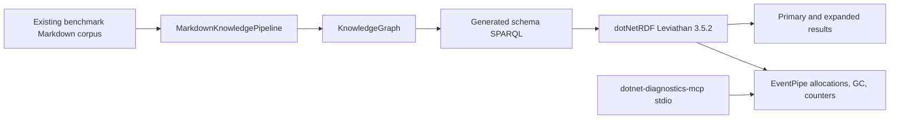

# Schema search profiling — 2026-10-12

## Outcome

The measured allocation problem has two actionable levels: the generated schema query creates expensive intermediate joins, and dotNetRDF 3.5.2 does not consistently propagate the configured disabled PLINQ setting to intermediate multisets. The diagnostic candidate experiment reduced allocations per search by approximately 84.7% on the measured corpus. Subsequent owner-side query/provenance fixes and candidate VALUES passed the full 127-case benchmark suite. Patch 0.2.13 was released successfully and its public NuGet package was verified; the 0.2.14 follow-up addresses the rich-catalog cost discovered during gateway integration.

The confirmed option-propagation issue was reported as [dotnetrdf/dotnetrdf#910](https://github.com/dotnetrdf/dotnetrdf/issues/910). The official engine and package family remain in use; this task does not fork or patch engine code. It does not establish how much a PLINQ fix would improve this workload. Do not attribute all allocation cost to an engine bug or replace the query language: SPARQL is the standard, dotNetRDF is the implementation, and our library owns query generation.

## Workload and evidence

The diagnostic workload [scripts/profile-schema-search.cs](../../scripts/profile-schema-search.cs) uses the existing benchmark corpus generator, the real MarkdownKnowledgePipeline with extraction None, and real SearchBySchemaAsync. It awaits calls, keeps one PID for captures, and accepts bounded phases. The process fails on unexpected primary counts. The ShortDocuments corpus has 250 Markdown documents; matching query is `cache restore manifest evidence` with AnyTerm and MaxResults 10. The no-match query is `satellite coffee roasting`.

The candidate pool is the 10 primary IDs obtained from a warm unrestricted search. Their primary order was verified equal before measurement. This measures a known-good candidate pool; it does not prove the recall of any separate preselector, all result metadata equivalence, federated performance, or release compatibility.

Runtime was .NET 10.0.12, SDK 10.0.401. The owning source included the unpublished CandidateNodeIds draft and pre-existing unrelated serialization/tokenization changes. No external service, model, or embeddings participated.

Two uninstrumented 10-second runs used GC.GetTotalAllocatedBytes(precise: true) and Stopwatch around repeated warmed operations. These are diagnostic harness figures, not full BenchmarkDotNet qualification. MB below means decimal 1,000,000 bytes.

| Phase | Allocation, run 1 MB/op | Allocation, run 2 MB/op | Time, run 1 ms/op | Time, run 2 ms/op |
|---|---:|---:|---:|---:|
| Unrestricted match | 72.843 | 72.895 | 46.987 | 53.424 |
| Same 10 candidates | 11.134 | 11.136 | 6.167 | 5.867 |
| Unrestricted no-match | 65.179 | 65.184 | 46.430 | 44.792 |
| Candidate no-match | 8.755 | 8.757 | 4.798 | 4.542 |

Counter receipts are in `artifacts/profiling/schema-metrics-20261012.json` (transcribed from actual workload JSON output). PIDs were 80771 and 81813. Raw diagnostic requests/results and tool schemas are in `artifacts/profiling/responses-20261012b/`.

## Allocation capture

Installed dotnet-diagnostics-mcp 0.28.0, source revision `551dd045a87de0e49ffe3165103a6df6450d2adf`, was accessed through the official MCP C# SDK over stdio. Its global skill is `~/.codex/skills/dotnet-diagnostics-mcp/SKILL.md`; the SDK helper supports tools/list and sequential calls with same-session retained handles.

A simultaneous 10-second CPU/allocation/GC/counter request on PID 80771 returned three successful collectors and one CPU failure. CPU explicitly returned UnsupportedPlatform on macOS with no fallback. Preflight's ClrMD live-attach failure did not prevent EventPipe allocation/GC/counters. There is no CPU profile to report.

Unrestricted allocation capture observed 145,898 allocation ticks totaling an estimated 15,605,821,024 attributed bytes. These ticks are sampled estimates, not individual object counts or bytes/op. Top types were Int32 arrays (3.106 GB), dictionary entry arrays for string-to-INode (2.857 GB), and Int32 entry arrays (2.031 GB). Top sites included HashSet<Int32>.UnionWith (3.646 GB), Dictionary.Resize (1.633 GB), BaseMultiset.EvalLeftJoin (1.094 GB), Set construction (0.852 GB), and Multiset.Add (0.649 GB). Saved call trees confirm Leviathan joins and set materialization underneath KnowledgeGraph.ProcessQuery. Allocation by-module sample attribution was 98.53% inclusive under dotNetRdf; this is allocation attribution, not CPU time.

The candidate capture processed more searches in its window and observed 16.853 GB attributed bytes. Comparing those two window totals alone would be misleading: per-operation counters establish the reduction. Its remaining allocation sites include SelectMany iteration, triple-pattern evaluation, HashSet initialization, Multiset.Add, graph-pattern variable enumeration, and SPARQL tokenization.

GC on the unrestricted capture reported 2,000 observed completed collections, with 200 retained detail rows and later rows dropped; aggregates cover valid observed pairs. Suspension evidence was unreliable, so no pause percentage is inferred. The candidate capture also hit the retained-row cap. Consult the raw response quality and errors before interpreting GC figures. Faster throughput can produce more collections per wall-clock window even with lower bytes/op.

## Source attribution and engine reproduction

At the diagnostic baseline, our compiler in `Graph/Runtime/KnowledgeGraph.SchemaSearchSparql.cs` added type, optional labels, description, and source decoration ahead of matching evidence in each direct/relationship UNION branch. Label resolution itself adds three OPTIONAL patterns. SearchBySchemaAsync then expands results, and focused graph materialization scans all triples. The large no-match allocation establishes that expensive work happens even when no primary result survives. The allocation stacks implicate intermediate query operations; their precise contribution needs a controlled query-shape experiment.

The exact engine source is pinned by the installed NuGet package to [`67142d12e67fb68b37d009c3579ddebaeb4ff2c1`](https://github.com/dotnetrdf/dotnetrdf/tree/67142d12e67fb68b37d009c3579ddebaeb4ff2c1). [`BaseMultiset`](https://github.com/dotnetrdf/dotnetrdf/blob/67142d12e67fb68b37d009c3579ddebaeb4ff2c1/Libraries/dotNetRdf.Core/Query/Algebra/BaseMultiset.cs) builds potential-match intersections with LINQ, allocates joined sets and indexes, and chooses ordinary Join/Product parallelism using its own UsePLinqEvaluation property. Its default is true. [`Multiset`](https://github.com/dotnetrdf/dotnetrdf/blob/67142d12e67fb68b37d009c3579ddebaeb4ff2c1/Libraries/dotNetRdf.Core/Query/Algebra/Multiset.cs) constructors do not pass a disabled value through to that base property. LeftJoin additionally consults context options, so disabling the processor option does not consistently affect all set operations.

The independent [scripts/profile-engine-options.cs](../../scripts/profile-engine-options.cs) executes a real two-row SPARQL join with UsePLinqEvaluation=false and algebra optimization disabled to expose the join. It overrides the engine's existing ProcessJoin hook only to observe flags. It returned two correct results, one observed join, context options false, and result multiset flag true. Receipt: `artifacts/profiling/engine-options-repro-20261012.json`. The disabled optimization setting is specific to exposing this reproduction and does not change production configuration.

## Next changes, in order

1. Finish CandidateNodeIds regression/coverage/release qualification in this owning repository, publish the patch, then consume it in MCPGateway and remove per-query candidate graph reconstruction. Owner-side runtime implementation is now complete; publication and consumer qualification are tracked in the active plan.
2. Benchmark evidence-first matching followed by metadata decoration of the small primary set. Preserve OPTIONAL unbound-variable behavior, multiple labels/types, relationship paths, source contexts, evidence ranking, expansion, local federation, and no-match results through real SPARQL tests. Moving patterns blindly can change OPTIONAL semantics.
3. Track upstream issue #910. Keep engine changes upstream; measure and optimize our query generation, candidate selection, provenance joins and graph projection.
4. Measure parsed-query/profile reuse and selective focused-snapshot creation after fixing the larger intermediate-query costs. Keep cache invalidation, graph mutation, thread safety, and ownership explicit. These are untested ideas, not delivered improvements.

## Initial diagnostic verification boundary

The skill validated, its SDK helper listed the installed schemas and executed real captures/drilldowns, the workload compiled warning-free after aligning file-app metadata, repeated match/no-match phases succeeded, and the independent engine reproduction succeeded. No production optimization was added in this diagnostic task. The candidate draft previously passed 10 focused real graph regression cases; full final coverage and release remain pending. Full BenchmarkDotNet runs and broader release checks were explicitly deferred. Owner outdated-package audit found no outdated direct dependencies; owner and gateway transitive vulnerability audits found no vulnerable packages. No NuGet versions changed in this profiling task.

## Owner-side implementation measurements

The production query compiler now groups mandatory evidence/type/facet/candidate patterns before metadata and keeps source labels inside the provenance OPTIONAL. Real local/federated regressions prove missing provenance cannot fabricate sources and multiple types/sources are preserved. Ontology type declarations and RDF fragment identity repairs additionally restore correct SHACL targeting and keep separate concept/entity/article IRIs distinct. No engine implementation is changed.

The new async SchemaGraphSearchBenchmarks uses MemoryDiagnoser, two corpus profiles, matching/no-match inputs and unrestricted/candidate methods. Initial Required-job receipts were preserved in artifacts/schema-bdn-before.json; incremental measurements are in schema-bdn-after.json and schema-bdn-grouped.json. On ShortDocuments the initial grouped compiler measurement reduced unrestricted matching allocations from 69.53 to 17.90 MB and unrestricted no-match from 62.61 to 7.26 MB. Matching with ten known-good candidates used 7.68 MB. These MB units follow BenchmarkDotNet (MiB); the earlier diagnostic table uses decimal MB. Background Roslynk CPU load and broad timing confidence intervals prevent a reliable latency speedup claim. The final full suite completed 127 cases in 430.01 seconds: ShortDocuments unrestricted matching 17.86 MiB/op, candidate matching 7.68 MiB/op, unrestricted no-match 7.24 MiB/op and candidate no-match 4.93 MiB/op. Matching allocation fell 74.3% and no-match 88.4% against the initial query-shape run. All current tables are in [Performance Benchmarks](../Features/PerformanceBenchmarks.md).

## Final local qualification

The owner patch passed strict Release build with zero warnings/errors, format verification and 396/396 TUnit tests with no skipped cases. Module coverage is 97.17%; touched production files are at least 97.03%, with query generation, candidate validation, ontology access/profile and legacy result mapping at 100%. Code-size review records the existing semantic-builder/compiler exceptions in ADR-0008/ADR-0007. Final direct outdated and transitive vulnerability audits found none. AngleSharp 1.8.4 remains the existing central transitive safety pin. Published-feed verification and MCPGateway integration follow through the canonical release workflow.

## Follow-up live profile after the repair

The same real 250-document workload on PID 99653 (.NET 10.0.12, owner commit aa05335 plus preserved unrelated checkout edits) was warmed and measured again. Uninstrumented 10-second phases allocated 18.419 MB/op unrestricted matching, 8.021 MB/op with ten candidates, 7.625 MB/op unrestricted no-match, and 5.148 MB/op candidate no-match. These use decimal MB and corroborate the full BenchmarkDotNet allocation reductions; they do not replace that suite or isolate latency from background load. Exact counters are saved in artifacts/profiling/schema-metrics-after-20261012.json.

The pure unrestricted allocation/GC/counter batch and drilldowns are in artifacts/profiling/responses-after-20261012/003-response.json through 008-response.json. Batch 002 overlaps successive phases and is retained only as mixed-workload evidence. The pure allocation sample has 80,312 ticks and an estimated 8.578 GB attributed bytes. dotNetRdf remains on 94.42% of allocation stacks, while System.Linq.Parallel appears on 11.62% (previous unrestricted capture: 51.72%). These percentages are inclusive allocation stack frequencies, not CPU time or bytes/op.

The current remaining hotspots include dictionary growth, RDF set construction/joins, triple-pattern evaluation, StringTrie key materialization, query tokenization, and DISTINCT set formatting. BaseSet.ToString appears on 19.10% of allocation stacks; its saved subtree shows literal formatting, StringBuilder and strings. Reducing duplicate rows before DISTINCT or validating a query-shape change is a next experiment, not a delivered optimization. Query/profile parsing reuse is also untested. Keep RDF term semantics, evidence/provenance and graph mutation/concurrency contracts intact before adopting either.

All three EventPipe collectors succeeded. GC retained 200 detail rows and dropped later detail rows, so consult the aggregate/quality fields. CPU sampling is still unsupported on this macOS tool version; no CPU findings are claimed. A caller-callee request (007) failed because its required argument is absent from the installed advertised schema; the supported re-rooted call-tree view (008) supplied the source attribution.

Canonical release 38182360790 finished successfully, including all seven full benchmark jobs and NuGet push acceptance for 0.2.13. Exact flat-container nupkg became available and MCPGateway restore verified nuspec version 0.2.13/repository commit aa05335983926a7d0ddde67b1d0608bb159e8e22.

## Rich gateway graph follow-up

A real 120-tool gateway export contains 56,168 triples. Removing the consumer candidate-copy path exposes the original full graph to subject VALUES, but the 0.2.13 generated query still uses a fully-variable evidence triple. Observational Leviathan ProcessBgp hooks see 56,168 output rows even when candidate bindings are small. The observation adapter uses the official engine and does not replace query execution. Diagnostic scripts: [profile-gateway-query.cs](../../scripts/profile-gateway-query.cs) compares complete raw row sets; [profile-query-cardinality.cs](../../scripts/profile-query-cardinality.cs) records BGP input/output sizes.

Controlled raw-query experiments on that export preserve all 32 distinct rows. Decimal allocations: original 237.12 MB/op; whole fixed-predicate evidence branches 69.22 MB/op; fixed-predicate branches plus one priority-preserving label OPTIONAL 15.41 MB/op. Flattening mandatory evidence or provenance OPTIONAL scope increased allocations and was rejected. These are diagnostic counter measurements, not release BenchmarkDotNet results. Receipts: artifacts/profiling/gateway-query-experiments*.jsonl and gateway-query-cardinality*.json.

The owning compiler uses compact predicate VALUES for small local graphs and indexed singleton branches for larger/unknown remote graphs, binding fixed predicate IRIs after mandatory filtering. Expansion uses constant-predicate branches. Subject metadata decorates the entire bound evidence union once; related metadata stays inside the relationship-only group; expansion metadata decorates its mandatory union once. Label metadata uses one OPTIONAL with schema:name, then rdfs:label, then skos:prefLabel; FILTER NOT EXISTS guards lower priorities, preserving every value at the highest present priority. Provenance labels remain inside the source OPTIONAL. Evidence and label writers live in feature-local partial files. Eight real local/federated priority flows cover multiple labels, direct and relationship evidence, labelled/unlabelled sources, and expansion; the prior six apparent test failures were an incorrect new expectation that mapped source contexts retain every label, corrected to assert all raw rows and the existing single-label mapping contract.

The new generated 120-document Tiktoken SchemaCatalogGraphSearchBenchmarks contains four matching/no-match unrestricted/candidate cases; no hand-authored graph fixture or remote service is used. Initial full Required-job benchmark results: unrestricted matching 483.26 MiB/op and no-match 476.81 MiB/op; one candidate matching 73.83 MiB/op and no-match 41.67 MiB/op. Its graph differs from the actual gateway export, so compare each corpus only against its own after measurement. Full 131-case suite, coverage and publication qualification are tracked in schema-expansion-roles.plan.md.

Related and next-step roles now remain separate when the same neighbor has both edges, with role-specific best scores/bindings and all RDF types retained. Four real expansion regressions reproduce the old role loss and verify generated Markdown, multiple types, edge competition, reverse order and parallel searches. Focused schema qualification currently passes 40 cases. No final gateway improvement is claimed until the published follow-up is adopted and measured end to end.

## Final compiler decision and correctness

The first complete 131-case run (453.49s) exposed regressions on simple graphs when every predicate duplicated its metadata. That shape was rejected. Shared metadata preserves all 32 actual gateway rows and reduces raw-query allocation further to 8.68 decimal MB/op. Sharing literal/type filters too raised raw allocation to 198.76 MB/op and was rejected. Keep mandatory literal/type filtering in its evidence branch.

Measured graph sizes guide the named 8,192-triple compiler split: ShortDocuments 250/1,794 triples, LongDocuments 80/684 triples, generated Tiktoken catalog 120/14,160 triples, actual gateway export 120/56,168 triples. Small local graphs use compact predicate VALUES; larger local graphs and unknown remote graphs use indexed singleton predicate branches. Singleton groups use fixed predicates even in compact mode. The threshold is an internal allocation tradeoff calibrated to these corpora, not a universal latency guarantee.

An empty relationship-target list initially produced unbound raw rows in indexed federated mode. Two new real local/federated cases reproduce and close that gap by emitting empty VALUES, rather than an identity-only group. One generated rich-catalog case exercises the large local path and verifies candidate/unrestricted primary evidence, no-match and empty pools. Final local correctness: 411/411 TUnit cases, module line coverage 97.223%; schema entrypoint 97.03%, all changed evidence/predicate/label/expansion compiler files 100%. Strict Release build has zero warnings/errors; full formatting, cloc and package audits pass. Explicit official split references retain graph/ontology/full-text/federation/SPIN and remove HTML/DataTables from assets. Final full 131-case benchmark receipts and release/feed verification are recorded when complete.

Final complete qualification benchmark: all 131 cases have valid statistics, 405.91 seconds. Rich-catalog candidate matching 73.83 -> 9.41 MB, unrestricted matching 483.26 -> 16.88 MB; candidate no-match 41.67 -> 4 MB. Small ShortDocuments candidate matching 7.68 -> 5.32 MB and candidate no-match 4.93 -> 3.26 MB. All final tables are current in PerformanceBenchmarks.md/README; receipts under artifacts/benchmarks/schema-release-final/results. Runtime queries keep the official engine, bound provenance and both expansion roles. No parsed-query cache or graph-projection rewrite was added without measurement.

## Indexed focused projection

The real gateway consumer on published 0.2.14 still allocated 23.815 decimal MB/weather search after the compiler repair. Pure PID 19445 captures retained 20,638 allocation ticks; BuildSchemaSearchFocusedGraph was present on 59.25% of inclusive allocation stacks, full asserted triple enumeration through SelectMany on 56.49%, and unrelated literal rendering on 2.74%. Counter phases and responses 014–019 live in MCPGateway artifacts/profiling. Re-rooting at the inlined CreateFocusedGraphSnapshot helper found no frame; the real BuildSchemaSearchFocusedGraph frame supplied attribution. These are allocation-sample frequencies, not CPU or exact byte fractions.

The 0.2.15 follow-up selects URI subject triples through official dotNetRDF indexes before rendering; object-index lookup preserves an existing selected object-only node. Focus containing blank/literal rendered identities retains the general RDF projection. Sorted induced edges, every selected label, and graph read/write locking stay unchanged; no snapshot cache is added. Projection now lives in a feature-local partial file (178 code lines) and expansion drops to 78 code lines.

Eight new real flow cases cover generated Markdown, edge-set equivalence against complete snapshots, object-only targets, mixed RDF nodes, ordinary/prefixed/URI-shaped literal metadata, existing URI object identity, and concurrent search after MergeAsync. The current contract projects rendered selected node identities; these tests preserve that behavior rather than introducing a parallel RDF serializer or typed result contract. Initial fixture setup omitted mandatory rdf:type and used the wrong kb namespace; corrected fixtures passed before production changes. Final local full TUnit/coverage: 419/419, module 97.2295%, focused projection and expansion files 100%. Strict build and format are clean, all stable direct references are current, transitive vulnerabilities none. TUnit updated 1.73.19 -> 1.74.0. Full 131-case measurements/publication and gateway follow-up complete the delivery gate.

Final projection qualification: all 131 benchmark cases completed with valid statistics in 434.31 seconds. Rich matching candidate allocation 9.41 -> 5.95 MiB/op and unrestricted 16.88 -> 12.90; ShortDocuments candidate 5.32 -> 4.78 MiB/op. Rich no-match candidate stays 4 MiB/op, as expected without focused projection. Complete current tables are in README/PerformanceBenchmarks; receipts are artifacts/projection-full-benchmarks.log and artifacts/benchmarks/projection-final/results. Final consumer/public-feed results remain separate from this local owning-checkout measurement.
